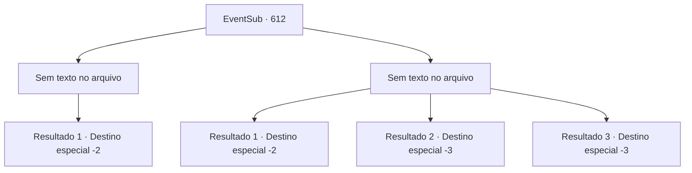

# Eventos secundários · 612

[Índice da tabela](index.md) · [Índice geral](../index.md)

ID: `pt:EventSub:612` · Fonte: `EventSub4` · Versão: 1.2.47.

Mapeamento estático dos arquivos; a disponibilidade e a execução dependem do estado da run.

## Texto do evento

*Sem texto no arquivo.*

## Dados de entrada

```json
{
  "id": 612,
  "grade": 1,
  "subEvent": "",
  "required": ""
}
```

## Mapa das escolhas



## Escolhas e resultados

### Escolha 1

*Sem texto no arquivo; o papel dessa opção depende da interface do jogo.*

Requisitos e outros campos da escolha:

```json
{
  "required": ""
}
```

#### Resultado 1.1

Você quebra a formação dos aventureiros, derrotando cada um deles. Vantagem em números? Táticas superiores? Tudo isso foi insignificante diante do poder devastador. Testemunhando isso, Osborne cai de bunda, fugindo de quatro. 

 "Não precisa ir atrás dele, {1}. Ele não é o que viemos buscar."

 Então, Edenheart começa a recolher todos os roteiros e instrumentos do laboratório, colocando-os em sua mochila. Somente quando sua mochila enorme estiver completamente cheia é que ela fica satisfeita. 

 "Acho que isso deve ser o suficiente. Não consigo agradecer o bastante. Aqui, isso é pelo seu trabalho árduo e assistência. Por favor."

 Edenheart diz que agora vai voltar para Mavelaine, continuando sua pesquisa lá. Você promete que vai passar por Mavelaine para vê-la novamente e, em seguida, seguem caminhos separados.

Continuação registrada: [Destino especial `-2`](../destinos-especiais.md).

```json
{
  "required": "",
  "chance": "1",
  "nextEvent": -2,
  "type": 2,
  "reward": "3_100_1|12_10_4"
}
```

### Escolha 2

*Sem texto no arquivo; o papel dessa opção depende da interface do jogo.*

Requisitos e outros campos da escolha:

```json
{
  "required": ""
}
```

#### Resultado 2.1

Você está sobrecarregado pelos aventureiros. Enquanto isso, Edenheart está deitado no chão, sangrando. Infelizmente, você não tem escolha a não ser fugir, segurando sua própria vida.

Continuação registrada: [Destino especial `-2`](../destinos-especiais.md).

```json
{
  "required": "1_0_2|1_1_2",
  "chance": "1",
  "nextEvent": -2,
  "type": 2,
  "reward": "0_0_-1|0_1_-1|12_10_7"
}
```

#### Resultado 2.2

Cercado por aventureiros, você não é páreo para eles. Edenheart sozinha luta, mas não dura muito. 

 "Bom. Agora, peguem tudo."

 Após as ordens de Osborne, vem o som dos aventureiros vasculhando o laboratório. Você sente tudo ficar escuro enquanto perde a consciência.

Continuação registrada: [Destino especial `-3`](../destinos-especiais.md).

```json
{
  "required": "2_0_2",
  "chance": "1",
  "nextEvent": -3,
  "type": 2,
  "reward": "0_0_-1|0_1_-1"
}
```

#### Resultado 2.3

Cercado por aventureiros, você não é páreo para eles. Edenheart sozinha luta, mas não dura muito. 

 "Bom. Agora, peguem tudo."

 Após as ordens de Osborne, vem o som dos aventureiros vasculhando o laboratório. Você sente tudo ficar preto enquanto perde a consciência.

Continuação registrada: [Destino especial `-3`](../destinos-especiais.md).

```json
{
  "required": "2_1_2",
  "chance": "1",
  "nextEvent": -3,
  "type": 2,
  "reward": "0_0_-1|0_1_-1"
}
```

## Referências que chegam a este evento

- [Evento 610 · escolha 1 · resultado 2](0610.md#escolha-1)
- [Evento 610 · escolha 2 · resultado 1](0610.md#escolha-2)
- [Evento 610 · escolha 2 · resultado 2](0610.md#escolha-2)
- [Evento 611 · escolha 1 · resultado 1](0611.md#escolha-1)
