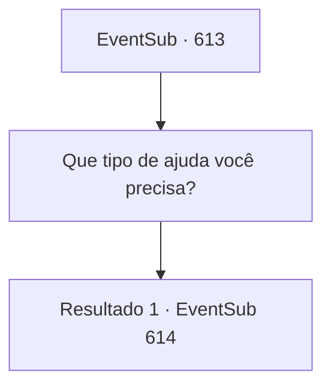

# Eventos secundários · 613

[Índice da tabela](index.md) · [Índice geral](../index.md)

ID: `pt:EventSub:613` · Fonte: `EventSub4` · Versão: 1.2.47.

Mapeamento estático dos arquivos; a disponibilidade e a execução dependem do estado da run.

## Texto do evento

Você retorna a Mavelaine mais uma vez. Você decide visitar uma taverna, para descansar e se recuperar. Ainda não está tarde, então a taverna não tem muitos clientes. Mas então, você vê Edenheart. Ela parece um pouco bêbada, enquanto percebe sua presença e olha para você. 

 "Ah... haha... se não é {1}! Eu estive... esperando por você. A cerveja de abóbora aqui é incrível. Gostaria de um... copo?"

 Você pergunta a Edenheart sobre a pesquisa sobre o Elixir. Ela esvazia seu copo e responde. 

 "Oh, estou quase lá. Um último procedimento precisa ser concluído. É aí que você entra. Preciso da sua ajuda, pela última vez."


## Dados de entrada

```json
{
  "id": 613,
  "grade": 1,
  "subEvent": "",
  "required": "12_10_4"
}
```

## Mapa das escolhas



## Escolhas e resultados

### Escolha 1

Que tipo de ajuda você precisa?

Requisitos e outros campos da escolha:

```json
{
  "required": ""
}
```

#### Resultado 1.1


 "Eu... vou elaborar mais tarde. Mas por agora, preciso que você ouça. Acho que é isso que eu preciso agora. Tirar as coisas da minha cabeça."

 Ela enche um copo vazio com cerveja e entrega para você. Ela então conta uma história sobre como Fheren e sua família são a única razão pela qual ela está viva hoje, falando sobre todas as suas memórias com Fheren. 

 "...e um dia, eu dei a Fheren uma poção que eu mesma fiz, dizendo a ele que beber aquilo lhe concederia força. Fheren me disse que eu deveria me tornar uma alquimista, contando como ele ficou tão forte depois de beber minha poção. Eu realmente pensei que ele estava falando sobre minha aptidão em alquimia! Daí, a alquimista que você vê na sua frente. Hahaha... em retrospecto, porém, era apenas uma suspensão aleatória de gramíneas selvagens."

 Você bebe do seu copo, ouvindo a história dela.

Continuação registrada: [Evento 614](0614.md) na mesma tabela.

```json
{
  "required": "",
  "chance": "1",
  "nextEvent": 614,
  "type": 2,
  "reward": ""
}
```

## Referências que chegam a este evento

Nenhum `nextEvent` positivo da mesma tabela aponta para este nó. Isso não prova que seja inacessível: sorteio e estado de história podem selecioná-lo.

