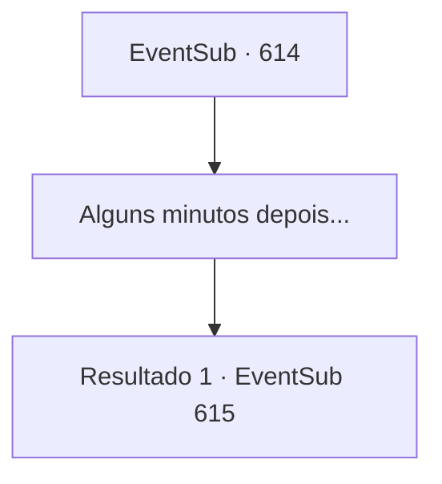

# Eventos secundários · 614

[Índice da tabela](index.md) · [Índice geral](../index.md)

ID: `pt:EventSub:614` · Fonte: `EventSub4` · Versão: 1.2.47.

Mapeamento estático dos arquivos; a disponibilidade e a execução dependem do estado da run.

## Texto do evento

*Sem texto no arquivo.*

## Dados de entrada

```json
{
  "id": 614,
  "grade": 1,
  "subEvent": "",
  "required": ""
}
```

## Mapa das escolhas



## Escolhas e resultados

### Escolha 1

Alguns minutos depois...

Requisitos e outros campos da escolha:

```json
{
  "required": ""
}
```

#### Resultado 1.1

Logo depois, você segue Edenheart até seu laboratório. O lugar está cheio de vários scripts e instrumentos alquímicos, todos usados na fabricação do Elixir. Edenheart apresenta o laboratório para você e também fala sobre o processo de fabricação do Elixir. 

 "A etapa final para fazer o Elixir... é a alma humana. Isso não é algo que eu possa fazer sozinha. É por isso que eu estava esperando por você, {1}."

 Após explicar detalhadamente a etapa final - como extrair, armazenar e derreter uma alma humana -, Edenheart pega uma adaga sinistra e suspeita e entrega a você. 

 "Esta é uma adaga que encontrei nas ruínas. Uma ferramenta usada para coletar almas humanas."

 Edenheart, fixando seu olhar no seu, fala com firmeza. 

 "Este é meu último pedido, {1}. Termine minha vida com esta adaga, complete o Elixir e salve a vida de Fheren."


Continuação registrada: [Evento 615](0615.md) na mesma tabela.

```json
{
  "required": "",
  "chance": "1",
  "nextEvent": 615,
  "type": 2,
  "reward": ""
}
```

## Referências que chegam a este evento

- [Evento 613 · escolha 1 · resultado 1](0613.md#escolha-1)
