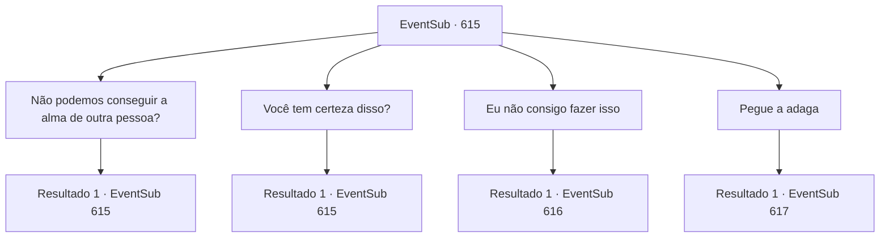

# Eventos secundários · 615

[Índice da tabela](index.md) · [Índice geral](../index.md)

ID: `pt:EventSub:615` · Fonte: `EventSub4` · Versão: 1.2.47.

Mapeamento estático dos arquivos; a disponibilidade e a execução dependem do estado da run.

## Texto do evento

*Sem texto no arquivo.*

## Dados de entrada

```json
{
  "id": 615,
  "grade": 1,
  "subEvent": "",
  "required": ""
}
```

## Mapa das escolhas



## Escolhas e resultados

### Escolha 1

Não podemos conseguir a alma de outra pessoa?

Requisitos e outros campos da escolha:

```json
{
  "required": "5_600_0"
}
```

#### Resultado 1.1

Você pergunta a Edenheart por que sua alma deve ser usada. Ela balança a cabeça e explica. 

 "Não. O Elixir só pode ser completado com um coração amoroso. Qualquer alma aleatória não serviria."

 Ela fica em silêncio por um momento, mas logo continua. 

 "É por isso... que eu devo fazer isso. Eu... amo Fheren. Com certeza."


Continuação registrada: [Evento 615](0615.md) na mesma tabela.

```json
{
  "required": "",
  "chance": "1",
  "nextEvent": 615,
  "type": 2,
  "reward": "5_600_1"
}
```

### Escolha 2

Você tem certeza disso?

Requisitos e outros campos da escolha:

```json
{
  "required": "5_600_1"
}
```

#### Resultado 2.1

Você pergunta a Edenheart se ela está falando sério. 

 "Agora é minha chance de retribuir sua bondade. Eu estaria mentindo se dissesse que não estou com medo. Estou... profundamente com medo, na verdade. De não poder mais vê-lo. Mas... isso não deve ser nada comparado à dor que eu teria que suportar ao vê-lo morrer enquanto eu vivo."

 Após garantir sua determinação, ela coloca a adaga em suas mãos e pergunta mais uma vez. 

 "Eu te imploro, {1}. Você é o único em quem posso confiar para isso. Por toda a ajuda que você me deu até agora... E mais uma coisa? Por favor, não deixe que Fheren saiba disso. Nem um pouco."


Continuação registrada: [Evento 615](0615.md) na mesma tabela.

```json
{
  "required": "",
  "chance": "1",
  "nextEvent": 615,
  "type": 2,
  "reward": "5_600_2"
}
```

### Escolha 3

Eu não consigo fazer isso

Requisitos e outros campos da escolha:

```json
{
  "required": "5_600_2"
}
```

#### Resultado 3.1

Você diz a Edenheart que não pode fazer isso. Mas ela agarra seus pulsos com firmeza, fazendo o mesmo pedido mais uma vez. 

 "Por favor, {1}... Você é o único em quem posso confiar!"


Continuação registrada: [Evento 616](0616.md) na mesma tabela.

```json
{
  "required": "",
  "chance": "1",
  "nextEvent": 616,
  "type": 2,
  "reward": ""
}
```

### Escolha 4

Pegue a adaga

Requisitos e outros campos da escolha:

```json
{
  "required": "5_600_2"
}
```

#### Resultado 4.1

Você relutantemente pega a adaga. Edenheart irrompe em lágrimas, sorrindo. Você se despede pela última vez, completando o último passo para o Elixir. Finalmente, o lendário Elixir está completo - ele emana um calor intenso. Você pega o Elixir engarrafado e coloca gentilmente o corpo de Edenheart em sua cama. Ela parece em paz, como se tivesse caído em um sono profundo. Então, você ouve alguém batendo na porta do laboratório. Lá está uma mulher de meia-idade, vestida de forma simples. 

 "Ah, é você, aventureiro. A Srta. Edenheart nos informou que a cura para nosso mestre deveria estar pronta agora."

 É a empregada que você viu na Mansão de Fheren.

Continuação registrada: [Evento 617](0617.md) na mesma tabela.

```json
{
  "required": "",
  "chance": "1",
  "nextEvent": 617,
  "type": 2,
  "reward": "0_2_1|3_296_1"
}
```

## Referências que chegam a este evento

- [Evento 614 · escolha 1 · resultado 1](0614.md#escolha-1)
- [Evento 615 · escolha 1 · resultado 1](0615.md#escolha-1)
- [Evento 615 · escolha 2 · resultado 1](0615.md#escolha-2)
