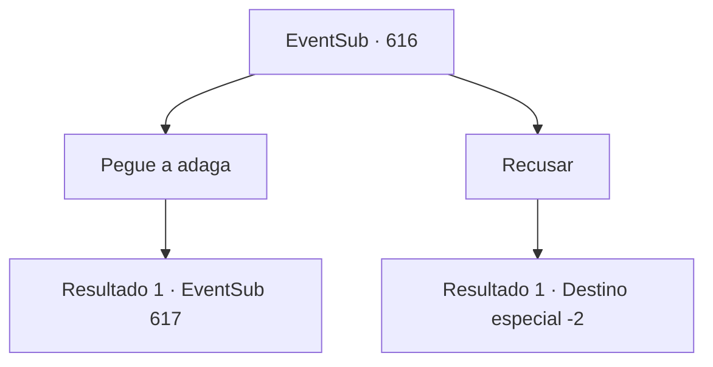

# Eventos secundários · 616

[Índice da tabela](index.md) · [Índice geral](../index.md)

ID: `pt:EventSub:616` · Fonte: `EventSub4` · Versão: 1.2.47.

Mapeamento estático dos arquivos; a disponibilidade e a execução dependem do estado da run.

## Texto do evento

*Sem texto no arquivo.*

## Dados de entrada

```json
{
  "id": 616,
  "grade": 1,
  "subEvent": "",
  "required": ""
}
```

## Mapa das escolhas



## Escolhas e resultados

### Escolha 1

Pegue a adaga

Requisitos e outros campos da escolha:

```json
{
  "required": ""
}
```

#### Resultado 1.1

Você relutantemente pega a adaga. Edenheart irrompe em lágrimas, sorrindo. Você se despede pela última vez, completando o último passo para o Elixir. Finalmente, o lendário Elixir está completo - ele emana um calor intenso. Você pega o Elixir engarrafado e coloca gentilmente o corpo de Edenheart em sua cama. Ela parece em paz, como se tivesse caído em um sono profundo. Então, você ouve alguém batendo na porta do laboratório. Lá está uma mulher de meia-idade, vestida de forma simples. 

 "Ah, é você, aventureiro. A senhorita Edenheart nos informou que a cura para nosso mestre deveria estar pronta agora."

 É a empregada que você viu na Mansão de Fheren.

Continuação registrada: [Evento 617](0617.md) na mesma tabela.

```json
{
  "required": "",
  "chance": "1",
  "nextEvent": 617,
  "type": 2,
  "reward": "0_2_1|3_296_1"
}
```

### Escolha 2

Recusar

Requisitos e outros campos da escolha:

```json
{
  "required": ""
}
```

#### Resultado 2.1

Você mais uma vez recusa o pedido de Edenheart. Sem palavras, Edenheart olha para você por um momento antes de deixar cair a adaga no chão. 

 "...Entendo. Tudo bem."

 Você fecha a porta do laboratório dela e sai.

Continuação registrada: [Destino especial `-2`](../destinos-especiais.md).

```json
{
  "required": "",
  "chance": "1",
  "nextEvent": -2,
  "type": 2,
  "reward": "12_10_-1|14_10_1"
}
```

## Referências que chegam a este evento

- [Evento 615 · escolha 3 · resultado 1](0615.md#escolha-3)
