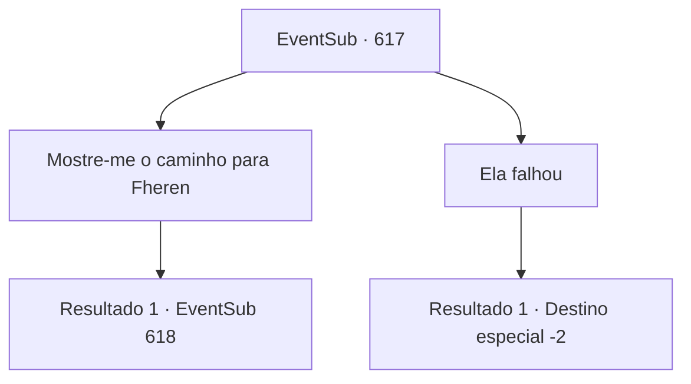

# Eventos secundários · 617

[Índice da tabela](index.md) · [Índice geral](../index.md)

ID: `pt:EventSub:617` · Fonte: `EventSub4` · Versão: 1.2.47.

Mapeamento estático dos arquivos; a disponibilidade e a execução dependem do estado da run.

## Texto do evento

*Sem texto no arquivo.*

## Dados de entrada

```json
{
  "id": 617,
  "grade": 1,
  "subEvent": "",
  "required": ""
}
```

## Mapa das escolhas



## Escolhas e resultados

### Escolha 1

Mostre-me o caminho para Fheren

Requisitos e outros campos da escolha:

```json
{
  "required": ""
}
```

#### Resultado 1.1

Você segue a empregada para o quarto de Fheren. Ele ainda está pálido, descansando imóvel na cama. Você cuidadosamente despeja o Elixir em seus lábios. 

 "...O que é isso? Sinto-me... quase estranhamente tranquilo. Isso é... simplesmente maravilhoso!"

 Quando o conteúdo da garrafa acaba, Fheren abre lentamente os olhos. Sua pele emana um calor saudável e as olheiras desapareceram também. Você diz a Fheren que ele recebeu um Elixir. Ele concorda, então faz uma pergunta. 

 "Entendo... Parece que tenho que agradecer a você, aventureiro. Mas... como diabos você conseguiu colocar as mãos em um Elixir? Eu pensei que fosse um mito!"


Continuação registrada: [Evento 618](0618.md) na mesma tabela.

```json
{
  "required": "",
  "chance": "1",
  "nextEvent": 618,
  "type": 2,
  "reward": ""
}
```

### Escolha 2

Ela falhou

Requisitos e outros campos da escolha:

```json
{
  "required": "2_3_-14"
}
```

#### Resultado 2.1

Você mente para a empregada, dizendo a ela que o Elixir ainda não está completo. Ela imediatamente fecha a porta e sai, sem mostrar nenhum sinal de dúvida. Você silenciosamente pega o Elixir para si mesmo e sai do laboratório de Edenheart.

Continuação registrada: [Destino especial `-2`](../destinos-especiais.md).

```json
{
  "required": "",
  "chance": "1",
  "nextEvent": -2,
  "type": 2,
  "reward": "0_3_-3|12_10_-1|3_297_1|14_10_10"
}
```

## Referências que chegam a este evento

- [Evento 615 · escolha 4 · resultado 1](0615.md#escolha-4)
- [Evento 616 · escolha 1 · resultado 1](0616.md#escolha-1)
