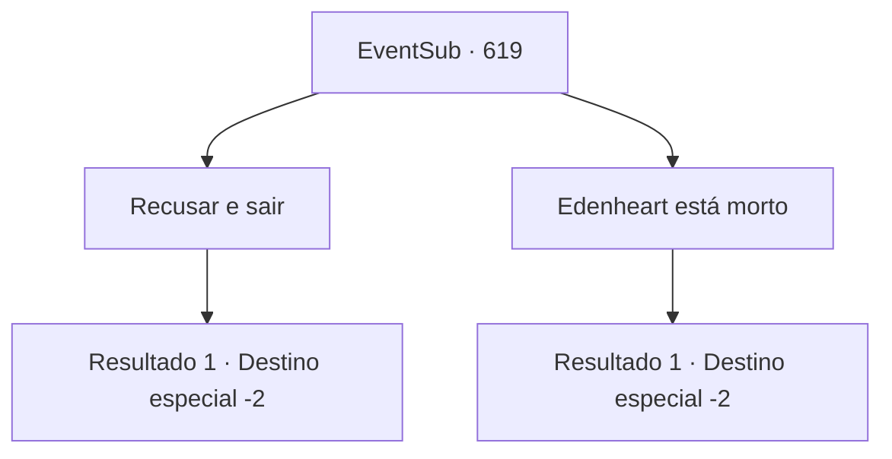

# Eventos secundários · 619

[Índice da tabela](index.md) · [Índice geral](../index.md)

ID: `pt:EventSub:619` · Fonte: `EventSub4` · Versão: 1.2.47.

Mapeamento estático dos arquivos; a disponibilidade e a execução dependem do estado da run.

## Texto do evento

*Sem texto no arquivo.*

## Dados de entrada

```json
{
  "id": 619,
  "grade": 1,
  "subEvent": "",
  "required": ""
}
```

## Mapa das escolhas



## Escolhas e resultados

### Escolha 1

Recusar e sair

Requisitos e outros campos da escolha:

```json
{
  "required": ""
}
```

#### Resultado 1.1

Você educadamente recusa a oferta de Fheren. Ele parece um pouco desapontado, então você decide sair da mansão antes que ele mude de ideia.

Continuação registrada: [Destino especial `-2`](../destinos-especiais.md).

```json
{
  "required": "",
  "chance": "1",
  "nextEvent": -2,
  "type": 2,
  "reward": "12_10_13"
}
```

### Escolha 2

Edenheart está morto

Requisitos e outros campos da escolha:

```json
{
  "required": ""
}
```

#### Resultado 2.1

Você notifica Fheren da morte de Edenheart. A expressão de Fheren escurece. 

 "O-o quê? Do que você está falando?"

 Você conta a ele tudo o que aconteceu. Fheren se levanta apressadamente, cambaleando em direção ao laboratório de Edenheart. Lá está a prova - o corpo sem vida de Edenheart. Fheren desaba de joelhos. 

 "...Por favor. Me deixe em paz."

 Você se afasta do laboratório de Edenheart, deixando Fheren em sua tristeza. Logo, você pode ouvi-lo chorando mesmo do lado de fora da mansão.

Continuação registrada: [Destino especial `-2`](../destinos-especiais.md).

```json
{
  "required": "",
  "chance": "1",
  "nextEvent": -2,
  "type": 2,
  "reward": "12_10_-1|14_10_0"
}
```

## Referências que chegam a este evento

- [Evento 618 · escolha 1 · resultado 1](0618.md#escolha-1)
