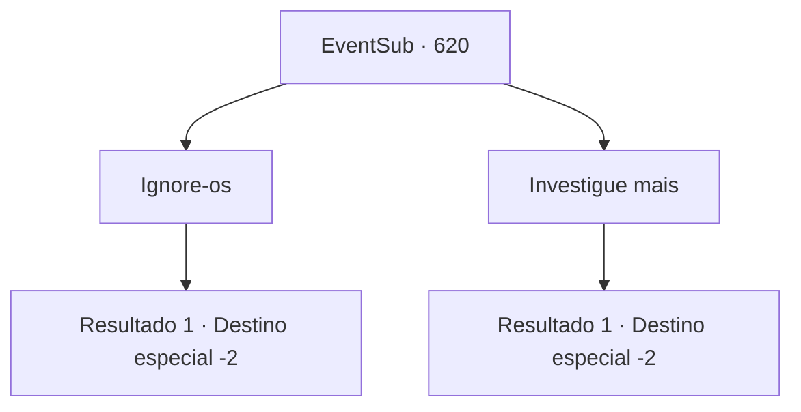

# Eventos secundários · 620

[Índice da tabela](index.md) · [Índice geral](../index.md)

ID: `pt:EventSub:620` · Fonte: `EventSub4` · Versão: 1.2.47.

Mapeamento estático dos arquivos; a disponibilidade e a execução dependem do estado da run.

## Texto do evento

Você vê um grupo de homens, aventureiros pelo que parecem, conversando alto em uma praça da cidade. Eles não parecem se importar com as outras pessoas, continuando a falar alto em um lugar público. 

 "Ei, você ouviu? Veneprada está procurando pelo antigo Elixir."

 "Você quer dizer a guilda que tem acumulado ingredientes e monopolizado o comércio em Grimdit? Ha, perseguindo um mito? Eles devem estar loucos!"


## Dados de entrada

```json
{
  "id": 620,
  "grade": 1,
  "subEvent": "",
  "required": "12_10_5"
}
```

## Mapa das escolhas



## Escolhas e resultados

### Escolha 1

Ignore-os

Requisitos e outros campos da escolha:

```json
{
  "required": ""
}
```

#### Resultado 1.1

Você deixa os aventureiros conversando, afastando-se. Eles se retiram para uma taverna próxima, continuando a conversa ociosa.

Continuação registrada: [Destino especial `-2`](../destinos-especiais.md).

```json
{
  "required": "",
  "chance": "1",
  "nextEvent": -2,
  "type": 2,
  "reward": "12_10_-1"
}
```

### Escolha 2

Investigue mais

Requisitos e outros campos da escolha:

```json
{
  "required": ""
}
```

#### Resultado 2.1

Você se aproxima deles, perguntando sobre o que eles estão falando. Um deles começa a falar. 

 "Ah, estávamos falando sobre a guilda de comerciantes Veneprada indo atrás do Elixir. Aparentemente, eles têm escavado antigas ruínas empoeiradas. Bem... Eu acho que eles estão apenas perdendo tempo, mas quem sabe. Talvez o lendário Elixir esteja em algum lugar por aí. Vá para Grimdit, se estiver interessado. A base de operações deve estar lá."

 Eles se despedem e voltam para uma taverna próxima.

Continuação registrada: [Destino especial `-2`](../destinos-especiais.md).

```json
{
  "required": "",
  "chance": "1",
  "nextEvent": -2,
  "type": 2,
  "reward": "12_10_12"
}
```

## Referências que chegam a este evento

Nenhum `nextEvent` positivo da mesma tabela aponta para este nó. Isso não prova que seja inacessível: sorteio e estado de história podem selecioná-lo.

