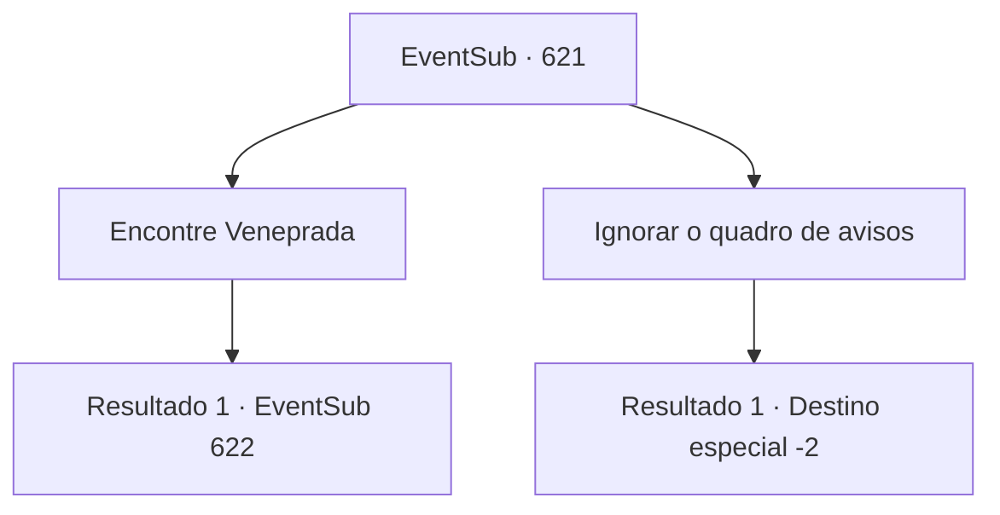

# Eventos secundários · 621

[Índice da tabela](index.md) · [Índice geral](../index.md)

ID: `pt:EventSub:621` · Fonte: `EventSub4` · Versão: 1.2.47.

Mapeamento estático dos arquivos; a disponibilidade e a execução dependem do estado da run.

## Texto do evento

Você chega em Grimdit, o local da Veneprada, a guilda de comerciantes. Um quadro de avisos no meio de Grimdit chama sua atenção. 'Osborne', um executivo da guilda de comerciantes, Veneprada, está contratando aventureiros para se juntarem a ele em uma expedição.

## Dados de entrada

```json
{
  "id": 621,
  "grade": 1,
  "subEvent": "",
  "required": "12_10_12"
}
```

## Mapa das escolhas



## Escolhas e resultados

### Escolha 1

Encontre Veneprada

Requisitos e outros campos da escolha:

```json
{
  "required": ""
}
```

#### Resultado 1.1

Você chega à guilda de comerciantes de Veneprada. Seu prédio está localizado no centro do distrito comercial. A ampla entrada já está cheia de aventureiros. Você espera por esse 'Osborne' com os outros. |drawing_Osborne| Logo, um homem baixo e gordo emerge do prédio. Orgulhoso de seu impressionante bigode, ele começa seu discurso. 

 "Ahem. Agradeço a vocês, aventureiros, por virem aqui hoje, como vice-presidente da guilda de comerciantes de Veneprada. Seu trabalho é proteger e escoltar a expedição de Veneprada até as 'Ruínas de Plasphere' - nosso objetivo é escavar todos os artefatos relacionados ao Elixir."

 Simplificando, os aventureiros devem proteger o pessoal de Veneprada enquanto eles trabalham em sua escavação. Osborne acrescenta que eles partirão imediatamente, então se alguém quiser desistir, agora é a chance.

Continuação registrada: [Evento 622](0622.md) na mesma tabela.

```json
{
  "required": "",
  "chance": "1",
  "nextEvent": 622,
  "type": 2,
  "reward": ""
}
```

### Escolha 2

Ignorar o quadro de avisos

Requisitos e outros campos da escolha:

```json
{
  "required": ""
}
```

#### Resultado 2.1

Você passa pelo quadro de avisos.

Continuação registrada: [Destino especial `-2`](../destinos-especiais.md).

```json
{
  "required": "",
  "chance": "1",
  "nextEvent": -2,
  "type": 2,
  "reward": "12_10_-1"
}
```

## Referências que chegam a este evento

Nenhum `nextEvent` positivo da mesma tabela aponta para este nó. Isso não prova que seja inacessível: sorteio e estado de história podem selecioná-lo.

