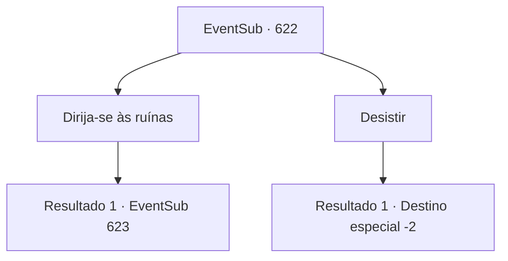

# Eventos secundários · 622

[Índice da tabela](index.md) · [Índice geral](../index.md)

ID: `pt:EventSub:622` · Fonte: `EventSub4` · Versão: 1.2.47.

Mapeamento estático dos arquivos; a disponibilidade e a execução dependem do estado da run.

## Texto do evento

*Sem texto no arquivo.*

## Dados de entrada

```json
{
  "id": 622,
  "grade": 1,
  "subEvent": "",
  "required": ""
}
```

## Mapa das escolhas



## Escolhas e resultados

### Escolha 1

Dirija-se às ruínas

Requisitos e outros campos da escolha:

```json
{
  "required": ""
}
```

#### Resultado 1.1

Você segue para as ruínas, seguindo a carruagem da guilda. A expedição é composta por vários tipos de pessoal - excluindo os aventureiros, há arqueólogos, membros da guilda, trabalhadores, etc. A jornada até Plasphere dura dez dias. 

 No meio da tempestade de areia, as ruínas capturam uma paisagem antiga. Edifícios antigos construídos com tijolos de pedra esculpidos estão espalhados aqui e ali, uma fonte seca e os destroços de esculturas e cercas quebradas espalhados pelo chão. Ao chegar às ruínas, Osborne imediatamente começa a dar ordens. 

 "Estudiosos - preparem a escavação! Trabalhadores - descarreguem nossos bens e montem as tendas! E os aventureiros - espalhem-se, fiquem de guarda e me informem se algo acontecer!"

 Você e os outros aventureiros se movem pelas ruínas, criando um perímetro. A maioria deles está cumprindo suas tarefas diligentemente, enquanto alguns decidem descansar em lugares onde Osborne não pode vê-los.

Continuação registrada: [Evento 623](0623.md) na mesma tabela.

```json
{
  "required": "",
  "chance": "1",
  "nextEvent": 623,
  "type": 2,
  "reward": ""
}
```

### Escolha 2

Desistir

Requisitos e outros campos da escolha:

```json
{
  "required": ""
}
```

#### Resultado 2.1

Você decide não participar da expedição.

Continuação registrada: [Destino especial `-2`](../destinos-especiais.md).

```json
{
  "required": "",
  "chance": "1",
  "nextEvent": -2,
  "type": 2,
  "reward": "12_10_-1"
}
```

## Referências que chegam a este evento

- [Evento 621 · escolha 1 · resultado 1](0621.md#escolha-1)
