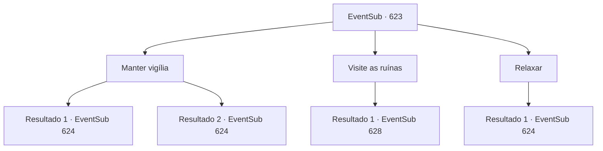

# Eventos secundários · 623

[Índice da tabela](index.md) · [Índice geral](../index.md)

ID: `pt:EventSub:623` · Fonte: `EventSub4` · Versão: 1.2.47.

Mapeamento estático dos arquivos; a disponibilidade e a execução dependem do estado da run.

## Texto do evento

*Sem texto no arquivo.*

## Dados de entrada

```json
{
  "id": 623,
  "grade": 1,
  "subEvent": "",
  "required": ""
}
```

## Mapa das escolhas



## Escolhas e resultados

### Escolha 1

Manter vigília

Requisitos e outros campos da escolha:

```json
{
  "required": ""
}
```

#### Resultado 1.1

Você faz o seu trabalho diligentemente, mantendo-se em vigília. 

 Cerca de uma hora depois, você ouve uma explosão vindo das ruínas. Você pega sua arma e investiga a origem do barulho. Um golem de pedra, recém-saído do subsolo pelo que parece, está causando estragos por toda parte. Outros aventureiros tentam lutar contra ele, mas não são páreo. Você ataca o golem de pedra antes que ele perceba sua presença.

Continuação registrada: [Evento 624](0624.md) na mesma tabela.

```json
{
  "required": "",
  "chance": "1|0_13_1",
  "nextEvent": 624,
  "type": 0,
  "reward": "6_2_15",
  "place": 5
}
```

#### Resultado 1.2

Tentas fazer o teu trabalho diligentemente, de pé a vigiar. Mas o sono vence-te. Finalmente, decides adormecer num espaço isolado, livre do olhar de outras pessoas. 

 Um som de explosão acorda-te. Não fazes ideia do que acabou de acontecer, mas consegues ver um golem de pedra a causar estragos nas ruínas. Outros aventureiros tentam lutar contra ele, mas não são páreo. 

 "Novo intruso detetado. Visitante não autorizado. Iniciar ataque."

 O golem de pedra vira-se para ti e ataca.

Continuação registrada: [Evento 624](0624.md) na mesma tabela.

```json
{
  "required": "",
  "chance": "13",
  "nextEvent": 624,
  "type": 1,
  "reward": "6_0_15",
  "place": 5
}
```

### Escolha 2

Visite as ruínas

Requisitos e outros campos da escolha:

```json
{
  "required": ""
}
```

#### Resultado 2.1

Você decide passear pelas ruínas, fingindo estar de guarda. Os arqueólogos e trabalhadores parecem ocupados com seu próprio trabalho. Alguns aventureiros te veem, mas eles também não parecem se importar muito. Você se afasta furtivamente do pessoal da guilda.

Continuação registrada: [Evento 628](0628.md) na mesma tabela.

```json
{
  "required": "",
  "chance": "1",
  "nextEvent": 628,
  "type": 2,
  "reward": ""
}
```

### Escolha 3

Relaxar

Requisitos e outros campos da escolha:

```json
{
  "required": ""
}
```

#### Resultado 3.1

Oh, há muitos outros aventureiros de guarda. Você não será perdido. Você olha ao redor e fecha os olhos em um espaço isolado. 

 Um som de explosão te acorda. Você não tem ideia do que acabou de acontecer, mas pode ver um golem de pedra causando estragos nas ruínas. Outros aventureiros tentam revidar, mas não são páreo. 

 "Novo intruso detectado. Visitante não autorizado. Iniciar ataque."

 O golem de pedra se vira para você e ataca.

Continuação registrada: [Evento 624](0624.md) na mesma tabela.

```json
{
  "required": "",
  "chance": "1",
  "nextEvent": 624,
  "type": 2,
  "reward": "6_0_15",
  "place": 5
}
```

## Referências que chegam a este evento

- [Evento 622 · escolha 1 · resultado 1](0622.md#escolha-1)
