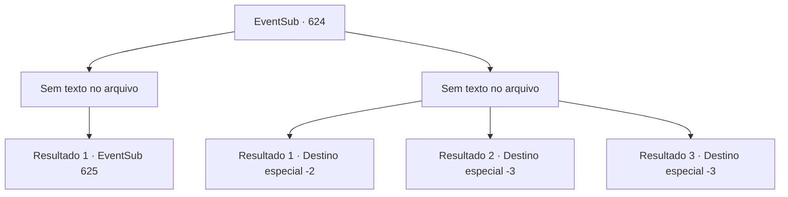

# Eventos secundários · 624

[Índice da tabela](index.md) · [Índice geral](../index.md)

ID: `pt:EventSub:624` · Fonte: `EventSub4` · Versão: 1.2.47.

Mapeamento estático dos arquivos; a disponibilidade e a execução dependem do estado da run.

## Texto do evento

*Sem texto no arquivo.*

## Dados de entrada

```json
{
  "id": 624,
  "grade": 1,
  "subEvent": "",
  "required": ""
}
```

## Mapa das escolhas



## Escolhas e resultados

### Escolha 1

*Sem texto no arquivo; o papel dessa opção depende da interface do jogo.*

Requisitos e outros campos da escolha:

```json
{
  "required": ""
}
```

#### Resultado 1.1

Sua cabeça se despedaçou, o golem de pedra vacila antes de desmoronar. Você guarda sua arma e olha ao redor. Alguns estão feridos, mas felizmente não há vítimas fatais. Então, Osborne se aproxima de você, depois de testemunhar sua luta contra o golem. Ele fala em um tom arrogante, arrumando seu bigode. 

 "Aquilo foi muito impressionante! Derrotar um golem de pedra, sozinho! Isso é realmente uma proeza, eu diria! O vice-presidente da Veneprada reconhece seu serviço, aventureiro! Me diga, há algo que você queira?"


Continuação registrada: [Evento 625](0625.md) na mesma tabela.

```json
{
  "required": "",
  "chance": "1",
  "nextEvent": 625,
  "type": 2,
  "reward": ""
}
```

### Escolha 2

*Sem texto no arquivo; o papel dessa opção depende da interface do jogo.*

Requisitos e outros campos da escolha:

```json
{
  "required": ""
}
```

#### Resultado 2.1

Você foi derrotado pelo golem de pedra e não tem escolha a não ser fugir das ruínas. 

 "Ataque! ATAQUE! Eu não contratei vocês idiotas à toa!"

 Você pode ouvir os gritos de raiva de Osborne do lado de fora das ruínas.

Continuação registrada: [Destino especial `-2`](../destinos-especiais.md).

```json
{
  "required": "1_0_2|1_1_2",
  "chance": "1",
  "nextEvent": -2,
  "type": 2,
  "reward": "0_0_-1|0_1_-1|12_10_8"
}
```

#### Resultado 2.2

O golem de pedra te golpeia com seus punhos de pedra pesados. Seu corpo é desmontado em pedaços de carne.

Continuação registrada: [Destino especial `-3`](../destinos-especiais.md).

```json
{
  "required": "2_0_2",
  "chance": "1",
  "nextEvent": -3,
  "type": 2,
  "reward": "0_0_-1|0_1_-1"
}
```

#### Resultado 2.3

O golem de pedra te golpeia com seus punhos de pedra pesados. Seu corpo é desmontado em pedaços de carne.

Continuação registrada: [Destino especial `-3`](../destinos-especiais.md).

```json
{
  "required": "2_1_2",
  "chance": "1",
  "nextEvent": -3,
  "type": 2,
  "reward": "0_0_-1|0_1_-1"
}
```

## Referências que chegam a este evento

- [Evento 623 · escolha 1 · resultado 1](0623.md#escolha-1)
- [Evento 623 · escolha 1 · resultado 2](0623.md#escolha-1)
- [Evento 623 · escolha 3 · resultado 1](0623.md#escolha-3)
- [Evento 628 · escolha 5 · resultado 1](0628.md#escolha-5)
- [Evento 629 · escolha 1 · resultado 1](0629.md#escolha-1)
- [Evento 629 · escolha 3 · resultado 2](0629.md#escolha-3)
