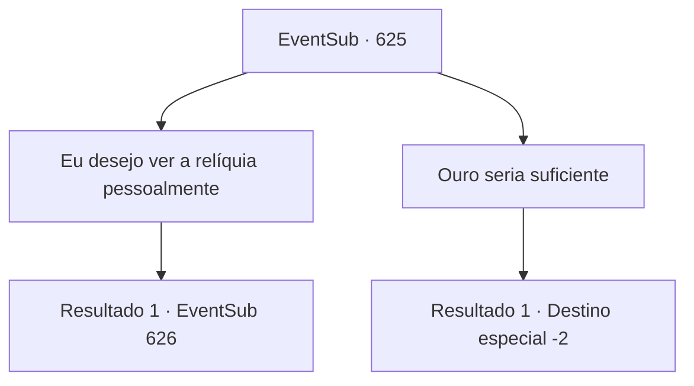

# Eventos secundários · 625

[Índice da tabela](index.md) · [Índice geral](../index.md)

ID: `pt:EventSub:625` · Fonte: `EventSub4` · Versão: 1.2.47.

Mapeamento estático dos arquivos; a disponibilidade e a execução dependem do estado da run.

## Texto do evento

*Sem texto no arquivo.*

## Dados de entrada

```json
{
  "id": 625,
  "grade": 1,
  "subEvent": "",
  "required": ""
}
```

## Mapa das escolhas



## Escolhas e resultados

### Escolha 1

Eu desejo ver a relíquia pessoalmente

Requisitos e outros campos da escolha:

```json
{
  "required": ""
}
```

#### Resultado 1.1

Você diz a Osborne que deseja ver o relicário escavado. 

 "O relicário? Hm... se tudo o que você quer é dar uma olhada... Claro."

 Osborne aceita, embora esteja um pouco curioso sobre o seu pedido. Mas a escavação ainda não terminou - sua chance de ver o relicário virá à noite. 

 Tarde da noite, você entra em uma tenda, onde o pessoal da guilda está guardando os relicários escavados. Eles planejam guardar os relicários na diligência depois de mantê-los dentro das tendas. Dentro da tenda, há uma infinidade de escritos e gravações antigas. Ao estender a mão para tocar em um deles, um guarda, contratado por Veneprada, repreende você e declara que eles são apenas para os olhos. Então, algo chama sua atenção. É uma adaga, com um formato torto, emitindo uma aura sinistra e suspeita.

Continuação registrada: [Evento 626](0626.md) na mesma tabela.

```json
{
  "required": "",
  "chance": "1",
  "nextEvent": 626,
  "type": 2,
  "reward": "5_601_1|0_2_1|12_10_8"
}
```

### Escolha 2

Ouro seria suficiente

Requisitos e outros campos da escolha:

```json
{
  "required": ""
}
```

#### Resultado 2.1

Você diz a Osborne que ouro seria suficiente. 

 "Eu gosto da sua atitude. Aqui, pegue isso."

 Osborne lhe dá um punhado de ouro e sai, dizendo que tem outros negócios para cuidar. Você verifica a quantidade de ouro e volta a ficar de guarda. 

 Quatro dias depois, a expedição finalmente chegou ao fim. Felizmente, nenhum outro incidente ocorreu depois disso, e todos voltaram com segurança para Grimdit ilesos. As relíquias encontradas serão armazenadas no depósito de Veneprada. De acordo com rumores, as relíquias serão usadas em algum tipo de novo negócio, planejado pela Veneprada. 

 "Bom trabalho, pessoal. Sua recompensa os aguarda."

 A soma dos aventureiros é de 80 ouro. Você pega a recompensa e deixa Grimdit.

Continuação registrada: [Destino especial `-2`](../destinos-especiais.md).

```json
{
  "required": "",
  "chance": "1",
  "nextEvent": -2,
  "type": 2,
  "reward": "0_4_200|0_4_80|12_10_8"
}
```

## Referências que chegam a este evento

- [Evento 624 · escolha 1 · resultado 1](0624.md#escolha-1)
