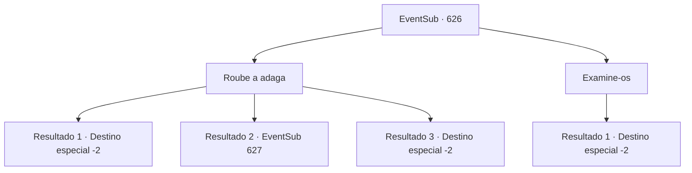

# Eventos secundários · 626

[Índice da tabela](index.md) · [Índice geral](../index.md)

ID: `pt:EventSub:626` · Fonte: `EventSub4` · Versão: 1.2.47.

Mapeamento estático dos arquivos; a disponibilidade e a execução dependem do estado da run.

## Texto do evento

*Sem texto no arquivo.*

## Dados de entrada

```json
{
  "id": 626,
  "grade": 1,
  "subEvent": "",
  "required": ""
}
```

## Mapa das escolhas



## Escolhas e resultados

### Escolha 1

Roube a adaga

Requisitos e outros campos da escolha:

```json
{
  "required": ""
}
```

#### Resultado 1.1

Você guarda a adaga num piscar de olhos. O guarda te observa, mas está sem entender sua ação. Você observa os outros artefatos por um momento antes de deixar a tenda. No dia seguinte, você volta às suas tarefas como se nada tivesse acontecido. 

 Quatro dias depois, a expedição finalmente chegou ao fim. Felizmente, nenhum outro incidente ocorreu depois disso, e todos voltaram em segurança para Grimdit sem ferimentos. Os artefatos encontrados serão armazenados no depósito de Veneprada. De acordo com rumores, os artefatos serão usados em algum tipo de novo negócio planejado pela Veneprada. 

 "Bom trabalho, todos. Sua recompensa os aguarda."

 A soma dos aventureiros é de 80 ouros. Você pega a recompensa e deixa Grimdit.

Continuação registrada: [Destino especial `-2`](../destinos-especiais.md).

```json
{
  "required": "21_5_2",
  "chance": "1|0_6_1",
  "nextEvent": -2,
  "type": 0,
  "reward": "0_2_1|3_296_1|0_4_80|12_10_8"
}
```

#### Resultado 1.2

Você tenta roubar a adaga. Mas o guarda tem estado de olho em você - você é pego em flagrante. Ele rapidamente apita seu apito, alertando os outros aventureiros perto da tenda. 

 "Ladrão! Ladrão! Peguem ele!"

 Os aventureiros te cercam instantaneamente.

Continuação registrada: [Evento 627](0627.md) na mesma tabela.

```json
{
  "required": "21_5_2",
  "chance": "13",
  "nextEvent": 627,
  "type": 1,
  "reward": "6_3_62",
  "place": 14
}
```

#### Resultado 1.3

Você guarda a adaga num piscar de olhos. O guarda te observa, mas está sem pistas da sua ação. Você observa os outros artefatos por um momento antes de deixar a tenda. No dia seguinte, você volta às suas obrigações como se nada tivesse acontecido. 

 Quatro dias depois, a expedição finalmente chegou ao fim. Felizmente, nenhum outro incidente ocorreu depois disso, e todos voltaram em segurança para Grimdit sem ferimentos. Os artefatos encontrados serão armazenados no depósito de Veneprada. De acordo com rumores, os artefatos serão usados em algum tipo de novo negócio planejado por Veneprada. 

 "Bom trabalho, pessoal. Sua recompensa os aguarda."

 A soma dos aventureiros é de 80 ouros. Você pega a recompensa e deixa Grimdit.

Continuação registrada: [Destino especial `-2`](../destinos-especiais.md).

```json
{
  "required": "20_5_2",
  "chance": "1",
  "nextEvent": -2,
  "type": 2,
  "reward": "0_2_1|3_296_1|0_4_80|12_10_8"
}
```

### Escolha 2

Examine-os

Requisitos e outros campos da escolha:

```json
{
  "required": ""
}
```

#### Resultado 2.1

Você simplesmente examina as relíquias antes de deixar a tenda. O guarda te olha com suspeita, mas não faz nada. No dia seguinte, você retorna às suas obrigações. 

 Quatro dias depois, a expedição finalmente chegou ao fim. Felizmente, nenhum outro incidente ocorreu depois disso, e todos voltaram em segurança para Grimdit ilesos. As relíquias encontradas devem ser armazenadas no depósito de Veneprada. De acordo com rumores, as relíquias serão usadas em algum tipo de novo negócio, planejado pela Veneprada. 

 "Bom trabalho, todos. Sua recompensa os aguarda."

 A soma dos aventureiros é de 80 ouros. Você pega a recompensa e deixa Grimdit.

Continuação registrada: [Destino especial `-2`](../destinos-especiais.md).

```json
{
  "required": "",
  "chance": "1",
  "nextEvent": -2,
  "type": 2,
  "reward": "5_601_1|0_2_1|0_4_80|12_10_8"
}
```

## Referências que chegam a este evento

- [Evento 625 · escolha 1 · resultado 1](0625.md#escolha-1)
