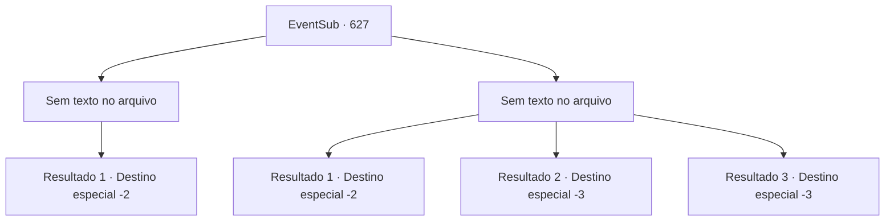

# Eventos secundários · 627

[Índice da tabela](index.md) · [Índice geral](../index.md)

ID: `pt:EventSub:627` · Fonte: `EventSub4` · Versão: 1.2.47.

Mapeamento estático dos arquivos; a disponibilidade e a execução dependem do estado da run.

## Texto do evento

*Sem texto no arquivo.*

## Dados de entrada

```json
{
  "id": 627,
  "grade": 1,
  "subEvent": "",
  "required": ""
}
```

## Mapa das escolhas



## Escolhas e resultados

### Escolha 1

*Sem texto no arquivo; o papel dessa opção depende da interface do jogo.*

Requisitos e outros campos da escolha:

```json
{
  "required": ""
}
```

#### Resultado 1.1

Uma pequena tenda é um lugar ruim para aproveitar a vantagem dos números. Você derrota os aventureiros um por um. Você guarda a adaga que tentou roubar e sai rapidamente da tenda. Não muito tempo depois, você pode ouvir pessoas te perseguindo, mas o véu da noite te proporciona cobertura suficiente.

Continuação registrada: [Destino especial `-2`](../destinos-especiais.md).

```json
{
  "required": "",
  "chance": "1",
  "nextEvent": -2,
  "type": 2,
  "reward": "3_296_1|12_10_8"
}
```

### Escolha 2

*Sem texto no arquivo; o papel dessa opção depende da interface do jogo.*

Requisitos e outros campos da escolha:

```json
{
  "required": ""
}
```

#### Resultado 2.1

Os aventureiros têm a vantagem dos números. Você está sozinho. A tenda é muito pequena para você lutar - tudo o que você pode fazer é correr pela sua vida. Os aventureiros te perseguem, mas o véu da noite te proporciona cobertura suficiente.

Continuação registrada: [Destino especial `-2`](../destinos-especiais.md).

```json
{
  "required": "1_0_2|1_1_2",
  "chance": "1",
  "nextEvent": -2,
  "type": 2,
  "reward": "0_0_-1|0_1_-1|12_10_8"
}
```

#### Resultado 2.2

Os aventureiros têm a vantagem dos números. Você está sozinho. Infelizmente, você é derrotado após ser bombardeado com ataques. Finalmente, o golpe decisivo corta sua garganta.

Continuação registrada: [Destino especial `-3`](../destinos-especiais.md).

```json
{
  "required": "2_0_2",
  "chance": "1",
  "nextEvent": -3,
  "type": 2,
  "reward": "0_0_-1|0_1_-1"
}
```

#### Resultado 2.3

Os aventureiros têm a vantagem dos números. Você está sozinho. Infelizmente, você é derrotado após ser bombardeado com ataques. Finalmente, o golpe decisivo corta sua garganta.

Continuação registrada: [Destino especial `-3`](../destinos-especiais.md).

```json
{
  "required": "2_1_2",
  "chance": "1",
  "nextEvent": -3,
  "type": 2,
  "reward": "0_0_-1|0_1_-1"
}
```

## Referências que chegam a este evento

- [Evento 626 · escolha 1 · resultado 2](0626.md#escolha-1)
