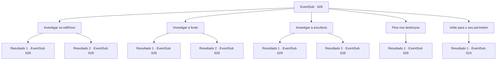

# Eventos secundários · 628

[Índice da tabela](index.md) · [Índice geral](../index.md)

ID: `pt:EventSub:628` · Fonte: `EventSub4` · Versão: 1.2.47.

Mapeamento estático dos arquivos; a disponibilidade e a execução dependem do estado da run.

## Texto do evento

*Sem texto no arquivo.*

## Dados de entrada

```json
{
  "id": 628,
  "grade": 1,
  "subEvent": "",
  "required": ""
}
```

## Mapa das escolhas



## Escolhas e resultados

### Escolha 1

Investigar os edifícios

Requisitos e outros campos da escolha:

```json
{
  "required": "5_595_0"
}
```

#### Resultado 1.1

Os prédios ainda permanecem em certa medida intactos, mesmo depois de terem resistido ao teste do tempo. Mas todos estão vazios, presumivelmente saqueados por caçadores de tesouros ou escavadores. Eles estão cheios de móveis quebrados, lixo empoeirado e uma infestação de insetos. Depois de olhar ao redor dos prédios, você retorna a Edenheart e vai embora.

Continuação registrada: [Evento 628](0628.md) na mesma tabela.

```json
{
  "required": "",
  "chance": "1|0_14_1",
  "nextEvent": 628,
  "type": 0,
  "reward": "5_595_1"
}
```

#### Resultado 1.2

Os prédios ainda permanecem em certa medida intactos, mesmo depois de terem resistido ao teste do tempo. Mas todos estão vazios, presumivelmente saqueados por caçadores de tesouros ou escavadores. Incapaz de encontrar algo fora do comum, você retorna a Edenheart e segue em frente.

Continuação registrada: [Evento 628](0628.md) na mesma tabela.

```json
{
  "required": "",
  "chance": "16",
  "nextEvent": 628,
  "type": 1,
  "reward": "5_595_1"
}
```

### Escolha 2

Investigar a fonte

Requisitos e outros campos da escolha:

```json
{
  "required": "5_596_0"
}
```

#### Resultado 2.1

Você se aproxima da fonte no centro das ruínas. A fonte parece ter sido decorada com belos fragmentos há muito tempo, mas agora sua estrutura não pode ser discernida. A água já se foi - a base da fonte está seca e rachada. Você se afasta da fonte.

Continuação registrada: [Evento 628](0628.md) na mesma tabela.

```json
{
  "required": "",
  "chance": "1|0_14_1",
  "nextEvent": 628,
  "type": 0,
  "reward": "5_596_1"
}
```

#### Resultado 2.2

Você se aproxima da fonte no centro das ruínas. Além de parecer muito, muito antiga, você não vê nada fora do comum.

Continuação registrada: [Evento 628](0628.md) na mesma tabela.

```json
{
  "required": "",
  "chance": "16",
  "nextEvent": 628,
  "type": 1,
  "reward": "5_596_1"
}
```

### Escolha 3

Investigar a escultura

Requisitos e outros campos da escolha:

```json
{
  "required": "5_597_0"
}
```

#### Resultado 3.1

Você dá uma olhada na escultura, colocada no canto das ruínas. Além do fato de parecer o rosto de um humano, você não consegue distinguir muito da escultura. Mas então, você instintivamente sente que algo está errado com essa escultura. Você empurra a escultura para longe e encontra algo que não deveria estar ali. É uma porta de pedra redonda escondida. Você cuidadosamente alcança a maçaneta da porta. A porta é muito pesada e está bem fechada. Provavelmente não abrirá facilmente.

Continuação registrada: [Evento 629](0629.md) na mesma tabela.

```json
{
  "required": "",
  "chance": "1|0_14_1",
  "nextEvent": 629,
  "type": 0,
  "reward": ""
}
```

#### Resultado 3.2

Você dá uma olhada na escultura, colocada no canto das ruínas. Além do fato de parecer o rosto de um humano, você não consegue distinguir muito da escultura. Você se afasta da escultura misteriosa. Uma tempestade de areia fria sopra.

Continuação registrada: [Evento 628](0628.md) na mesma tabela.

```json
{
  "required": "",
  "chance": "16",
  "nextEvent": 628,
  "type": 1,
  "reward": "5_597_1"
}
```

### Escolha 4

Pise nos destroços

Requisitos e outros campos da escolha:

```json
{
  "required": "5_598_0"
}
```

#### Resultado 4.1


 "Você aí! O que está fazendo?! Volte para suas obrigações!"

 Você pisa na pilha de entulho, mas não vê nada fora do comum. Um funcionário da guilda, irritado, ordena que você desça. Para evitar qualquer complicação adicional, você rapidamente retorna às suas obrigações.

Continuação registrada: [Evento 628](0628.md) na mesma tabela.

```json
{
  "required": "",
  "chance": "1",
  "nextEvent": 628,
  "type": 2,
  "reward": "5_598_1"
}
```

### Escolha 5

Volte para o seu perímetro

Requisitos e outros campos da escolha:

```json
{
  "required": "-1|5_595_1|5_596_1|5_597_1|5_598_1"
}
```

#### Resultado 5.1

Você termina seu passeio pelas ruínas, voltando para suas obrigações. Mas então, você ouve uma explosão vindo das ruínas. Você investiga a origem do barulho. Um golem de pedra, acabou de emergir do subsolo pelo que parece, está causando estragos por toda parte. Outros aventureiros tentam lutar contra ele, mas não são páreo. 

 "Novo intruso detectado. Visitante não autorizado. Iniciar ataque."

 O golem de pedra se vira para você e ataca.

Continuação registrada: [Evento 624](0624.md) na mesma tabela.

```json
{
  "required": "",
  "chance": "1",
  "nextEvent": 624,
  "type": 2,
  "reward": "6_0_15",
  "place": 5
}
```

## Referências que chegam a este evento

- [Evento 623 · escolha 2 · resultado 1](0623.md#escolha-2)
- [Evento 628 · escolha 1 · resultado 1](0628.md#escolha-1)
- [Evento 628 · escolha 1 · resultado 2](0628.md#escolha-1)
- [Evento 628 · escolha 2 · resultado 1](0628.md#escolha-2)
- [Evento 628 · escolha 2 · resultado 2](0628.md#escolha-2)
- [Evento 628 · escolha 3 · resultado 2](0628.md#escolha-3)
- [Evento 628 · escolha 4 · resultado 1](0628.md#escolha-4)
