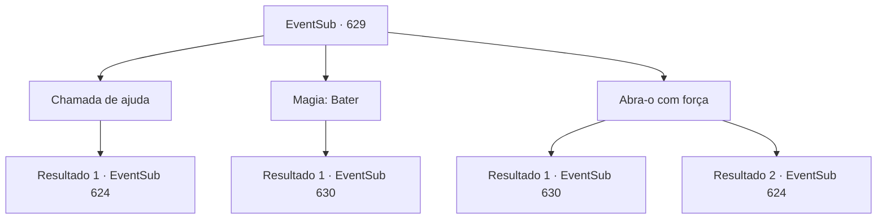

# Eventos secundários · 629

[Índice da tabela](index.md) · [Índice geral](../index.md)

ID: `pt:EventSub:629` · Fonte: `EventSub4` · Versão: 1.2.47.

Mapeamento estático dos arquivos; a disponibilidade e a execução dependem do estado da run.

## Texto do evento

*Sem texto no arquivo.*

## Dados de entrada

```json
{
  "id": 629,
  "grade": 1,
  "subEvent": "",
  "required": ""
}
```

## Mapa das escolhas



## Escolhas e resultados

### Escolha 1

Chamada de ajuda

Requisitos e outros campos da escolha:

```json
{
  "required": ""
}
```

#### Resultado 1.1

O seu pedido é atendido - membros da expedição vêm em seu auxílio e ajudam a abrir a porta de pedra. À medida que a porta desliza, uma escadaria que leva ao subsolo se revela. Os arqueólogos dão uma olhada e correm animados para dentro, investigando. Tanta gente entrou que você nem ousa entrar lá sozinho. 

 "AACCCCKKKK!!"

 Mas logo você ouve gritos vindos da escadaria. Um golem de pedra emerge do porão e começa a causar estragos. Ele ataca todos que estão por perto, inclusive você. 

 "Novo intruso detectado. Visitante não autorizado. Iniciar ataque."

 O golem de pedra se vira para você e ataca.

Continuação registrada: [Evento 624](0624.md) na mesma tabela.

```json
{
  "required": "",
  "chance": "1",
  "nextEvent": 624,
  "type": 2,
  "reward": "6_0_15",
  "place": 5
}
```

### Escolha 2

Magia: Bater

Requisitos e outros campos da escolha:

```json
{
  "required": "20_0_1"
}
```

#### Resultado 2.1

Você conjura magia para abrir magicamente a porta de pedra. À medida que a porta desliza aberta, uma escada que leva ao subsolo se revela. Você desce cuidadosamente as escadas e dá uma olhada no porão. Ao chegar ao final da escada, você encontra um corredor escuro e úmido. Está coberto de pedras vermelhas, com sinais e desenhos esotéricos preenchendo as paredes. Escritas no chão estão letras misteriosas que você não consegue entender, emitindo uma luz fraca, como se fossem um grupo de vaga-lumes.

Continuação registrada: [Evento 630](0630.md) na mesma tabela.

```json
{
  "required": "",
  "chance": "1",
  "nextEvent": 630,
  "type": 2,
  "reward": ""
}
```

### Escolha 3

Abra-o com força

Requisitos e outros campos da escolha:

```json
{
  "required": ""
}
```

#### Resultado 3.1

Você arromba a porta com força bárbara. Uma escada que leva ao subsolo se revela. Você desce cuidadosamente os degraus e dá uma olhada no porão. Ao chegar ao final da escada, você encontra um corredor escuro e úmido. Está coberto de pedras vermelhas, com sinais e desenhos esotéricos preenchendo as paredes. Escritas no chão estão letras misteriosas que você não consegue entender, emitindo uma luz fraca, como se fossem um grupo de vaga-lumes.

Continuação registrada: [Evento 630](0630.md) na mesma tabela.

```json
{
  "required": "",
  "chance": "1|0_5_1",
  "nextEvent": 630,
  "type": 0,
  "reward": ""
}
```

#### Resultado 3.2

Tentas abrir a porta com a tua força. Mas ela não se mexe. Lutas com a porta durante alguns minutos e em breve outros membros da expedição vêm em teu auxílio. Finalmente, consegues abrir a porta de pedra. À medida que a porta desliza, revela-se uma escadaria que leva ao subsolo. Os arqueólogos dão uma olhada e correm animados para dentro, investigando. Tanta gente entrou que nem te atreves a entrar lá. 

 "AACCCCKKKK!!"

 Mas em breve, ouves gritos vindos da escadaria. Um golem de pedra emerge do porão e começa a causar estragos. Ele ataca todos na proximidade, incluindo-te. 

 "Novo intruso detetado. Visitante não autorizado. Iniciar ataque."

 O golem de pedra vira-se para ti e ataca.

Continuação registrada: [Evento 624](0624.md) na mesma tabela.

```json
{
  "required": "",
  "chance": "22",
  "nextEvent": 624,
  "type": 1,
  "reward": "6_0_15",
  "place": 5
}
```

## Referências que chegam a este evento

- [Evento 628 · escolha 3 · resultado 1](0628.md#escolha-3)
