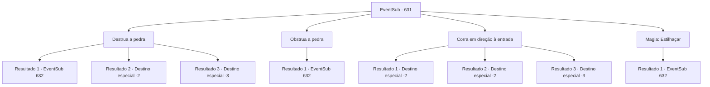

# Eventos secundários · 631

[Índice da tabela](index.md) · [Índice geral](../index.md)

ID: `pt:EventSub:631` · Fonte: `EventSub4` · Versão: 1.2.47.

Mapeamento estático dos arquivos; a disponibilidade e a execução dependem do estado da run.

## Texto do evento

*Sem texto no arquivo.*

## Dados de entrada

```json
{
  "id": 631,
  "grade": 1,
  "subEvent": "",
  "required": ""
}
```

## Mapa das escolhas



## Escolhas e resultados

### Escolha 1

Destrua a pedra

Requisitos e outros campos da escolha:

```json
{
  "required": ""
}
```

#### Resultado 1.1

Você golpeia a pedra rolante, destruindo-a. A pedra - ou os pedaços restantes dela - está no chão imóvel. Você passa pelos restos da pedra pelo corredor. Você entra em um salão amplo. No centro do salão há um golem de pedra, parado lá como uma decoração, e no teto você vê uma luz estranha, parecida com um lustre. 

 "Intruso detectado. Visitante não autorizado. Iniciar ataque."

 Assim que você pisa no salão, o golem de pedra levanta os punhos para atacar.

Continuação registrada: [Evento 632](0632.md) na mesma tabela.

```json
{
  "required": "",
  "chance": "1|0_5_1",
  "nextEvent": 632,
  "type": 0,
  "reward": "6_0_15",
  "place": 7
}
```

#### Resultado 1.2

Tentas atingir a pedra rolante, destruindo-a. Mas a tua força inadequada não consegue fazê-lo. És perseguido pelo corredor pela pedra rolante. A pedra finalmente para de se mover quando bate numa coluna dentro do laboratório. 

 <link=shake>'BBBBRRRGH! RRRRG!' </link> 

 Incapaz de resistir ao choque, todo o laboratório desmorona. A falta de manutenção deve ter deixado a estrutura frágil. O barulho alto atrai a atenção de outras pessoas, e uma delas é o empreiteiro Osborne. Depois de ouvir as notícias, ele vem te repreender, incapaz de conter a raiva. 

 "VOCÊ MALDITO IDIOTA! Em vez de ficar de guarda, VOCÊ TRAZ A DESTRUIÇÃO PARA TODO O LUGAR!?"

 Osborne jura e amaldiçoa por muito tempo antes de chamar os aventureiros e te expulsar do acampamento. Infelizmente, não tens escolha a não ser deixar as Ruínas de Plasphere de mãos vazias.

Continuação registrada: [Destino especial `-2`](../destinos-especiais.md).

```json
{
  "required": "1_0_2",
  "chance": "14",
  "nextEvent": -2,
  "type": 1,
  "reward": "0_0_-1|12_10_8"
}
```

#### Resultado 1.3

Tentas atingir a pedra rolante, destruindo-a. Mas a tua força inadequada não consegue fazê-lo. És esmagado pela pedra - encontras a tua morte.

Continuação registrada: [Destino especial `-3`](../destinos-especiais.md).

```json
{
  "required": "2_0_2",
  "chance": "14",
  "nextEvent": -3,
  "type": 1,
  "reward": "0_0_-1"
}
```

### Escolha 2

Obstrua a pedra

Requisitos e outros campos da escolha:

```json
{
  "required": "20_9_2"
}
```

#### Resultado 2.1

Você bloqueia a pedra rolando. Perdendo seu impulso, a pedra fica parada no meio do corredor. Você passa pela estreita abertura entre a pedra e as paredes. Logo, você chega a um salão amplo. No centro do salão há um golem de pedra, parado lá como uma decoração, e no teto você vê uma luz estranha, parecida com um lustre. 

 "Intruso detectado. Visitante não autorizado. Iniciar ataque."

 Assim que você pisa no salão, o golem de pedra levanta os punhos para atacar.

Continuação registrada: [Evento 632](0632.md) na mesma tabela.

```json
{
  "required": "",
  "chance": "1",
  "nextEvent": 632,
  "type": 2,
  "reward": "6_0_15",
  "place": 7
}
```

### Escolha 3

Corra em direção à entrada

Requisitos e outros campos da escolha:

```json
{
  "required": ""
}
```

#### Resultado 3.1

Você foge para fora, correndo para longe da pedra rolante. Felizmente, você consegue escapar antes que a pedra te esmague. A pedra finalmente para de se mover quando bate em uma coluna dentro do laboratório. 

 <link=shake>'BBBBRRRGH! RRRRG!' </link> 

 Incapaz de suportar o impacto, o laboratório inteiro desmorona. A falta de manutenção deve ter deixado a estrutura frágil. O barulho alto atrai a atenção de outras pessoas, e uma delas é o empreiteiro Osborne. Depois de ouvir as notícias, ele vem te repreender, incapaz de conter a raiva. 

 "VOCÊ MALDITO IDIOTA! Em vez de ficar de guarda, você TRAZ A DESTRUIÇÃO PARA TODO O LUGAR!?"

 Osborne xinga e amaldiçoa por um longo tempo antes de chamar os aventureiros e te expulsar do acampamento. Infelizmente, você não tem escolha a não ser deixar as Ruínas de Plasphere de mãos vazias.

Continuação registrada: [Destino especial `-2`](../destinos-especiais.md).

```json
{
  "required": "",
  "chance": "1|0_6_1",
  "nextEvent": -2,
  "type": 0,
  "reward": "12_10_8"
}
```

#### Resultado 3.2

Você foge para fora, correndo para longe da pedra rolante. Você torce o tornozelo no processo, mas consegue cobrir uma distância suficiente. A pedra finalmente para de se mover quando bate em uma coluna dentro do laboratório. 

 <link=shake>'BBBBRRRGH! RRRRG!' </link> 

 Incapaz de resistir ao choque, o laboratório inteiro desmorona. A falta de manutenção deve ter deixado a estrutura frágil. O barulho alto atrai a atenção de outras pessoas, e uma delas é o empreiteiro Osborne. Após ouvir as notícias, ele vem te repreender, incapaz de conter a raiva. 

 "VOCÊ IDIOTA! Em vez de ficar de guarda, VOCÊ TRAZ A RUÍNA PARA TODO O LUGAR!?"

 Osborne xinga e amaldiçoa por um longo tempo antes de chamar os aventureiros e te expulsar do acampamento. Infelizmente, você não tem escolha a não ser deixar as Ruínas de Plasphere de mãos vazias.

Continuação registrada: [Destino especial `-2`](../destinos-especiais.md).

```json
{
  "required": "1_0_2",
  "chance": "14",
  "nextEvent": -2,
  "type": 1,
  "reward": "0_0_-1|12_10_8"
}
```

#### Resultado 3.3

Tentas fugir para fora, correndo para longe da pedra rolante. Mas a pedra é mais rápida do que tu, e és esmagado(a) completamente.

Continuação registrada: [Destino especial `-3`](../destinos-especiais.md).

```json
{
  "required": "2_0_2",
  "chance": "14",
  "nextEvent": -3,
  "type": 1,
  "reward": "0_0_-1"
}
```

### Escolha 4

Magia: Estilhaçar

Requisitos e outros campos da escolha:

```json
{
  "required": "20_0_2|1_1_2"
}
```

#### Resultado 4.1

Você conjura Estilhaçar, destruindo a pedra. A pedra - ou as peças restantes dela - jaz no chão imóvel. Você passa pelos restos da pedra pelo corredor. Você entra em um salão amplo. No centro do salão há um golem de pedra, parado lá como uma decoração, e no teto você vê uma luz estranha, parecida com um lustre. 

 "Intruso detectado. Visitante não autorizado. Iniciar ataque."

 Assim que você pisa no salão, o golem de pedra levanta os punhos para atacar.

Continuação registrada: [Evento 632](0632.md) na mesma tabela.

```json
{
  "required": "",
  "chance": "1",
  "nextEvent": 632,
  "type": 2,
  "reward": "6_0_15",
  "place": 7
}
```

## Referências que chegam a este evento

- [Evento 630 · escolha 1 · resultado 2](0630.md#escolha-1)
- [Evento 630 · escolha 2 · resultado 2](0630.md#escolha-2)
