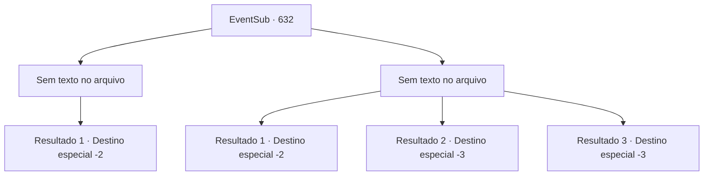

# Eventos secundários · 632

[Índice da tabela](index.md) · [Índice geral](../index.md)

ID: `pt:EventSub:632` · Fonte: `EventSub4` · Versão: 1.2.47.

Mapeamento estático dos arquivos; a disponibilidade e a execução dependem do estado da run.

## Texto do evento

*Sem texto no arquivo.*

## Dados de entrada

```json
{
  "id": 632,
  "grade": 1,
  "subEvent": "",
  "required": ""
}
```

## Mapa das escolhas



## Escolhas e resultados

### Escolha 1

*Sem texto no arquivo; o papel dessa opção depende da interface do jogo.*

Requisitos e outros campos da escolha:

```json
{
  "required": ""
}
```

#### Resultado 1.1

Você passa pelo golem de pedra desmoronado e entra no laboratório mais interno. É um lugar distintivo, dividido em duas partes. Um lado tem uma estante cheia de vários scripts, enquanto o outro é adornado com uma mesa de pedra e instrumentos usados na alquimia. Depois de derrotar o golem de pedra, você investiga lentamente o local. Então, algo chama sua atenção. É uma adaga torta, emitindo uma aura sinistra e suspeita. Você pega a adaga para si e sai silenciosamente. 

 Quatro dias depois, a expedição finalmente chegou ao fim. Felizmente, nenhum outro incidente ocorreu depois disso, e todos voltaram com segurança para Grimdit ilesos. Os artefatos encontrados serão armazenados no depósito de Veneprada. De acordo com rumores, os artefatos serão usados em algum tipo de novo negócio, planejado por Veneprada. 

 "Bom trabalho, pessoal. Sua recompensa os aguarda."

 A soma dos aventureiros é de 80 ouros. Você pega a recompensa e deixa Grimdit.

Continuação registrada: [Destino especial `-2`](../destinos-especiais.md).

```json
{
  "required": "",
  "chance": "1",
  "nextEvent": -2,
  "type": 2,
  "reward": "3_296_1|0_4_80|12_10_8"
}
```

### Escolha 2

*Sem texto no arquivo; o papel dessa opção depende da interface do jogo.*

Requisitos e outros campos da escolha:

```json
{
  "required": ""
}
```

#### Resultado 2.1

Você não tem escolha a não ser fugir do laboratório, derrotado pelo golem de pedra. O golem de pedra persegue você do lado de fora, emergindo do subsolo. Então ele começa a causar estragos, atacando tudo ao redor. Os aventureiros revidam, mas não são páreo. 

 "Ataque! ATAQUE! Eu não contratei vocês, idiotas, à toa!"

 Você foge rapidamente. Você pode ouvir os gritos de raiva de Osborne do lado de fora das ruínas.

Continuação registrada: [Destino especial `-2`](../destinos-especiais.md).

```json
{
  "required": "1_0_2|1_1_2",
  "chance": "1",
  "nextEvent": -2,
  "type": 2,
  "reward": "0_0_-1|0_1_-1|12_10_8"
}
```

#### Resultado 2.2

O golem de pedra te golpeia com seus punhos de pedra pesados. Seu corpo é desmontado em pedaços de carne.

Continuação registrada: [Destino especial `-3`](../destinos-especiais.md).

```json
{
  "required": "2_0_2",
  "chance": "1",
  "nextEvent": -3,
  "type": 2,
  "reward": "0_0_-1|0_1_-1"
}
```

#### Resultado 2.3

O golem de pedra te golpeia com seus punhos de pedra pesados. Seu corpo é desmontado em pedaços de carne.

Continuação registrada: [Destino especial `-3`](../destinos-especiais.md).

```json
{
  "required": "2_1_2",
  "chance": "1",
  "nextEvent": -3,
  "type": 2,
  "reward": "0_0_-1|0_1_-1"
}
```

## Referências que chegam a este evento

- [Evento 630 · escolha 1 · resultado 1](0630.md#escolha-1)
- [Evento 630 · escolha 1 · resultado 3](0630.md#escolha-1)
- [Evento 630 · escolha 2 · resultado 1](0630.md#escolha-2)
- [Evento 630 · escolha 2 · resultado 3](0630.md#escolha-2)
- [Evento 631 · escolha 1 · resultado 1](0631.md#escolha-1)
- [Evento 631 · escolha 2 · resultado 1](0631.md#escolha-2)
- [Evento 631 · escolha 4 · resultado 1](0631.md#escolha-4)
