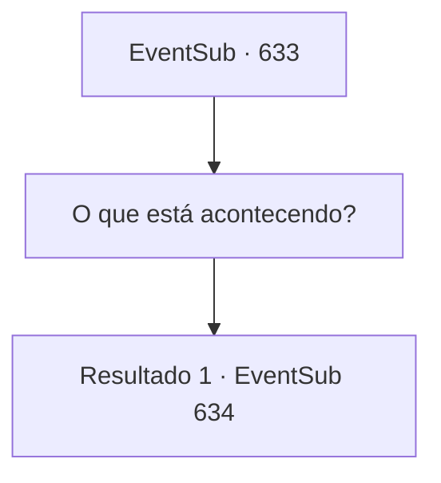

# Eventos secundários · 633

[Índice da tabela](index.md) · [Índice geral](../index.md)

ID: `pt:EventSub:633` · Fonte: `EventSub4` · Versão: 1.2.47.

Mapeamento estático dos arquivos; a disponibilidade e a execução dependem do estado da run.

## Texto do evento

Você está descansando em uma estalagem local, quando um visitante inesperado se aproxima de você. É Edenheart! Da última vez que você a viu, ela estava pesquisando sobre o Elixir individualmente. Sem lhe dar uma explicação, ela faz um pedido. 

 "{1}, você estaria disposto a me acompanhar até as Ruínas de Plasphere?"


## Dados de entrada

```json
{
  "id": 633,
  "grade": 1,
  "subEvent": "",
  "required": "12_10_6"
}
```

## Mapa das escolhas



## Escolhas e resultados

### Escolha 1

O que está acontecendo?

Requisitos e outros campos da escolha:

```json
{
  "required": ""
}
```

#### Resultado 1.1

Edenheart limpa a garganta de forma desajeitada em resposta. 

 "Ahem, desculpe. Estou um pouco apressada, então..."

 Depois de se separar de você, ela de fato continuou sua pesquisa individualmente em Mavelaine. Mas a pesquisa chegou a um beco sem saída, devido à falta de roteiros e instrumentos necessários. Então, ela ouviu falar sobre a guilda de comerciantes, Veneprada, entrando no negócio do Elixir do nada. 

 "Pelo que ouvi, a Veneprada já enviou uma expedição para as 'Ruínas de Plasphere'. Este é o lugar onde o lendário Elixir foi preparado uma vez. Ou pelo menos é o que as pessoas dizem."

 Edenheart diz que ela deseja ir lá pessoalmente e adquirir os roteiros e instrumentos necessários para preparar o Elixir. Após terminar sua explicação, ela pede para você acompanhá-la até as ruínas.

Continuação registrada: [Evento 634](0634.md) na mesma tabela.

```json
{
  "required": "",
  "chance": "1",
  "nextEvent": 634,
  "type": 2,
  "reward": ""
}
```

## Referências que chegam a este evento

Nenhum `nextEvent` positivo da mesma tabela aponta para este nó. Isso não prova que seja inacessível: sorteio e estado de história podem selecioná-lo.

