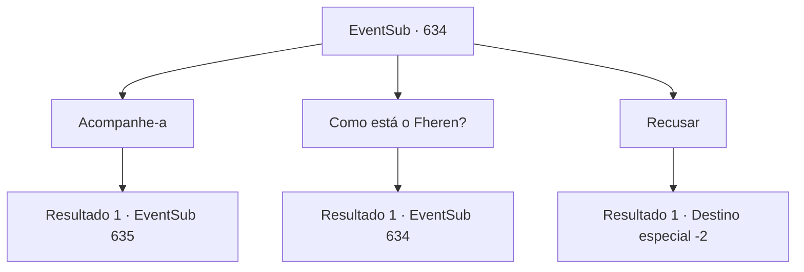

# Eventos secundários · 634

[Índice da tabela](index.md) · [Índice geral](../index.md)

ID: `pt:EventSub:634` · Fonte: `EventSub4` · Versão: 1.2.47.

Mapeamento estático dos arquivos; a disponibilidade e a execução dependem do estado da run.

## Texto do evento

*Sem texto no arquivo.*

## Dados de entrada

```json
{
  "id": 634,
  "grade": 1,
  "subEvent": "",
  "required": ""
}
```

## Mapa das escolhas



## Escolhas e resultados

### Escolha 1

Acompanhe-a

Requisitos e outros campos da escolha:

```json
{
  "required": ""
}
```

#### Resultado 1.1

Você segue Edenheart até as Ruínas de Plasphere. Ela conhecia bem o caminho, então leva apenas alguns dias para chegar lá. |drawing_Plasphere| No meio da tempestade de areia, as ruínas capturam uma paisagem antiga. Edifícios antigos construídos com tijolos de pedra esculpidos estão espalhados aqui e ali, uma fonte seca e os destroços de esculturas e cercas quebradas espalhados pelo chão. O local está lotado de aventureiros, estudiosos e trabalhadores, todos usando os mesmos símbolos. O símbolo de Veneprada. 

 "Pare! Este lugar é restrito apenas ao pessoal da Veneprada."

 Um guarda levemente armado te impede. Assim como todos os outros, sua armadura é inscrita com o símbolo da guilda de comerciantes da Veneprada.

Continuação registrada: [Evento 635](0635.md) na mesma tabela.

```json
{
  "required": "",
  "chance": "1",
  "nextEvent": 635,
  "type": 2,
  "reward": ""
}
```

### Escolha 2

Como está o Fheren?

Requisitos e outros campos da escolha:

```json
{
  "required": "5_609_0"
}
```

#### Resultado 2.1

Você pergunta a Edenheart sobre a condição de Fheren. Ela responde balançando a cabeça e suspirando. Você pode perceber como ele está, julgando pela reação dela.

Continuação registrada: [Evento 634](0634.md) na mesma tabela.

```json
{
  "required": "",
  "chance": "1",
  "nextEvent": 634,
  "type": 2,
  "reward": "5_609_9"
}
```

### Escolha 3

Recusar

Requisitos e outros campos da escolha:

```json
{
  "required": ""
}
```

#### Resultado 3.1

Você recusa o pedido de Edenheart e vai embora. Surpresa, ela nem mesmo te impede enquanto você se retira.

Continuação registrada: [Destino especial `-2`](../destinos-especiais.md).

```json
{
  "required": "",
  "chance": "1",
  "nextEvent": -2,
  "type": 2,
  "reward": "12_10_10"
}
```

## Referências que chegam a este evento

- [Evento 633 · escolha 1 · resultado 1](0633.md#escolha-1)
- [Evento 634 · escolha 2 · resultado 1](0634.md#escolha-2)
