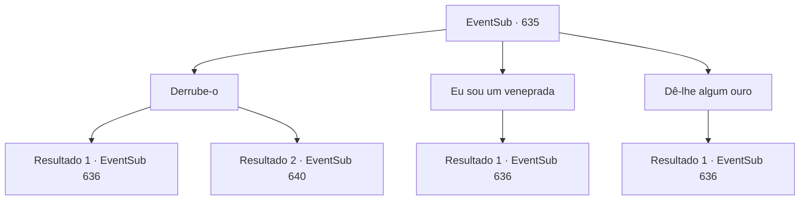

# Eventos secundários · 635

[Índice da tabela](index.md) · [Índice geral](../index.md)

ID: `pt:EventSub:635` · Fonte: `EventSub4` · Versão: 1.2.47.

Mapeamento estático dos arquivos; a disponibilidade e a execução dependem do estado da run.

## Texto do evento

*Sem texto no arquivo.*

## Dados de entrada

```json
{
  "id": 635,
  "grade": 1,
  "subEvent": "",
  "required": ""
}
```

## Mapa das escolhas



## Escolhas e resultados

### Escolha 1

Derrube-o

Requisitos e outros campos da escolha:

```json
{
  "required": ""
}
```

#### Resultado 1.1

Você nocauteia o guarda inconsciente. Sua decisão preocupa Edenheart, enquanto ela pergunta com voz trêmula. 

 "Uh... Não tenho certeza se isso é a coisa certa a fazer, {1}."

 Você e Edenheart passam pelo guarda inconsciente e entram no local de escavação. Logo, o som de uma explosão enche as ruínas. Do local do som emerge um golem de pedra. O golem de pedra causa estragos, atacando todos na proximidade, o que inclui você. Alguns estão gritando de terror e outros já estão fugindo. 

 "Novo intruso detectado. Visitante não autorizado. Iniciar ataque."

 O golem de pedra se vira para você e ataca. Você tem tempo suficiente para se preparar para a luta - você prepara sua arma e contra-ataca.

Continuação registrada: [Evento 636](0636.md) na mesma tabela.

```json
{
  "required": "",
  "chance": "1|0_5_1",
  "nextEvent": 636,
  "type": 0,
  "reward": "6_0_15",
  "place": 5
}
```

#### Resultado 1.2

Tentas deixar o guarda inconsciente ao derrubá-lo. Mas ele não cai - ele agarra sua lança e revida.

Continuação registrada: [Evento 640](0640.md) na mesma tabela.

```json
{
  "required": "",
  "chance": "14",
  "nextEvent": 640,
  "type": 1,
  "reward": "6_0_91",
  "place": 5
}
```

### Escolha 2

Eu sou um veneprada

Requisitos e outros campos da escolha:

```json
{
  "required": "5_590_2"
}
```

#### Resultado 2.1

Você explica que é membro da Veneprada. Ele pergunta pelo seu nome, lê uma lista e acena com a cabeça. 

 "Hmph. Você está na lista. O vice-presidente te ligou? De qualquer forma, pode entrar."

 Você e Edenheart passam pelo guarda e entram no local de escavação. Logo, o som de uma explosão preenche as ruínas. Do local do som emerge um golem de pedra. O golem de pedra causa estragos, atacando todos na proximidade, incluindo você. Alguns estão gritando de terror, e outros já estão fugindo. 

 "Novo intruso detectado. Visitante não autorizado. Iniciar ataque."

 O golem de pedra se vira para você e ataca. Você tem tempo suficiente para se preparar para a luta - você pega sua arma e luta.

Continuação registrada: [Evento 636](0636.md) na mesma tabela.

```json
{
  "required": "",
  "chance": "1",
  "nextEvent": 636,
  "type": 2,
  "reward": "6_0_15",
  "place": 5
}
```

### Escolha 3

Dê-lhe algum ouro

Requisitos e outros campos da escolha:

```json
{
  "required": "1_4_60"
}
```

#### Resultado 3.1

Você mostra a ele algumas moedas de ouro. Ele limpa a garganta, pega o ouro e sussurra. 

 "Você pode passar. E não me faça me arrepender disso."

 Você e Edenheart passam pelo guarda e entram no local de escavação. Logo, o som de uma explosão enche as ruínas. Da fonte do som emerge um golem de pedra. O golem de pedra causa estragos, atacando todos na proximidade, o que inclui você. Alguns estão gritando de terror e outros já estão fugindo. 

 "Novo intruso detectado. Visitante não autorizado. Iniciar ataque."

 O golem de pedra se vira para você e ataca. Você tem tempo suficiente para se preparar para a luta - você prepara sua arma e luta.

Continuação registrada: [Evento 636](0636.md) na mesma tabela.

```json
{
  "required": "",
  "chance": "1",
  "nextEvent": 636,
  "type": 2,
  "reward": "0_4_-60|6_0_15",
  "place": 5
}
```

## Referências que chegam a este evento

- [Evento 634 · escolha 1 · resultado 1](0634.md#escolha-1)
