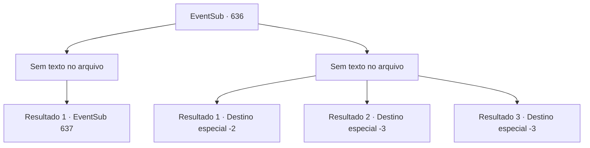

# Eventos secundários · 636

[Índice da tabela](index.md) · [Índice geral](../index.md)

ID: `pt:EventSub:636` · Fonte: `EventSub4` · Versão: 1.2.47.

Mapeamento estático dos arquivos; a disponibilidade e a execução dependem do estado da run.

## Texto do evento

*Sem texto no arquivo.*

## Dados de entrada

```json
{
  "id": 636,
  "grade": 1,
  "subEvent": "",
  "required": ""
}
```

## Mapa das escolhas



## Escolhas e resultados

### Escolha 1

*Sem texto no arquivo; o papel dessa opção depende da interface do jogo.*

Requisitos e outros campos da escolha:

```json
{
  "required": ""
}
```

#### Resultado 1.1

Sua cabeça se despedaçou, o golem de pedra vacila antes de desmoronar. Você guarda sua arma e olha ao redor. Alguns estão feridos, mas felizmente não há vítimas. |drawing_Osborne| Então, um homem, depois de assistir você lutar, se aproxima de você. Ele é um homem com um bigode impressionante e uma aparência curta e rechonchuda. Ele se aproxima lentamente de você, aplaudindo. 

 "Isso foi muito impressionante! Derrotar um golem de pedra, sozinho! Eu diria que é um feito e tanto. O vice-presidente da Veneprada reconhece você, aventureiro! Acredito que há incentivos especiais devidos! Diga-me, há algo que você deseja?"

 Você diz a ele que precisa de um momento para pensar e se aproxima de Edenheart. Edenheart ouve sua história e então lhe diz quem é o homem. Esse homem é 'Osborne', o vice-presidente da guilda de comerciantes da Veneprada, e também o responsável pela expedição-escavação. 

 "Acredito que podemos conseguir o que precisamos se aproveitarmos bem essa oportunidade..."


Continuação registrada: [Evento 637](0637.md) na mesma tabela.

```json
{
  "required": "",
  "chance": "1",
  "nextEvent": 637,
  "type": 2,
  "reward": ""
}
```

### Escolha 2

*Sem texto no arquivo; o papel dessa opção depende da interface do jogo.*

Requisitos e outros campos da escolha:

```json
{
  "required": ""
}
```

#### Resultado 2.1

Derrotado pelo golem de pedra, você foge das ruínas. 

 "{1}! Por aqui!"

 Você e Edenheart deixam as ruínas. Felizmente, ninguém os persegue, e quando os dois estão longe das ruínas, Edenheart suspira e continua. 

 "*suspiro*... Preciso voltar para Mavelaine por enquanto. Parece que preciso encontrar outro caminho."

 Você e Edenheart viajam para uma cidade próxima e se separam lá.

Continuação registrada: [Destino especial `-2`](../destinos-especiais.md).

```json
{
  "required": "1_0_2|1_1_2",
  "chance": "1",
  "nextEvent": -2,
  "type": 2,
  "reward": "0_0_-1|0_1_-1|12_10_10"
}
```

#### Resultado 2.2

O golem de pedra te golpeia com seus punhos de pedra pesados. Seu corpo é desmontado em pedaços de carne.

Continuação registrada: [Destino especial `-3`](../destinos-especiais.md).

```json
{
  "required": "2_0_2",
  "chance": "1",
  "nextEvent": -3,
  "type": 2,
  "reward": "0_0_-1|0_1_-1"
}
```

#### Resultado 2.3

O golem de pedra te golpeia com seus punhos de pedra pesados. Seu corpo é desmontado em pedaços de carne.

Continuação registrada: [Destino especial `-3`](../destinos-especiais.md).

```json
{
  "required": "2_1_2",
  "chance": "1",
  "nextEvent": -3,
  "type": 2,
  "reward": "0_0_-1|0_1_-1"
}
```

## Referências que chegam a este evento

- [Evento 635 · escolha 1 · resultado 1](0635.md#escolha-1)
- [Evento 635 · escolha 2 · resultado 1](0635.md#escolha-2)
- [Evento 635 · escolha 3 · resultado 1](0635.md#escolha-3)
- [Evento 641 · escolha 1 · resultado 1](0641.md#escolha-1)
- [Evento 641 · escolha 2 · resultado 1](0641.md#escolha-2)
