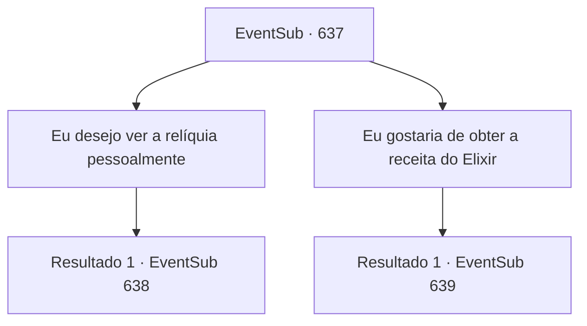

# Eventos secundários · 637

[Índice da tabela](index.md) · [Índice geral](../index.md)

ID: `pt:EventSub:637` · Fonte: `EventSub4` · Versão: 1.2.47.

Mapeamento estático dos arquivos; a disponibilidade e a execução dependem do estado da run.

## Texto do evento

*Sem texto no arquivo.*

## Dados de entrada

```json
{
  "id": 637,
  "grade": 1,
  "subEvent": "",
  "required": ""
}
```

## Mapa das escolhas



## Escolhas e resultados

### Escolha 1

Eu desejo ver a relíquia pessoalmente

Requisitos e outros campos da escolha:

```json
{
  "required": ""
}
```

#### Resultado 1.1

Você pergunta a Osborne que deseja ver as relíquias que foram encontradas na escavação. 

 "As relíquias? Hmph... bem, contanto que você não esteja planejando roubá-las. Tudo bem. Se isso lhe convém."

 Osborne, embora curioso com seu pedido, aceita. Mas a escavação ainda não terminou - sua chance de ver a relíquia virá à noite. 

 Tarde da noite, você e Edenheart entram em uma tenda, onde o pessoal da guilda está guardando as relíquias escavadas. Eles planejam guardar as relíquias na diligência depois de mantê-las dentro das tendas. 

 "Ah...! Essas são exatamente as que eu li nos roteiros! Graças aos deuses, elas ainda estão aqui."

 Como Edenheart disse, dentro da tenda há uma infinidade de scripts e gravações antigas. Ao estender a mão para tocar uma delas, um guarda, contratado por Veneprada, repreende você e declara que elas são apenas para os olhos. 

 "...O que devemos fazer, {1}?"

 Edenheart sussurra, espiando o guarda.

Continuação registrada: [Evento 638](0638.md) na mesma tabela.

```json
{
  "required": "",
  "chance": "1",
  "nextEvent": 638,
  "type": 2,
  "reward": ""
}
```

### Escolha 2

Eu gostaria de obter a receita do Elixir

Requisitos e outros campos da escolha:

```json
{
  "required": ""
}
```

#### Resultado 2.1

Você volta para Osborne e pede a receita do Elixir. Se ele é o responsável pela escavação, ele pode saber como fazer o Elixir. Ao ouvir esse pedido, Osborne franze a testa, aponta o dedo para você e grita. 

 "...Heh. Um flagrante de espionagem! Quem te mandou fazer isso? Alkan? Fanad? Ou outra guilda de comerciantes?"

 Parece haver um mal-entendido, mas ele não ouve. 

 "Chega. Não precisa ouvir. Ouçam, aventureiros! Recompensa adicional para quem se livrar deste espião!"

 Logo, os aventureiros te cercam e começam seu ataque.

Continuação registrada: [Evento 639](0639.md) na mesma tabela.

```json
{
  "required": "",
  "chance": "1",
  "nextEvent": 639,
  "type": 2,
  "reward": "6_2_62",
  "place": 5
}
```

## Referências que chegam a este evento

- [Evento 636 · escolha 1 · resultado 1](0636.md#escolha-1)
