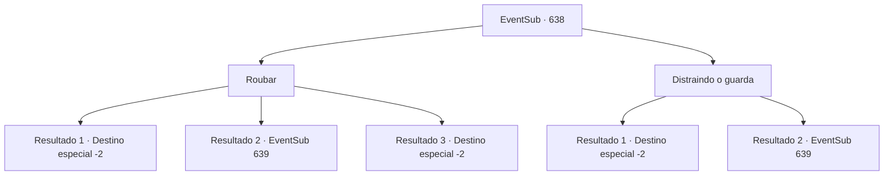

# Eventos secundários · 638

[Índice da tabela](index.md) · [Índice geral](../index.md)

ID: `pt:EventSub:638` · Fonte: `EventSub4` · Versão: 1.2.47.

Mapeamento estático dos arquivos; a disponibilidade e a execução dependem do estado da run.

## Texto do evento

*Sem texto no arquivo.*

## Dados de entrada

```json
{
  "id": 638,
  "grade": 1,
  "subEvent": "",
  "required": ""
}
```

## Mapa das escolhas



## Escolhas e resultados

### Escolha 1

Roubar

Requisitos e outros campos da escolha:

```json
{
  "required": ""
}
```

#### Resultado 1.1

Você silenciosamente guarda os roteiros e instrumentos, alheio aos olhos do guarda. Como uma sombra, você sai da tenda, mostrando a Edenheart o que conseguiu obter. Edenheart fica surpresa com sua habilidade - ela agradece a você. 

 "O quê?! Como você conseguiu...? Bem... de qualquer forma, obrigado, {1}! Sério! Com isso, posso continuar minha pesquisa!"

 Com seu objetivo cumprido, Edenheart lhe entrega um elixir do sábio como recompensa. Edenheart diz que agora voltará para Mavelaine, continuando sua pesquisa lá. Você promete que passará por Mavelaine para vê-la novamente e então seguem caminhos separados.

Continuação registrada: [Destino especial `-2`](../destinos-especiais.md).

```json
{
  "required": "21_5_4",
  "chance": "1|0_6_1",
  "nextEvent": -2,
  "type": 0,
  "reward": "3_100_1|12_10_4"
}
```

#### Resultado 1.2

Tentas roubar os roteiros e instrumentos, mas o guarda apanha-te em flagrante. Ele rapidamente apita o seu apito, alertando os aventureiros próximos. 

 "Ladrão! Apanhem-no!"

 Os aventureiros cercam-te e a Edenheart num instante. Edenheart está assustada, mas tu lutas contra os aventureiros, protegendo-a.

Continuação registrada: [Evento 639](0639.md) na mesma tabela.

```json
{
  "required": "21_5_4",
  "chance": "15",
  "nextEvent": 639,
  "type": 1,
  "reward": "6_3_62",
  "place": 14
}
```

#### Resultado 1.3

Você silenciosamente guarda os roteiros e instrumentos, alheio aos olhos do guarda. Como uma sombra, você sai da tenda, mostrando a Edenheart o que conseguiu obter. Edenheart fica surpresa com sua habilidade - ela agradece a você. 

 "O quê?! Quando você...? Ha- hahaha! Obrigado, {1}! Sério! Com isso, posso continuar minha pesquisa!"

 Com seu objetivo cumprido, Edenheart lhe entrega um elixir do sábio como recompensa. Edenheart diz que agora voltará para Mavelaine, continuando sua pesquisa lá. Você promete que passará por Mavelaine para vê-la novamente e então seguem caminhos separados.

Continuação registrada: [Destino especial `-2`](../destinos-especiais.md).

```json
{
  "required": "20_5_4",
  "chance": "1",
  "nextEvent": -2,
  "type": 2,
  "reward": "3_100_1|12_10_4"
}
```

### Escolha 2

Distraindo o guarda

Requisitos e outros campos da escolha:

```json
{
  "required": ""
}
```

#### Resultado 2.1

Sinalize Edenheart com os olhos e, em seguida, inicie uma conversa com o guarda. Surpreendentemente, ele é facilmente enganado pela sua habilidade de persuasão. Enquanto isso, Edenheart rapidamente pega o que precisa e já fez uma saída rápida. Fora da tenda, ela mostra as coisas que conseguiu obter. 

 "Obrigado, {1}! Consegui obter o que precisava! Com isso, acredito que posso continuar minha pesquisa!"

 Com seu objetivo alcançado, Edenheart lhe entrega um elixir do sábio como recompensa. Edenheart diz que agora retornará a Mavelaine, continuando sua pesquisa lá. Você promete que irá passar por Mavelaine para vê-la novamente e, em seguida, seguem caminhos separados.

Continuação registrada: [Destino especial `-2`](../destinos-especiais.md).

```json
{
  "required": "",
  "chance": "1|0_12_1",
  "nextEvent": -2,
  "type": 0,
  "reward": "3_100_1|12_10_4"
}
```

#### Resultado 2.2

Você sinaliza Edenheart com os olhos e então começa uma conversa com o guarda. O plano é para Edenheart conseguir o que ela precisa, enquanto você conversa com o guarda. Mas o guarda não é enganado. Ele rapidamente apita seu apito, alertando os aventureiros próximos. 

 "Ladrão! Peguem ele!"

 Os aventureiros cercam você e Edenheart em um instante. Edenheart está assustada, mas você luta contra os aventureiros, protegendo-a.

Continuação registrada: [Evento 639](0639.md) na mesma tabela.

```json
{
  "required": "",
  "chance": "15",
  "nextEvent": 639,
  "type": 1,
  "reward": "6_3_62",
  "place": 14
}
```

## Referências que chegam a este evento

- [Evento 637 · escolha 1 · resultado 1](0637.md#escolha-1)
