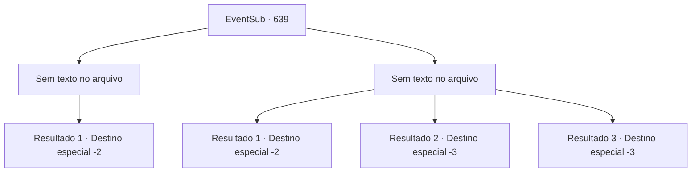

# Eventos secundários · 639

[Índice da tabela](index.md) · [Índice geral](../index.md)

ID: `pt:EventSub:639` · Fonte: `EventSub4` · Versão: 1.2.47.

Mapeamento estático dos arquivos; a disponibilidade e a execução dependem do estado da run.

## Texto do evento

*Sem texto no arquivo.*

## Dados de entrada

```json
{
  "id": 639,
  "grade": 1,
  "subEvent": "",
  "required": ""
}
```

## Mapa das escolhas



## Escolhas e resultados

### Escolha 1

*Sem texto no arquivo; o papel dessa opção depende da interface do jogo.*

Requisitos e outros campos da escolha:

```json
{
  "required": ""
}
```

#### Resultado 1.1

Você quebra a formação dos aventureiros, derrotando cada um deles. Vantagem em números? Táticas superiores? Tudo isso foi insignificante diante do poder devastador. 

 "Vamos sair daqui, {1}!"

 Edenheart grita, depois de coletar os roteiros e instrumentos necessários enquanto você estava ocupado lutando. Você e Edenheart saem apressadamente das ruínas. 

 "Obrigado, {1}! Eu consegui o que precisava! Com isso, acredito que posso continuar minha pesquisa!"

 Com seu objetivo alcançado, Edenheart lhe entrega um elixir do sábio como recompensa. Edenheart diz que agora voltará para Mavelaine, continuando sua pesquisa lá. Você promete que irá visitá-la novamente em Mavelaine e então seguem caminhos separados.

Continuação registrada: [Destino especial `-2`](../destinos-especiais.md).

```json
{
  "required": "",
  "chance": "1",
  "nextEvent": -2,
  "type": 2,
  "reward": "3_100_1|12_10_4"
}
```

### Escolha 2

*Sem texto no arquivo; o papel dessa opção depende da interface do jogo.*

Requisitos e outros campos da escolha:

```json
{
  "required": ""
}
```

#### Resultado 2.1

Tudo o que você consegue fazer contra um exército de aventureiros é romper sua formação e criar uma janela de fuga. Você consegue sair da tenda e você e Edenheart fogem das ruínas. 

 "{1}! Aqui, por aqui!"

 Felizmente, não há mais perseguição. Depois que vocês dois estão longe das ruínas, Edenheart suspira e fala. 

 "*suspiro*... Eu devo voltar para Mavelaine agora. Parece que devo fazer isso sozinho, por mim mesmo."

 Você e Edenheart viajam para uma cidade próxima e se separam lá.

Continuação registrada: [Destino especial `-2`](../destinos-especiais.md).

```json
{
  "required": "1_0_2|1_1_2",
  "chance": "1",
  "nextEvent": -2,
  "type": 2,
  "reward": "0_0_-1|0_1_-1|12_10_10"
}
```

#### Resultado 2.2


 "{1}! Não!"

 Uma ponta de lança perfura o seu corpo. Sangue carmesim respinga na tenda, e você é forçado a se ajoelhar enquanto tudo escurece. A morte cai sobre você, enquanto os gritos de Edenheart começam a ficar silenciosos.

Continuação registrada: [Destino especial `-3`](../destinos-especiais.md).

```json
{
  "required": "2_0_2",
  "chance": "1",
  "nextEvent": -3,
  "type": 2,
  "reward": "0_0_-1|0_1_-1"
}
```

#### Resultado 2.3


 "{1}! Não!"

 Uma ponta de lança perfura o seu corpo. Sangue carmesim respinga na tenda, e você é forçado a se ajoelhar enquanto tudo escurece. A morte cai sobre você, enquanto os gritos de Edenheart começam a ficar silenciosos.

Continuação registrada: [Destino especial `-3`](../destinos-especiais.md).

```json
{
  "required": "2_1_2",
  "chance": "1",
  "nextEvent": -3,
  "type": 2,
  "reward": "0_0_-1|0_1_-1"
}
```

## Referências que chegam a este evento

- [Evento 637 · escolha 2 · resultado 1](0637.md#escolha-2)
- [Evento 638 · escolha 1 · resultado 2](0638.md#escolha-1)
- [Evento 638 · escolha 2 · resultado 2](0638.md#escolha-2)
