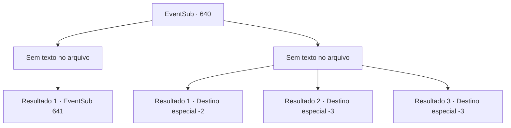

# Eventos secundários · 640

[Índice da tabela](index.md) · [Índice geral](../index.md)

ID: `pt:EventSub:640` · Fonte: `EventSub4` · Versão: 1.2.47.

Mapeamento estático dos arquivos; a disponibilidade e a execução dependem do estado da run.

## Texto do evento

*Sem texto no arquivo.*

## Dados de entrada

```json
{
  "id": 640,
  "grade": 1,
  "subEvent": "",
  "required": ""
}
```

## Mapa das escolhas



## Escolhas e resultados

### Escolha 1

*Sem texto no arquivo; o papel dessa opção depende da interface do jogo.*

Requisitos e outros campos da escolha:

```json
{
  "required": ""
}
```

#### Resultado 1.1

Você ataca o guarda mais uma vez, nocauteando-o de vez desta vez. Enquanto você guarda sua arma, Edenheart pergunta com uma voz preocupada. 

 "Uh, não tenho certeza se isso foi a coisa certa a fazer, {1}."

 Então, um som de explosão vem das ruínas. Você não tem ideia do que está acontecendo, mas pode ouvir pessoas gritando e algumas até fugindo. Você dá uma olhada na origem do tumulto, depois de sair das ruínas. Parece ser o centro do local, coberto de poeira.

Continuação registrada: [Evento 641](0641.md) na mesma tabela.

```json
{
  "required": "",
  "chance": "1",
  "nextEvent": 641,
  "type": 2,
  "reward": ""
}
```

### Escolha 2

*Sem texto no arquivo; o papel dessa opção depende da interface do jogo.*

Requisitos e outros campos da escolha:

```json
{
  "required": ""
}
```

#### Resultado 2.1

O guarda te domina. Tudo o que você pode fazer agora é fugir com Edenheart. 

 "{1}! Aqui, por aqui!"

 Felizmente, não há mais perseguição. Depois que vocês dois estão longe das ruínas, Edenheart suspira e fala. 

 "*suspiro*... Eu devo voltar para Mavelaine agora. Parece que devo fazer isso sozinho, por mim mesmo."

 Você e Edenheart viajam para uma cidade próxima e se separam lá.

Continuação registrada: [Destino especial `-2`](../destinos-especiais.md).

```json
{
  "required": "1_0_2|1_1_2",
  "chance": "1",
  "nextEvent": -2,
  "type": 2,
  "reward": "0_0_-1|0_1_-1|12_10_10"
}
```

#### Resultado 2.2

O guarda desarma você com sua lança. Não parando por aí, ele corta seu peito com ela. 

 "{1}! Não!"

 Sangue carmesim respinga no chão, e você é forçado a se ajoelhar enquanto tudo escurece. A morte cai sobre você, enquanto os gritos de Edenheart começam a ficar silenciosos.

Continuação registrada: [Destino especial `-3`](../destinos-especiais.md).

```json
{
  "required": "2_0_2",
  "chance": "1",
  "nextEvent": -3,
  "type": 2,
  "reward": "0_0_-1|0_1_-1"
}
```

#### Resultado 2.3

O guarda desarma você com sua lança. Não parando por aí, ele corta seu peito com ela. 

 "{1}! Não!"

 Sangue carmesim respinga no chão, e você é forçado a se ajoelhar enquanto tudo escurece. A morte cai sobre você, enquanto os gritos de Edenheart começam a ficar silenciosos.

Continuação registrada: [Destino especial `-3`](../destinos-especiais.md).

```json
{
  "required": "2_1_2",
  "chance": "1",
  "nextEvent": -3,
  "type": 2,
  "reward": "0_0_-1|0_1_-1"
}
```

## Referências que chegam a este evento

- [Evento 635 · escolha 1 · resultado 2](0635.md#escolha-1)
