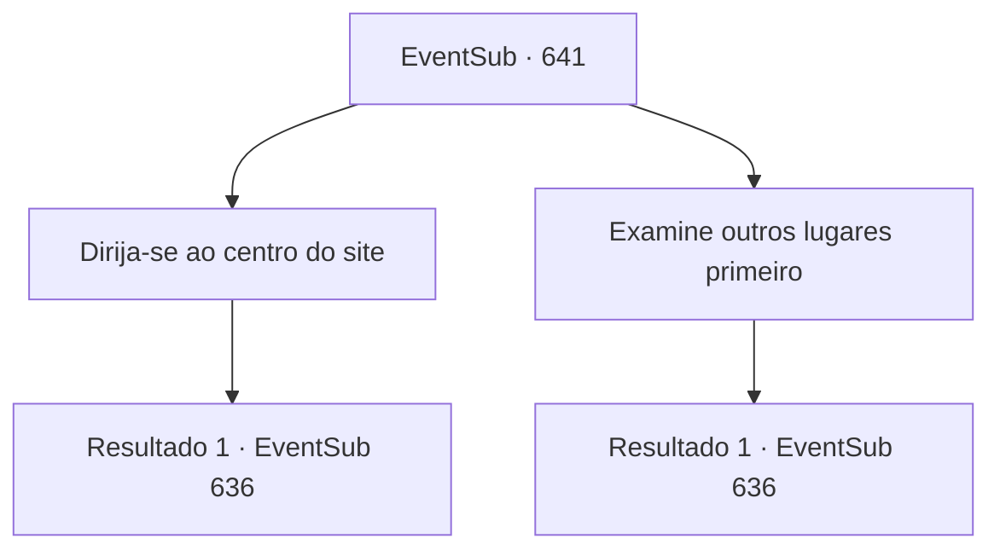

# Eventos secundários · 641

[Índice da tabela](index.md) · [Índice geral](../index.md)

ID: `pt:EventSub:641` · Fonte: `EventSub4` · Versão: 1.2.47.

Mapeamento estático dos arquivos; a disponibilidade e a execução dependem do estado da run.

## Texto do evento

*Sem texto no arquivo.*

## Dados de entrada

```json
{
  "id": 641,
  "grade": 1,
  "subEvent": "",
  "required": ""
}
```

## Mapa das escolhas



## Escolhas e resultados

### Escolha 1

Dirija-se ao centro do site

Requisitos e outros campos da escolha:

```json
{
  "required": ""
}
```

#### Resultado 1.1

Você e Edenheart dirigem-se ao centro das ruínas. Lá, você vê um golem de pedra - acabado de emergir do subsolo, pelo que parece. O golem de pedra está atacando todos na vizinhança, balançando seus punhos. Alguns aventureiros tentam revidar, mas não são páreo. 

 "Novo intruso detectado. Visitante não autorizado. Iniciar ataque."

 O golem de pedra vira-se para você e ataca.

Continuação registrada: [Evento 636](0636.md) na mesma tabela.

```json
{
  "required": "",
  "chance": "1",
  "nextEvent": 636,
  "type": 2,
  "reward": "6_0_15",
  "place": 5
}
```

### Escolha 2

Examine outros lugares primeiro

Requisitos e outros campos da escolha:

```json
{
  "required": ""
}
```

#### Resultado 2.1

Você decide evitar o centro das ruínas por enquanto. Então, você encontra uma tenda colocada perto da entrada. Na tenda há um símbolo de Veneprada, mas não há ninguém por perto. Dentro da tenda há uma mesa com um mapa das ruínas em cima dela, e uma caixa de madeira cheia de várias ferramentas. Edenheart dá uma olhada no mapa e fala. 

 "Hm... parece que devemos nos aventurar no centro das ruínas. Está marcado aqui no mapa - o laboratório de elixir deve estar localizado lá."

 Você e Edenheart seguem para o centro das ruínas. O golem de pedra ainda está lá, guardando o caminho. Ele ataca assim que te vê. 

 "Novo intruso detectado. Visitante não autorizado. Iniciar ataque."


Continuação registrada: [Evento 636](0636.md) na mesma tabela.

```json
{
  "required": "",
  "chance": "1",
  "nextEvent": 636,
  "type": 2,
  "reward": "6_0_15",
  "place": 5
}
```

## Referências que chegam a este evento

- [Evento 640 · escolha 1 · resultado 1](0640.md#escolha-1)
