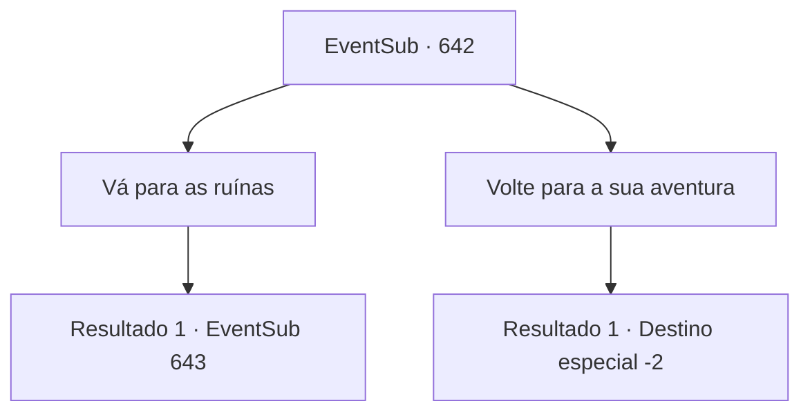

# Eventos secundários · 642

[Índice da tabela](index.md) · [Índice geral](../index.md)

ID: `pt:EventSub:642` · Fonte: `EventSub4` · Versão: 1.2.47.

Mapeamento estático dos arquivos; a disponibilidade e a execução dependem do estado da run.

## Texto do evento

Enquanto se aventura, ouve-se um estranho rumor. Aparentemente, as Ruínas de Plasphere são assombradas por um terrível espectro. De acordo com o rumor, mais de dez pessoas já pereceram por causa do espectro.

## Dados de entrada

```json
{
  "id": 642,
  "grade": 1,
  "subEvent": "",
  "required": "12_10_7"
}
```

## Mapa das escolhas



## Escolhas e resultados

### Escolha 1

Vá para as ruínas

Requisitos e outros campos da escolha:

```json
{
  "required": ""
}
```

#### Resultado 1.1

Você se dirige em direção às Ruínas de Plasphere. 

 Já faz muito tempo desde a última vez que você visitou as ruínas - o lugar parece um pouco diferente. A entrada das ruínas está guardada por tendas de Veneprada, com membros da guilda circulando. Ao tentar entrar nas ruínas, um guarda robusto e musculoso bloqueia seu caminho. 

 "Pare. Este lugar é propriedade da guilda de comerciantes Veneprada."


Continuação registrada: [Evento 643](0643.md) na mesma tabela.

```json
{
  "required": "",
  "chance": "1",
  "nextEvent": 643,
  "type": 2,
  "reward": ""
}
```

### Escolha 2

Volte para a sua aventura

Requisitos e outros campos da escolha:

```json
{
  "required": ""
}
```

#### Resultado 2.1

Isto não tem nada a ver com você. Volte para a sua aventura.

Continuação registrada: [Destino especial `-2`](../destinos-especiais.md).

```json
{
  "required": "",
  "chance": "1",
  "nextEvent": -2,
  "type": 2,
  "reward": "12_10_-1|14_10_4|14_10_10"
}
```

## Referências que chegam a este evento

Nenhum `nextEvent` positivo da mesma tabela aponta para este nó. Isso não prova que seja inacessível: sorteio e estado de história podem selecioná-lo.

