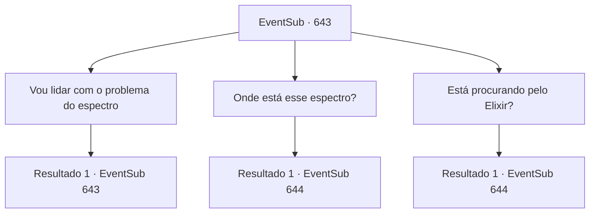

# Eventos secundários · 643

[Índice da tabela](index.md) · [Índice geral](../index.md)

ID: `pt:EventSub:643` · Fonte: `EventSub4` · Versão: 1.2.47.

Mapeamento estático dos arquivos; a disponibilidade e a execução dependem do estado da run.

## Texto do evento

*Sem texto no arquivo.*

## Dados de entrada

```json
{
  "id": 643,
  "grade": 1,
  "subEvent": "",
  "required": ""
}
```

## Mapa das escolhas



## Escolhas e resultados

### Escolha 1

Vou lidar com o problema do espectro

Requisitos e outros campos da escolha:

```json
{
  "required": "5_602_0"
}
```

#### Resultado 1.1

Você diz a ele que está aqui para ajudar com o problema do espectro. Ao ouvir sua resposta, o guarda pensa um pouco antes de levá-lo para uma tenda próxima. Dentro da tenda, há um grupo de trabalhadores vestidos levemente. 

 "... Uau! Você realmente vai nos ajudar? Agradeça aos céus! Aquele bastardo do Osborne não dá a mínima para esse espectro! Estávamos até pensando em fugir!"

 Depois de ouvir o guarda, os trabalhadores todos agradecem a você, inclinando a cabeça. Os trabalhadores todos parecem ter medo de algo - isso fica evidente em seus rostos.

Continuação registrada: [Evento 643](0643.md) na mesma tabela.

```json
{
  "required": "",
  "chance": "1",
  "nextEvent": 643,
  "type": 2,
  "reward": "5_602_1"
}
```

### Escolha 2

Onde está esse espectro?

Requisitos e outros campos da escolha:

```json
{
  "required": "5_602_1"
}
```

#### Resultado 2.1

O mais velho dos trabalhadores responde a você. Para ser preciso, o espectro se manifesta no centro das ruínas, o lugar que parece um laboratório. Se ele está certo, esse deve ser o lugar que você e Edenheart descobriram. O trabalhador fecha os olhos enquanto fala, como se apenas lembrar disso o deixasse desconfortável. 

 "O espectro matou TODOS que colocaram os pés lá dentro, murmurando algo em uma língua que nunca ouvimos antes! Parecia uma maldição, entendeu! Por favor! Livre-se desse espírito maldito!"


Continuação registrada: [Evento 644](0644.md) na mesma tabela.

```json
{
  "required": "",
  "chance": "1",
  "nextEvent": 644,
  "type": 2,
  "reward": ""
}
```

### Escolha 3

Está procurando pelo Elixir?

Requisitos e outros campos da escolha:

```json
{
  "required": "5_602_1|1_14_12"
}
```

#### Resultado 3.1

Você pergunta aos trabalhadores se eles estão procurando o Elixir. 

 "Bem... Eu mesmo não tenho certeza, mas ouvi Osborne murmurando algo sobre um elixir."

 Ele acrescenta que o espectro se manifesta no centro das ruínas, no lugar que parece um laboratório. Se isso for verdade, deve ser o lugar que você e Edenheart descobriram. O trabalhador fecha os olhos enquanto fala, como se apenas lembrar disso o deixasse desconfortável. 

 "O espectro matou TODOS que colocaram os pés lá dentro, murmurando algo em uma língua que nunca ouvimos! Parecia uma maldição, entendeu! Por favor! Livre-se desse maldito espírito!"


Continuação registrada: [Evento 644](0644.md) na mesma tabela.

```json
{
  "required": "",
  "chance": "1",
  "nextEvent": 644,
  "type": 2,
  "reward": ""
}
```

## Referências que chegam a este evento

- [Evento 642 · escolha 1 · resultado 1](0642.md#escolha-1)
- [Evento 643 · escolha 1 · resultado 1](0643.md#escolha-1)
