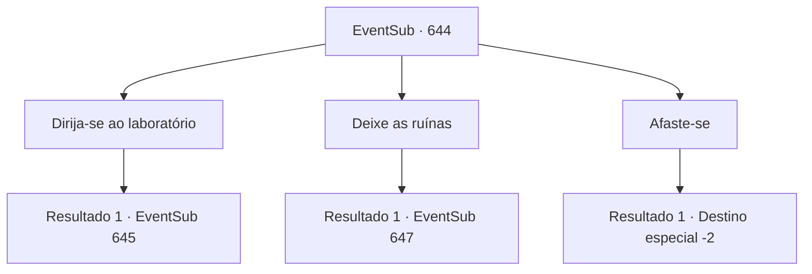

# Eventos secundários · 644

[Índice da tabela](index.md) · [Índice geral](../index.md)

ID: `pt:EventSub:644` · Fonte: `EventSub4` · Versão: 1.2.47.

Mapeamento estático dos arquivos; a disponibilidade e a execução dependem do estado da run.

## Texto do evento

*Sem texto no arquivo.*

## Dados de entrada

```json
{
  "id": 644,
  "grade": 1,
  "subEvent": "",
  "required": ""
}
```

## Mapa das escolhas



## Escolhas e resultados

### Escolha 1

Dirija-se ao laboratório

Requisitos e outros campos da escolha:

```json
{
  "required": ""
}
```

#### Resultado 1.1

Você aceita o pedido dos trabalhadores, dirigindo-se ao centro das ruínas. Lá está a entrada do laboratório - assim como da última vez que você veio aqui. Você caminha cuidadosamente pelo corredor mais uma vez. 

 <link=wave>'sssssshhhh....'</link> 

 Após cerca de dez minutos de caminhada, você encontra uma figura negra assustadora, acompanhada de uma rajada de vento gelado. É um espectro maligno, com o rosto de Edenheart. Seus olhos estão ensanguentados, e ela está murmurando algo repetidamente. Então, com uma adaga afiada em sua mão, ela avança em sua direção.

Continuação registrada: [Evento 645](0645.md) na mesma tabela.

```json
{
  "required": "",
  "chance": "1",
  "nextEvent": 645,
  "type": 2,
  "reward": "6_0_163",
  "place": 7
}
```

### Escolha 2

Deixe as ruínas

Requisitos e outros campos da escolha:

```json
{
  "required": ""
}
```

#### Resultado 2.1

Você aconselha os trabalhadores a deixarem as ruínas. Se o problema do espectro não for resolvido, deixar o local deve ser a única solução restante. Conflitados com seu conselho, os trabalhadores hesitam alguns minutos antes de finalmente decidirem arrumar suas coisas. Então, um homem irritado entra na tenda. É Osborne, o vice-presidente da guilda de comerciantes Veneprada. 

 "Você ousa tentar fugir enquanto estou ausente? Vocês parasitas gananciosos!"

 Mas então, sua raiva é direcionada a você. Embora curto e rechonchudo, sua voz é intimidadora. 

 "HAH! Se não é o aventureiro que vi da última vez. Você tem a menor ideia de quanto ouro foi gasto no negócio do elixir?! Quem é VOCÊ para decidir se os trabalhadores devem sair ou não?"


Continuação registrada: [Evento 647](0647.md) na mesma tabela.

```json
{
  "required": "",
  "chance": "1",
  "nextEvent": 647,
  "type": 2,
  "reward": ""
}
```

### Escolha 3

Afaste-se

Requisitos e outros campos da escolha:

```json
{
  "required": ""
}
```

#### Resultado 3.1

Os trabalhadores imploram por sua ajuda, mas você sai da tenda e finalmente também das ruínas.

Continuação registrada: [Destino especial `-2`](../destinos-especiais.md).

```json
{
  "required": "",
  "chance": "1",
  "nextEvent": -2,
  "type": 2,
  "reward": "12_10_-1|14_10_4|14_10_10"
}
```

## Referências que chegam a este evento

- [Evento 643 · escolha 2 · resultado 1](0643.md#escolha-2)
- [Evento 643 · escolha 3 · resultado 1](0643.md#escolha-3)
