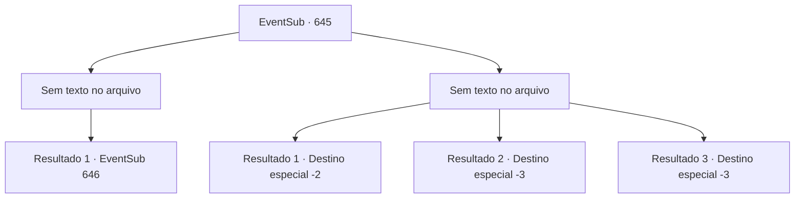

# Eventos secundários · 645

[Índice da tabela](index.md) · [Índice geral](../index.md)

ID: `pt:EventSub:645` · Fonte: `EventSub4` · Versão: 1.2.47.

Mapeamento estático dos arquivos; a disponibilidade e a execução dependem do estado da run.

## Texto do evento

*Sem texto no arquivo.*

## Dados de entrada

```json
{
  "id": 645,
  "grade": 1,
  "subEvent": "",
  "required": ""
}
```

## Mapa das escolhas



## Escolhas e resultados

### Escolha 1

*Sem texto no arquivo; o papel dessa opção depende da interface do jogo.*

Requisitos e outros campos da escolha:

```json
{
  "required": ""
}
```

#### Resultado 1.1

Seus ataques enfraquecem o espectro de Edenheart, mas ela continua voltando. Em vez disso, à medida que o tempo passa, parece que ela está recuperando sua força. Finalmente, você percebe que precisa usar algo além de força para se livrar dela.

Continuação registrada: [Evento 646](0646.md) na mesma tabela.

```json
{
  "required": "",
  "chance": "1",
  "nextEvent": 646,
  "type": 2,
  "reward": ""
}
```

### Escolha 2

*Sem texto no arquivo; o papel dessa opção depende da interface do jogo.*

Requisitos e outros campos da escolha:

```json
{
  "required": ""
}
```

#### Resultado 2.1

Parece que o espectro está obcecado com algo que você tem. Infelizmente, incapaz de resistir aos ataques do espectro, você deixa as ruínas. O espectro te persegue do lado de fora, mas logo se dissipa no ar.

Continuação registrada: [Destino especial `-2`](../destinos-especiais.md).

```json
{
  "required": "1_0_2|1_1_2",
  "chance": "1",
  "nextEvent": -2,
  "type": 2,
  "reward": "0_0_-1|0_1_-1|12_10_-1|14_10_4|14_10_10"
}
```

#### Resultado 2.2

A adaga do espectro perfura o seu coração. Você sente uma dor imensa, como se sua própria alma estivesse sendo despedaçada, enquanto perde a consciência.

Continuação registrada: [Destino especial `-3`](../destinos-especiais.md).

```json
{
  "required": "2_0_2",
  "chance": "1",
  "nextEvent": -3,
  "type": 2,
  "reward": "0_0_-1|0_1_-1"
}
```

#### Resultado 2.3

A adaga do espectro perfura o seu coração. Você sente uma dor imensa, como se sua própria alma estivesse sendo despedaçada, enquanto perde a consciência.

Continuação registrada: [Destino especial `-3`](../destinos-especiais.md).

```json
{
  "required": "2_1_2",
  "chance": "1",
  "nextEvent": -3,
  "type": 2,
  "reward": "0_0_-1|0_1_-1"
}
```

## Referências que chegam a este evento

- [Evento 644 · escolha 1 · resultado 1](0644.md#escolha-1)
