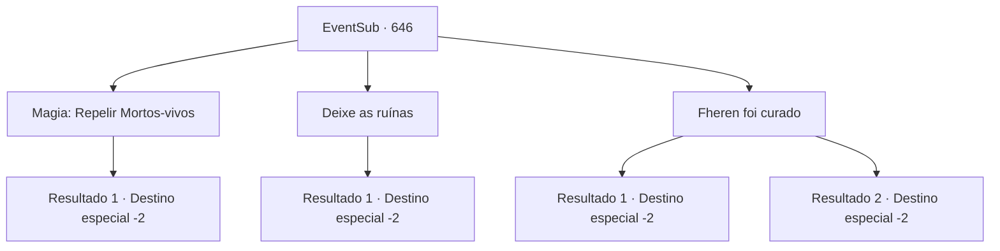

# Eventos secundários · 646

[Índice da tabela](index.md) · [Índice geral](../index.md)

ID: `pt:EventSub:646` · Fonte: `EventSub4` · Versão: 1.2.47.

Mapeamento estático dos arquivos; a disponibilidade e a execução dependem do estado da run.

## Texto do evento

*Sem texto no arquivo.*

## Dados de entrada

```json
{
  "id": 646,
  "grade": 1,
  "subEvent": "",
  "required": ""
}
```

## Mapa das escolhas



## Escolhas e resultados

### Escolha 1

Magia: Repelir Mortos-vivos

Requisitos e outros campos da escolha:

```json
{
  "required": "20_0_1|20_3_1"
}
```

#### Resultado 1.1

Você purifica o espectro com força sagrada. Cercada pela luz, ela desaparece lentamente no nada. A única coisa que resta é a adaga - torta, assustadora, estranha. Você murmura suas orações por Edenheart e sai do laboratório. Então, um rosto familiar se aproxima de você. 

 "Ouvi dizer que alguém resolveu o problema do espectro enquanto eu estava fora. Não sabia que era você! Pelo que parece, você lidou com isso de maneira adequada e correta!"

 É o Osborne. Depois de arrumar seu bigode, ele joga uma bolsa de ouro para você. 

 "Bom trabalho. Um símbolo pessoal de gratidão de mim, pessoalmente."

 Ele então volta a comandar os trabalhadores. Você pega a bolsa de ouro, passa por Osborne e sai das ruínas.

Continuação registrada: [Destino especial `-2`](../destinos-especiais.md).

```json
{
  "required": "",
  "chance": "1",
  "nextEvent": -2,
  "type": 2,
  "reward": "0_2_1|0_3_1|3_296_1|0_4_100|12_10_-1|14_10_5|14_10_10"
}
```

### Escolha 2

Deixe as ruínas

Requisitos e outros campos da escolha:

```json
{
  "required": ""
}
```

#### Resultado 2.1

Infelizmente, você não tem o que é necessário para lidar adequadamente com um espectro. Ai de você, foge do laboratório. Então, um rosto familiar se aproxima de você. 

 "Ouvi dizer que alguém veio lidar com o problema do espectro. Não sabia que era você."

 É o Osborne. Ele te examina de cima a baixo, franzindo a testa e estalando a língua. 

 "Tsk. Julgando pela aparência, você falhou miseravelmente. A guilda cuidará disso daqui em diante. Saia. Não há torta para você aqui."

 Ele então ordena que seus homens se preparem para algo. Você passa por Osborne e deixa as ruínas.

Continuação registrada: [Destino especial `-2`](../destinos-especiais.md).

```json
{
  "required": "",
  "chance": "1",
  "nextEvent": -2,
  "type": 2,
  "reward": "12_10_-1|14_10_6|14_10_10"
}
```

### Escolha 3

Fheren foi curado

Requisitos e outros campos da escolha:

```json
{
  "required": ""
}
```

#### Resultado 3.1

Você mente para Edenheart, que Fheren foi curado de sua doença. O espectro de Edenheart está paralisado - como se o tempo tivesse parado. Depois de olhar para você por um longo tempo, ela acena com a cabeça e fala. 

 "...Eu vejo. Eu vejo. Eu não acho que você está mentindo para mim... Que alívio... que... alívio...."

 Ela se dissipa no ar, lamentando. A única coisa que resta é a adaga - torta, sinistra, estranha. Você murmura suas orações por Edenheart e sai do laboratório. Então, um rosto familiar se aproxima de você. 

 "Ouvi dizer que alguém resolveu o problema do espectro enquanto eu estava fora. Não sabia que era você! Pelo que parece, você lidou com isso de maneira adequada!"

 É Osborne. Depois de arrumar seu bigode, ele joga uma bolsa de ouro para você. 

 "Bom trabalho. Um sinal pessoal de gratidão de mim, pessoalmente."

 Ele então volta a comandar os trabalhadores. Você pega a bolsa de ouro, passa por Osborne e sai das ruínas.

Continuação registrada: [Destino especial `-2`](../destinos-especiais.md).

```json
{
  "required": "",
  "chance": "1|0_12_1",
  "nextEvent": -2,
  "type": 0,
  "reward": "0_2_1|0_3_1|3_296_1|0_4_100|12_10_-1|14_10_5|14_10_10"
}
```

#### Resultado 3.2

Você mente para Edenheart, que Fheren foi curado de sua doença. O espectro de Edenheart está paralisado – como se o tempo tivesse parado. Depois de ficar olhando para você por um longo tempo, ela solta um grito furioso e grita. <color=red>

 "Mentiras.LIES.LIES.LIES.LIES.LIES.LIES.LIES.LIES.LIES.LIES.LIES.LIES.LIES.LIES.LIES.LIES.LIES.LIES.LIES.LIES."

</color> Você é perseguido pelo espectro, fora das ruínas. Então, um rosto familiar se aproxima de você. 

 "Ouvi dizer que alguém veio lidar com o problema do espectro. Não sabia que era você."

 É Osborne. Ele examina você de cima a baixo, franze a testa e estala a língua. 

 "Tsk. A julgar pela aparência, você falhou miseravelmente. A guilda lidará com isso a partir daqui. Sair. Não há torta para você aqui."

 Ele então ordena que seus homens se preparem para algo. Você passa por Osborne e sai das ruínas.

Continuação registrada: [Destino especial `-2`](../destinos-especiais.md).

```json
{
  "required": "",
  "chance": "16",
  "nextEvent": -2,
  "type": 1,
  "reward": "12_10_-1|14_10_6|14_10_10"
}
```

## Referências que chegam a este evento

- [Evento 645 · escolha 1 · resultado 1](0645.md#escolha-1)
