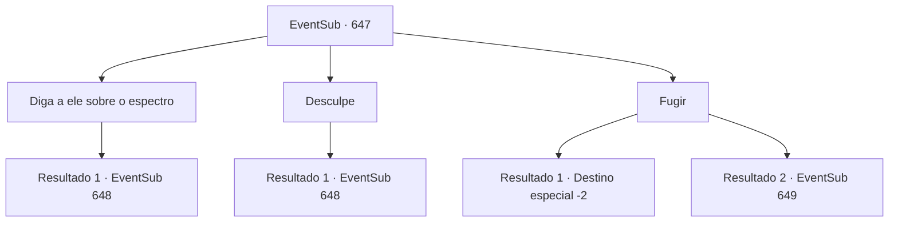

# Eventos secundários · 647

[Índice da tabela](index.md) · [Índice geral](../index.md)

ID: `pt:EventSub:647` · Fonte: `EventSub4` · Versão: 1.2.47.

Mapeamento estático dos arquivos; a disponibilidade e a execução dependem do estado da run.

## Texto do evento

*Sem texto no arquivo.*

## Dados de entrada

```json
{
  "id": 647,
  "grade": 1,
  "subEvent": "",
  "required": ""
}
```

## Mapa das escolhas



## Escolhas e resultados

### Escolha 1

Diga a ele sobre o espectro

Requisitos e outros campos da escolha:

```json
{
  "required": ""
}
```

#### Resultado 1.1

Você conta a Osborne sobre o problema do espectro. Mas o rosto dele não se mexe nem um pouco. Osborne aponta o dedo para você, gritando furiosamente. 

 "Você sabe o que é mais assustador do que espectros insignificantes? DINHEIRO! OURO!! SEU IDIOTA BURRO!!"

 Após te encher de insultos e maldições, ele exige que você pague pela interrupção dos negócios. Ele exige que você pague a ele 1677 ouro.

Continuação registrada: [Evento 648](0648.md) na mesma tabela.

```json
{
  "required": "",
  "chance": "1",
  "nextEvent": 648,
  "type": 2,
  "reward": ""
}
```

### Escolha 2

Desculpe

Requisitos e outros campos da escolha:

```json
{
  "required": ""
}
```

#### Resultado 2.1

Você se desculpa educadamente com Osborne. Mas seu rosto não se mexe nem um pouco. Osborne aponta o dedo para você, gritando furiosamente. 

 "Ha! Você acha que um PEDIDO DE DESCULPAS pode desfazer o que foi feito? Você é um aventureiro idiota!"

 Depois de te encher de insultos e maldições, ele exige que você pague pela interrupção dos negócios. Ele exige que você lhe pague 1677 ouros.

Continuação registrada: [Evento 648](0648.md) na mesma tabela.

```json
{
  "required": "",
  "chance": "1",
  "nextEvent": 648,
  "type": 2,
  "reward": ""
}
```

### Escolha 3

Fugir

Requisitos e outros campos da escolha:

```json
{
  "required": ""
}
```

#### Resultado 3.1

Em vez de convencê-lo, você decide fugir. 

 "Oh, não vai não! Peguem ele!"

 Obviamente, Osborne não quer que você escape. Ele ordena que seus homens te persigam, e a perseguição dura uma hora. Mas sua agilidade é melhor do que a capacidade deles de perseguir. Depois de muito tempo, os homens leais de Osborne finalmente desistem da perseguição também.

Continuação registrada: [Destino especial `-2`](../destinos-especiais.md).

```json
{
  "required": "",
  "chance": "1|0_6_1",
  "nextEvent": -2,
  "type": 0,
  "reward": "0_2_1|12_10_-1|14_10_6|14_10_10"
}
```

#### Resultado 3.2

Em vez de convencê-lo, você decide fugir. 

 "Oh, não vai não! Peguem ele!"

 Obviamente, Osborne não quer que você escape. Ele ordena que seus homens te persigam, e você é pego instantaneamente. 

 "Eu suponho que agora seja um bom momento para ensinar uma lição a esses parasitas. Esmaguem todos eles."

 Os homens de Osborne alcançam suas armas, iniciando o ataque.

Continuação registrada: [Evento 649](0649.md) na mesma tabela.

```json
{
  "required": "",
  "chance": "15",
  "nextEvent": 649,
  "type": 1,
  "reward": "6_3_62",
  "place": 5
}
```

## Referências que chegam a este evento

- [Evento 644 · escolha 2 · resultado 1](0644.md#escolha-2)
