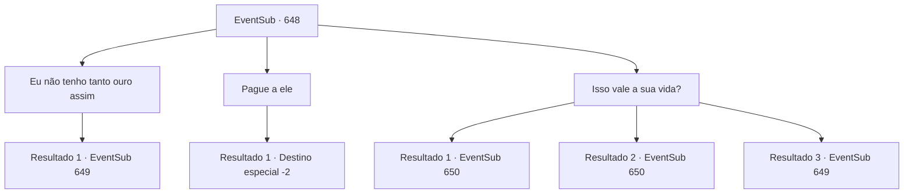

# Eventos secundários · 648

[Índice da tabela](index.md) · [Índice geral](../index.md)

ID: `pt:EventSub:648` · Fonte: `EventSub4` · Versão: 1.2.47.

Mapeamento estático dos arquivos; a disponibilidade e a execução dependem do estado da run.

## Texto do evento

*Sem texto no arquivo.*

## Dados de entrada

```json
{
  "id": 648,
  "grade": 1,
  "subEvent": "",
  "required": ""
}
```

## Mapa das escolhas



## Escolhas e resultados

### Escolha 1

Eu não tenho tanto ouro assim

Requisitos e outros campos da escolha:

```json
{
  "required": ""
}
```

#### Resultado 1.1

Você balança a cabeça, dizendo que não tem tanto ouro com você. Osborne responde assobiando para seus capangas. Os capangas de Osborne, agora reunidos dentro da tenda, começam a cercar você. 

 "Suponho que agora seja um bom momento para ensinar uma lição a esses parasitas. Esmaguem todos eles."

 Os homens de Osborne alcançam suas armas, iniciando seu ataque.

Continuação registrada: [Evento 649](0649.md) na mesma tabela.

```json
{
  "required": "",
  "chance": "1",
  "nextEvent": 649,
  "type": 2,
  "reward": "6_3_62",
  "place": 5
}
```

### Escolha 2

Pague a ele

Requisitos e outros campos da escolha:

```json
{
  "required": "1_4_1677"
}
```

#### Resultado 2.1

Você paga a Osborne, pedindo desculpas mais uma vez. Ele conta as moedas de ouro uma por uma e finalmente levanta os lábios, como se estivesse satisfeito. 

 "Hmph! Se você tentar isso mais uma vez, não vai acabar assim."

 Ele então reúne seus homens, fazendo a mesma exigência aos trabalhadores. Os trabalhadores protestam no início, mas logo são intimidados pelos capangas de Osborne. Você deixa as ruínas, segurando seus bolsos vazios.

Continuação registrada: [Destino especial `-2`](../destinos-especiais.md).

```json
{
  "required": "",
  "chance": "1",
  "nextEvent": -2,
  "type": 2,
  "reward": "0_4_-1677|12_10_-1|14_10_6|14_10_10"
}
```

### Escolha 3

Isso vale a sua vida?

Requisitos e outros campos da escolha:

```json
{
  "required": ""
}
```

#### Resultado 3.1

Você intimida Osborne, emitindo uma aura de hostilidade. Sentindo-se ameaçado, Osborne evita o seu olhar, reclamando. 

 "A... ahem. Deixa pra lá."

 Após encarar Osborne com raiva, você se vira para encarar os trabalhadores na tenda. Eles estão te encarando em silêncio, confusos.

Continuação registrada: [Evento 650](0650.md) na mesma tabela.

```json
{
  "required": "",
  "chance": "1|0_12_1",
  "nextEvent": 650,
  "type": 0,
  "reward": ""
}
```

#### Resultado 3.2

Você intimida Osborne, emitindo uma aura de hostilidade. Sentindo-se ameaçado, Osborne se ajoelha, coloca a cabeça no chão e começa a implorar. 

 "P-POR FAVOR! Poupe minha vida, oh respeitado aventureiro. E- Eu te prejudiquei!"

 Depois de encarar Osborne, você se vira para os trabalhadores na tenda. Eles estão te olhando em silêncio, confusos.

Continuação registrada: [Evento 650](0650.md) na mesma tabela.

```json
{
  "required": "20_1_4",
  "chance": "1|0_12_1",
  "nextEvent": 650,
  "type": 0,
  "reward": ""
}
```

#### Resultado 3.3

Você intimida Osborne, emitindo uma aura de hostilidade. Osborne responde assobiando para seus capangas. Os capangas de Osborne, agora reunidos dentro da tenda, começam a cercar você. 

 "Suponho que agora seja um bom momento para ensinar uma lição a esses parasitas. Esmague todos eles."

 Os homens de Osborne alcançam suas armas, iniciando seu ataque.

Continuação registrada: [Evento 649](0649.md) na mesma tabela.

```json
{
  "required": "",
  "chance": "18",
  "nextEvent": 649,
  "type": 1,
  "reward": "6_3_62",
  "place": 5
}
```

## Referências que chegam a este evento

- [Evento 647 · escolha 1 · resultado 1](0647.md#escolha-1)
- [Evento 647 · escolha 2 · resultado 1](0647.md#escolha-2)
