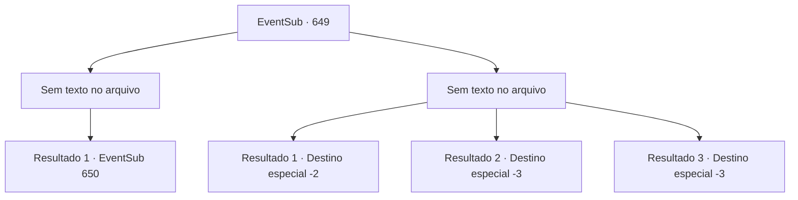

# Eventos secundários · 649

[Índice da tabela](index.md) · [Índice geral](../index.md)

ID: `pt:EventSub:649` · Fonte: `EventSub4` · Versão: 1.2.47.

Mapeamento estático dos arquivos; a disponibilidade e a execução dependem do estado da run.

## Texto do evento

*Sem texto no arquivo.*

## Dados de entrada

```json
{
  "id": 649,
  "grade": 1,
  "subEvent": "",
  "required": ""
}
```

## Mapa das escolhas



## Escolhas e resultados

### Escolha 1

*Sem texto no arquivo; o papel dessa opção depende da interface do jogo.*

Requisitos e outros campos da escolha:

```json
{
  "required": ""
}
```

#### Resultado 1.1

Você derrota todos os aventureiros que te atacaram. Em seguida, desvia o olhar para Osborne. Assustado, Osborne começa a se afastar de você, caindo de bunda no caminho. Você se aproxima de Osborne. Sentindo-se ameaçado, Osborne se põe de quatro, coloca a cabeça no chão e começa a implorar. 

 "P-POR FAVOR! Poupe minha vida, oh respeitado aventureiro. E-Eu te prejudiquei!"

 Depois de encarar Osborne, você se vira para encarar os trabalhadores na tenda. Eles estão te encarando em silêncio, confusos.

Continuação registrada: [Evento 650](0650.md) na mesma tabela.

```json
{
  "required": "",
  "chance": "1",
  "nextEvent": 650,
  "type": 2,
  "reward": ""
}
```

### Escolha 2

*Sem texto no arquivo; o papel dessa opção depende da interface do jogo.*

Requisitos e outros campos da escolha:

```json
{
  "required": ""
}
```

#### Resultado 2.1

Os aventureiros fazem uso de seu número - espancando você impiedosamente. Sua violência imprudente continua até que Osborne finalmente ordena que parem. 

 "Hmph! Se você tentar isso mais uma vez, não vai acabar assim."

 Depois de uma hora de espancamento, Osborne ordena que seus homens parem. Então, ele se vira para enfrentar os trabalhadores, exigindo que continuem com a escavação. Os trabalhadores protestam no início, mas logo são intimidados pelos capangas de Osborne. Você é expulso das ruínas.

Continuação registrada: [Destino especial `-2`](../destinos-especiais.md).

```json
{
  "required": "1_0_2|1_1_2",
  "chance": "1",
  "nextEvent": -2,
  "type": 2,
  "reward": "12_10_-1|14_10_6|14_10_10"
}
```

#### Resultado 2.2

Os aventureiros fazem uso de seu número - espancando você impiedosamente. Sua violência imprudente continua até que Osborne esteja satisfeito. E quando ele finalmente ficou satisfeito? No momento em que você encontrou a morte.

Continuação registrada: [Destino especial `-3`](../destinos-especiais.md).

```json
{
  "required": "2_0_2",
  "chance": "1",
  "nextEvent": -3,
  "type": 2,
  "reward": "0_0_-1|0_1_-1"
}
```

#### Resultado 2.3

Os aventureiros fazem uso de seu número - espancando você impiedosamente. Sua violência imprudente continua até que Osborne esteja satisfeito. E quando ele finalmente ficou satisfeito? No momento em que você encontrou a morte.

Continuação registrada: [Destino especial `-3`](../destinos-especiais.md).

```json
{
  "required": "2_1_2",
  "chance": "1",
  "nextEvent": -3,
  "type": 2,
  "reward": "0_0_-1|0_1_-1"
}
```

## Referências que chegam a este evento

- [Evento 647 · escolha 3 · resultado 2](0647.md#escolha-3)
- [Evento 648 · escolha 1 · resultado 1](0648.md#escolha-1)
- [Evento 648 · escolha 3 · resultado 3](0648.md#escolha-3)
