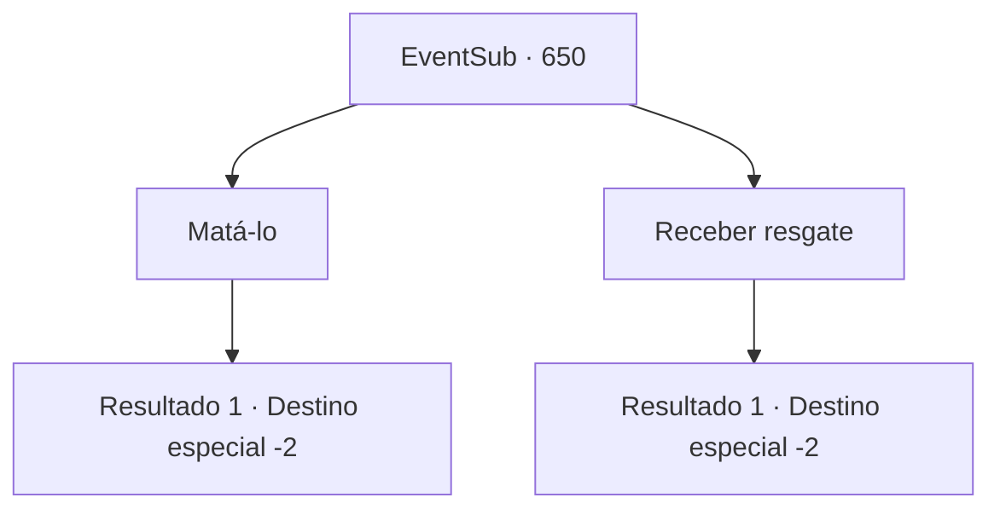

# Eventos secundários · 650

[Índice da tabela](index.md) · [Índice geral](../index.md)

ID: `pt:EventSub:650` · Fonte: `EventSub4` · Versão: 1.2.47.

Mapeamento estático dos arquivos; a disponibilidade e a execução dependem do estado da run.

## Texto do evento

*Sem texto no arquivo.*

## Dados de entrada

```json
{
  "id": 650,
  "grade": 1,
  "subEvent": "",
  "required": ""
}
```

## Mapa das escolhas



## Escolhas e resultados

### Escolha 1

Matá-lo

Requisitos e outros campos da escolha:

```json
{
  "required": ""
}
```

#### Resultado 1.1

Você mata Osborne e depois sai da tenda. Os trabalhadores estão petrificados de medo - e fogem da tenda assim que você sai. Em seguida, eles se dispersam, correndo por suas vidas.

Continuação registrada: [Destino especial `-2`](../destinos-especiais.md).

```json
{
  "required": "",
  "chance": "1",
  "nextEvent": -2,
  "type": 2,
  "reward": "12_10_-1|14_10_7|14_10_10|0_3_-5"
}
```

### Escolha 2

Receber resgate

Requisitos e outros campos da escolha:

```json
{
  "required": ""
}
```

#### Resultado 2.1

Você pega o ouro em troca de poupar Osborne. Você sai pomposamente da tenda. Os trabalhadores estão petrificados de medo - e fogem da tenda assim que você sai. Em seguida, eles se dispersam, correndo por suas vidas.

Continuação registrada: [Destino especial `-2`](../destinos-especiais.md).

```json
{
  "required": "",
  "chance": "1",
  "nextEvent": -2,
  "type": 2,
  "reward": "0_4_200|12_10_-1|14_10_4|14_10_10"
}
```

## Referências que chegam a este evento

- [Evento 648 · escolha 3 · resultado 1](0648.md#escolha-3)
- [Evento 648 · escolha 3 · resultado 2](0648.md#escolha-3)
- [Evento 649 · escolha 1 · resultado 1](0649.md#escolha-1)
