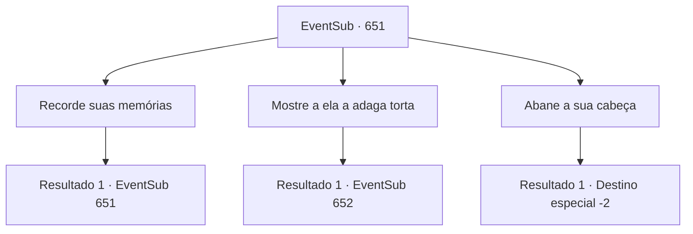

# Eventos secundários · 651

[Índice da tabela](index.md) · [Índice geral](../index.md)

ID: `pt:EventSub:651` · Fonte: `EventSub4` · Versão: 1.2.47.

Mapeamento estático dos arquivos; a disponibilidade e a execução dependem do estado da run.

## Texto do evento

Você está passando por uma trilha grande perto de Mavelaine. Então, um rosto familiar se aproxima de você. É Edenheart, a alquimista pesquisando o Elixir. 

 "Há quanto tempo, {1}."

 Edenheart te cumprimenta com um sorriso, mas você percebe um certo desconforto nela. Após hesitar por alguns segundos, ela pede sua ajuda, dizendo que a pesquisa sobre o Elixir chegou a um impasse. 

 "Ouvi dizer que você visitou as Ruínas de Plasphere, seguindo a guilda de comerciantes Veneprada. Você... por acaso encontrou algo? Qualquer coisa relacionada ao Elixir?"

 Segundo ela, Plasphere foi a cidade onde o lendário Elixir foi criado pela primeira vez. Seu olhar desesperado encontra seus olhos.

## Dados de entrada

```json
{
  "id": 651,
  "grade": 1,
  "subEvent": "",
  "required": "12_10_8"
}
```

## Mapa das escolhas



## Escolhas e resultados

### Escolha 1

Recorde suas memórias

Requisitos e outros campos da escolha:

```json
{
  "required": "5_601_1"
}
```

#### Resultado 1.1

Você se lembra do que viu nas Ruínas de Plasphere. Você fala sobre as relíquias que viu lá. Depois de ouvir sua história, Edenheart pergunta com uma voz animada. 

 "Você... você acabou pegando alguma coisa no caminho?"


Continuação registrada: [Evento 651](0651.md) na mesma tabela.

```json
{
  "required": "",
  "chance": "1",
  "nextEvent": 651,
  "type": 2,
  "reward": "5_601_2"
}
```

### Escolha 2

Mostre a ela a adaga torta

Requisitos e outros campos da escolha:

```json
{
  "required": "8_296_1"
}
```

#### Resultado 2.1

Você mostra a ela a adaga torta que encontrou nas ruínas. Ao ver a adaga, Edenheart murmura algo para si mesma, pensativa. 

 "Ah - isso deve ser a coisa que vi nos escritos... Então isso realmente existe, o que significa que os escritos são reais - então o conteúdo dos escritos deve significar ... Ah, peço desculpas, {1}. Parece que estava pensando em voz alta."

 Edenheart então pede a adaga torta. Ela diz que a adaga será muito útil para a pesquisa sobre o Elixir.

Continuação registrada: [Evento 652](0652.md) na mesma tabela.

```json
{
  "required": "",
  "chance": "1",
  "nextEvent": 652,
  "type": 2,
  "reward": ""
}
```

### Escolha 3

Abane a sua cabeça

Requisitos e outros campos da escolha:

```json
{
  "required": ""
}
```

#### Resultado 3.1

Você balança a cabeça em negação. Edenheart suspira, então se despede com uma expressão triste. 

 "Ufa. Tudo bem. Nada pode ser feito, eu acho. Vou me despedir, então."

 Você encara Edenheart enquanto ela se afasta. A direção para onde ela está indo não é Mavelaine - é Grimdit. Você se afasta daqui, na direção oposta.

Continuação registrada: [Destino especial `-2`](../destinos-especiais.md).

```json
{
  "required": "",
  "chance": "1",
  "nextEvent": -2,
  "type": 2,
  "reward": "12_10_9"
}
```

## Referências que chegam a este evento

- [Evento 651 · escolha 1 · resultado 1](0651.md#escolha-1)
