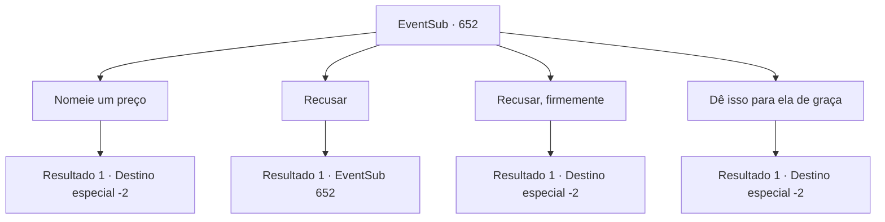

# Eventos secundários · 652

[Índice da tabela](index.md) · [Índice geral](../index.md)

ID: `pt:EventSub:652` · Fonte: `EventSub4` · Versão: 1.2.47.

Mapeamento estático dos arquivos; a disponibilidade e a execução dependem do estado da run.

## Texto do evento

*Sem texto no arquivo.*

## Dados de entrada

```json
{
  "id": 652,
  "grade": 1,
  "subEvent": "",
  "required": ""
}
```

## Mapa das escolhas



## Escolhas e resultados

### Escolha 1

Nomeie um preço

Requisitos e outros campos da escolha:

```json
{
  "required": "8_296_1"
}
```

#### Resultado 1.1

Você decide vender a adaga torta para Edenheart. Depois de pegar a adaga sinistra, Edenheart agradece várias vezes, inclinando a cabeça. 

 "Obrigado! Muito obrigado, {1}!"

 Depois de mostrar sua gratidão, Edenheart lhe dá uma bolsa cheia de ouro e vai embora. Ela lhe diz que continuará sua pesquisa individualmente em Mavelaine. Você pega a recompensa e seguem caminhos separados.

Continuação registrada: [Destino especial `-2`](../destinos-especiais.md).

```json
{
  "required": "",
  "chance": "1",
  "nextEvent": -2,
  "type": 2,
  "reward": "4_296_1|0_4_180|12_10_10"
}
```

### Escolha 2

Recusar

Requisitos e outros campos da escolha:

```json
{
  "required": "5_603_0"
}
```

#### Resultado 2.1

Você recusa o pedido de Edenheart. Edenheart agarra você pelos pulsos, suplicando. 

 "Por favor, {1}! Eu - Eu nunca vou esquecer disso!"


Continuação registrada: [Evento 652](0652.md) na mesma tabela.

```json
{
  "required": "",
  "chance": "1",
  "nextEvent": 652,
  "type": 2,
  "reward": "5_603_1"
}
```

### Escolha 3

Recusar, firmemente

Requisitos e outros campos da escolha:

```json
{
  "required": "5_603_1"
}
```

#### Resultado 3.1

Você balança a cabeça. Edenheart suspira, então se despede com uma expressão triste. 

 "Ufa. Tudo bem. Nada pode ser feito, eu acho. Vou me despedir, então."

 Você encara Edenheart enquanto ela se afasta. A direção para onde ela está indo não é Mavelaine - é Grimdit. Você se afasta daqui, na direção oposta.

Continuação registrada: [Destino especial `-2`](../destinos-especiais.md).

```json
{
  "required": "",
  "chance": "1",
  "nextEvent": -2,
  "type": 2,
  "reward": "12_10_9"
}
```

### Escolha 4

Dê isso para ela de graça

Requisitos e outros campos da escolha:

```json
{
  "required": "8_296_1"
}
```

#### Resultado 4.1

Você decide vender a adaga torta para Edenheart. Depois de pegar a adaga sinistra, Edenheart agradece várias vezes, inclinando a cabeça. 

 "Obrigado! Muito obrigado, {1}!"

 Depois de mostrar sua gratidão, Edenheart lhe dá uma bolsa cheia de ouro. Você insiste que ela não precisa compensar pela adaga, mas não consegue impedi-la. Ela lhe diz que continuará suas pesquisas individualmente em Mavelaine. Você pega a recompensa e seguem caminhos separados.

Continuação registrada: [Destino especial `-2`](../destinos-especiais.md).

```json
{
  "required": "",
  "chance": "1",
  "nextEvent": -2,
  "type": 2,
  "reward": "4_296_1|0_4_100|12_10_10|0_3_3"
}
```

## Referências que chegam a este evento

- [Evento 651 · escolha 2 · resultado 1](0651.md#escolha-2)
- [Evento 652 · escolha 2 · resultado 1](0652.md#escolha-2)
