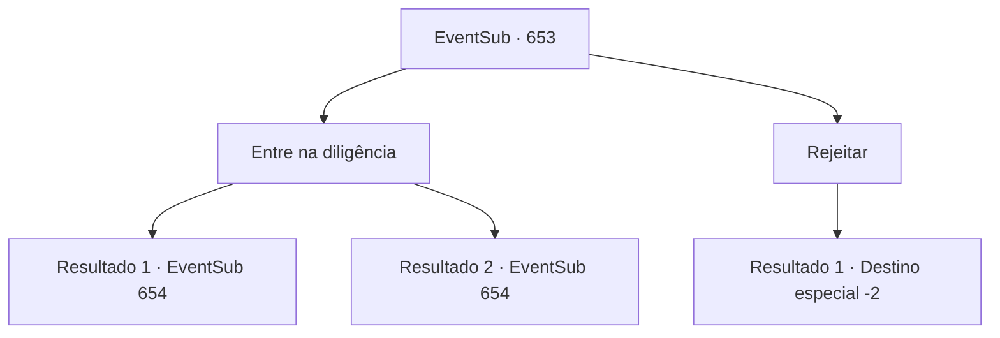

# Eventos secundários · 653

[Índice da tabela](index.md) · [Índice geral](../index.md)

ID: `pt:EventSub:653` · Fonte: `EventSub4` · Versão: 1.2.47.

Mapeamento estático dos arquivos; a disponibilidade e a execução dependem do estado da run.

## Texto do evento

Uma diligência decorada com uma bandeira elegante atravessa a estrada principal. A bandeira é da Veneprada, aquela que você viu antes. A diligência para em sua frente. Do interior da diligência sai um grupo de homens, curvando suas cabeças respeitosamente. 

 "{1}. Precisamos da sua presença."


## Dados de entrada

```json
{
  "id": 653,
  "grade": 1,
  "subEvent": "",
  "required": "12_10_10"
}
```

## Mapa das escolhas



## Escolhas e resultados

### Escolha 1

Entre na diligência

Requisitos e outros campos da escolha:

```json
{
  "required": ""
}
```

#### Resultado 1.1

A diligência leva você a um lugar desconhecido para você. Você pergunta para onde estão te levando, mas a única resposta que eles te dão é que você vai saber quando chegar lá. 

 Alguns minutos depois, você é recebido por um homem vestido com uma túnica de seda. É o Osborne. Ele começa a falar, arrumando seu bigode. 

 "É bom te ver, {1}. Nos encontramos novamente. Venha, venha. Vamos entrar."

 Ele pessoalmente te acompanha até dentro da mansão. 

 "A razão pela qual eu te chamei aqui hoje... é porque tenho um pedido a fazer."


Continuação registrada: [Evento 654](0654.md) na mesma tabela.

```json
{
  "required": "-1|5_601_1|5_601_2",
  "chance": "1",
  "nextEvent": 654,
  "type": 2,
  "reward": ""
}
```

#### Resultado 1.2

A diligência leva você a um lugar desconhecido para você. Você pergunta para onde estão te levando, mas a única resposta que eles te dão é que você saberá quando chegar lá. |drawing_Osborne| Alguns minutos depois, você é recebido por um homem vestido com uma túnica de seda. O homem baixo e gordo fala com você, arrumando seu impressionante bigode. 

 "Seja bem-vindo. Eu sou Osborne, o vice-presidente da guilda de comerciantes Veneprada. Venha, venha. Vamos entrar."

 Ele pessoalmente te acompanha até dentro da mansão. 

 "A razão pela qual eu te chamei aqui hoje... é porque tenho um pedido."


Continuação registrada: [Evento 654](0654.md) na mesma tabela.

```json
{
  "required": "18_601_1|18_601_2",
  "chance": "1",
  "nextEvent": 654,
  "type": 2,
  "reward": ""
}
```

### Escolha 2

Rejeitar

Requisitos e outros campos da escolha:

```json
{
  "required": ""
}
```

#### Resultado 2.1

Você educadamente recusa a oferta deles, passando pelo coche. Eles tentam te impedir no começo, mas acabam não conseguindo chamar sua atenção.

Continuação registrada: [Destino especial `-2`](../destinos-especiais.md).

```json
{
  "required": "",
  "chance": "1",
  "nextEvent": -2,
  "type": 2,
  "reward": "12_10_-1|14_10_8|14_10_10"
}
```

## Referências que chegam a este evento

Nenhum `nextEvent` positivo da mesma tabela aponta para este nó. Isso não prova que seja inacessível: sorteio e estado de história podem selecioná-lo.

