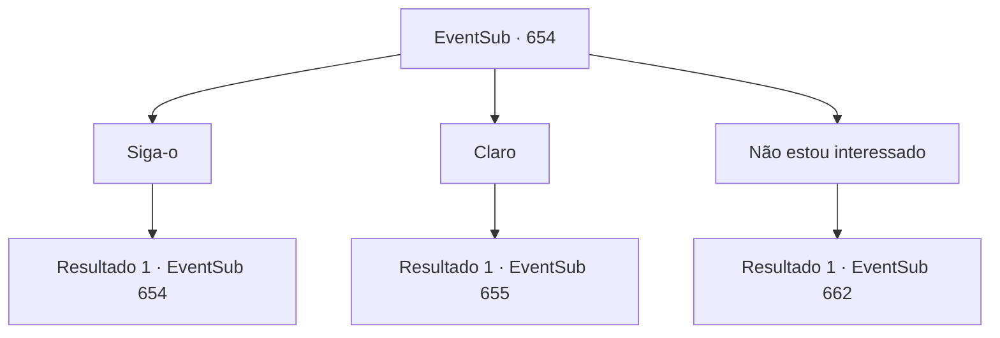

# Eventos secundários · 654

[Índice da tabela](index.md) · [Índice geral](../index.md)

ID: `pt:EventSub:654` · Fonte: `EventSub4` · Versão: 1.2.47.

Mapeamento estático dos arquivos; a disponibilidade e a execução dependem do estado da run.

## Texto do evento

*Sem texto no arquivo.*

## Dados de entrada

```json
{
  "id": 654,
  "grade": 1,
  "subEvent": "",
  "required": ""
}
```

## Mapa das escolhas



## Escolhas e resultados

### Escolha 1

Siga-o

Requisitos e outros campos da escolha:

```json
{
  "required": "5_604_0"
}
```

#### Resultado 1.1

Osborne leva você a uma câmara de audiência dentro da mansão. Ele pega um copo de chá, servido por sua empregada pessoal, dá um gole e começa a falar. 

 "Veneprada está preparando um novo negócio. Vamos vender o Elixir! Não posso lhe dar os detalhes exatos - tenho certeza de que você entende. Confidencialidade e tudo mais."

 Enquanto você se senta, a empregada também lhe serve um copo de chá vermelho. Você ouve o pedido de Osborne, desfrutando do aroma do chá. 

 "De qualquer forma. O que eu quero que você faça é simples. Você está familiarizado com a alquimista Edenheart, presumo? Pelo que ouvi, ela também está pesquisando o Elixir..."

 Osborne limpa a garganta, dizendo que se os materiais de pesquisa dela caíssem em suas mãos, seria propício para o sucesso do negócio. 

 "Você já a conhece. Então trazer os materiais para mim não deve ser um grande problema para você. Estou errado? Você me traz os materiais dela, e eu vou garantir que você seja recompensado. 200 ouros, o que acha?"

 Ele olha para você com entusiasmo.

Continuação registrada: [Evento 654](0654.md) na mesma tabela.

```json
{
  "required": "",
  "chance": "1",
  "nextEvent": 654,
  "type": 2,
  "reward": "5_604_1"
}
```

### Escolha 2

Claro

Requisitos e outros campos da escolha:

```json
{
  "required": "5_604_1"
}
```

#### Resultado 2.1


 "Haha! Eu estarei esperando, então. Agora, apenas aguarde suas recompensas."

, responde Osborne, sorrindo amplamente. Atendendo ao seu pedido, você deixa sua mansão e segue para Mavelaine. 

 O laboratório de Edenheart não está longe da Mansão de Fheren. Você espreita pela janela. Felizmente, Edenheart não está em lugar algum e você também não sente mais ninguém lá dentro. Você se aproxima da porta do laboratório e alcança a maçaneta. Julgando pelo som, algo está bloqueando - ou trancando - esta porta por dentro.

Continuação registrada: [Evento 655](0655.md) na mesma tabela.

```json
{
  "required": "",
  "chance": "1",
  "nextEvent": 655,
  "type": 2,
  "reward": ""
}
```

### Escolha 3

Não estou interessado

Requisitos e outros campos da escolha:

```json
{
  "required": "5_604_1"
}
```

#### Resultado 3.1

Você recusa o pedido dele e sai. Osborne estala a língua, mas não te impede. 

 Alguns dias depois, Edenheart te envia uma carta. Ela deseja que você visite o laboratório dela. Ela diz que o laboratório não está longe da Mansão de Fheren. Ao chegar no laboratório de Edenheart, você percebe que o lugar está uma bagunça. As janelas estão quebradas, a mesa é um desastre e a sala está cheia de esculturas quebradas e pinturas arruinadas. Você encontra Edenheart, ajoelhada no chão. Seu olhar vazio encontra o seu. 

 "{1}..."

 Ela começa a soluçar. Em uma noite, toda a sua pesquisa sobre o Elixir foi roubada. Ela chora desesperadamente, dizendo que não será capaz de terminar o Elixir agora.

Continuação registrada: [Evento 662](0662.md) na mesma tabela.

```json
{
  "required": "",
  "chance": "1",
  "nextEvent": 662,
  "type": 2,
  "reward": ""
}
```

## Referências que chegam a este evento

- [Evento 653 · escolha 1 · resultado 1](0653.md#escolha-1)
- [Evento 653 · escolha 1 · resultado 2](0653.md#escolha-1)
- [Evento 654 · escolha 1 · resultado 1](0654.md#escolha-1)
