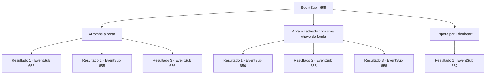

# Eventos secundários · 655

[Índice da tabela](index.md) · [Índice geral](../index.md)

ID: `pt:EventSub:655` · Fonte: `EventSub4` · Versão: 1.2.47.

Mapeamento estático dos arquivos; a disponibilidade e a execução dependem do estado da run.

## Texto do evento

*Sem texto no arquivo.*

## Dados de entrada

```json
{
  "id": 655,
  "grade": 1,
  "subEvent": "",
  "required": ""
}
```

## Mapa das escolhas



## Escolhas e resultados

### Escolha 1

Arrombe a porta

Requisitos e outros campos da escolha:

```json
{
  "required": "5_605_0"
}
```

#### Resultado 1.1

Você força a porta aberta, entrando no laboratório de Edenheart sem permissão. Dentro do laboratório há uma infinidade de vários scripts e instrumentos, desorganizados. Sem mencionar as pinturas, joias e esculturas - você não tem ideia de onde olhar primeiro. Mas então, uma das esculturas começa a se mover, avançando em sua direção. É uma gárgula.

Continuação registrada: [Evento 656](0656.md) na mesma tabela.

```json
{
  "required": "21_60_2",
  "chance": "1|0_5_1",
  "nextEvent": 656,
  "type": 0,
  "reward": "6_0_37",
  "place": 10
}
```

#### Resultado 1.2

Você tenta arrombar a porta para destruí-la. Mas a porta não se move. Tudo o que você consegue fazer é machucar seus ombros.

Continuação registrada: [Evento 655](0655.md) na mesma tabela.

```json
{
  "required": "21_60_2",
  "chance": "13",
  "nextEvent": 655,
  "type": 1,
  "reward": "5_605_9"
}
```

#### Resultado 1.3

Você destrói a porta com uma força imensa, entrando no laboratório de Edenheart sem permissão. Dentro do laboratório há uma infinidade de vários scripts e instrumentos, desorganizados. Sem mencionar as pinturas, joias e esculturas - você não tem ideia de onde olhar primeiro. Mas então, uma das esculturas começa a se mover, avançando em sua direção. É uma gárgula.

Continuação registrada: [Evento 656](0656.md) na mesma tabela.

```json
{
  "required": "20_60_2",
  "chance": "1",
  "nextEvent": 656,
  "type": 2,
  "reward": "6_0_37",
  "place": 10
}
```

### Escolha 2

Abra o cadeado com uma chave de fenda

Requisitos e outros campos da escolha:

```json
{
  "required": "5_606_0"
}
```

#### Resultado 2.1

Você abre a porta, entrando no laboratório de Edenheart sem permissão. Dentro do laboratório há uma infinidade de vários scripts e instrumentos, desorganizados. Sem mencionar as pinturas, joias e esculturas - você não tem ideia de onde olhar primeiro. Mas então, uma das esculturas começa a se mover, avançando em sua direção. É uma gárgula.

Continuação registrada: [Evento 656](0656.md) na mesma tabela.

```json
{
  "required": "10_41_1",
  "chance": "1|0_6_1",
  "nextEvent": 656,
  "type": 0,
  "reward": "6_0_37",
  "place": 10
}
```

#### Resultado 2.2

Você tenta pegar um pedaço de metal, tentando abrir a fechadura da porta. Mas o metal quebra primeiro. Incapaz de abrir a fechadura, você joga fora o pedaço de metal e tira o pó das mãos.

Continuação registrada: [Evento 655](0655.md) na mesma tabela.

```json
{
  "required": "10_41_1",
  "chance": "13",
  "nextEvent": 655,
  "type": 1,
  "reward": "5_606_9"
}
```

#### Resultado 2.3

Você abre a porta com seu pé de cabra, entrando no laboratório de Edenheart sem permissão. Dentro do laboratório há uma infinidade de vários scripts e instrumentos, desorganizados. Sem mencionar as pinturas, joias e esculturas - você não tem ideia de onde olhar primeiro. Mas então, uma das esculturas começa a se mover, avançando em sua direção. É um gárgula.

Continuação registrada: [Evento 656](0656.md) na mesma tabela.

```json
{
  "required": "8_41_1",
  "chance": "1",
  "nextEvent": 656,
  "type": 2,
  "reward": "6_0_37",
  "place": 10
}
```

### Escolha 3

Espere por Edenheart

Requisitos e outros campos da escolha:

```json
{
  "required": ""
}
```

#### Resultado 3.1

Você decide esperar pelo dono do laboratório em vez de arrombar. Cerca de uma hora depois, Edenheart chega ao laboratório, vindo da direção da Mansão de Fheren. Ao te ver, Edenheart se aproxima apressadamente do laboratório. 

 "Ah, é você, {1}. Eu não te fiz esperar muito, fiz? Sinceramente, não estava esperando por você... mas por favor, entre."

 Você segue Edenheart até seu laboratório. Dentro do laboratório há uma infinidade de scripts e instrumentos diversos, desorganizados. Edenheart rapidamente arruma o lugar - dá para ver que ela não é uma ótima arrumadeira - e continua. 

 "Só um minuto. Vou te trazer um copo de chá ou algo assim."

 Enquanto isso, você decide dar uma olhada ao redor do laboratório. Então, você encontra sua pesquisa sobre o Elixir na mesa. Edenheart está se preparando para fazer chá vermelho, sem saber das suas ações.

Continuação registrada: [Evento 657](0657.md) na mesma tabela.

```json
{
  "required": "",
  "chance": "1",
  "nextEvent": 657,
  "type": 2,
  "reward": ""
}
```

## Referências que chegam a este evento

- [Evento 654 · escolha 2 · resultado 1](0654.md#escolha-2)
- [Evento 655 · escolha 1 · resultado 2](0655.md#escolha-1)
- [Evento 655 · escolha 2 · resultado 2](0655.md#escolha-2)
