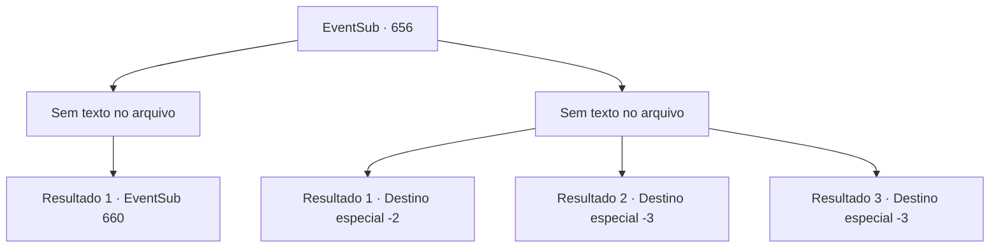

# Eventos secundários · 656

[Índice da tabela](index.md) · [Índice geral](../index.md)

ID: `pt:EventSub:656` · Fonte: `EventSub4` · Versão: 1.2.47.

Mapeamento estático dos arquivos; a disponibilidade e a execução dependem do estado da run.

## Texto do evento

*Sem texto no arquivo.*

## Dados de entrada

```json
{
  "id": 656,
  "grade": 1,
  "subEvent": "",
  "required": ""
}
```

## Mapa das escolhas



## Escolhas e resultados

### Escolha 1

*Sem texto no arquivo; o papel dessa opção depende da interface do jogo.*

Requisitos e outros campos da escolha:

```json
{
  "required": ""
}
```

#### Resultado 1.1

Você empurra os restos do gárgula para o canto do laboratório e começa a procurar. Então, você encontra o que parece ser a mesa de Edenheart. Em cima da mesa há uma coleção de pergaminhos, preenchidos com uma caligrafia elegante. Você os pega. Estas são todas as notas de pesquisa sobre o Elixir - de Edenheart. 

 "{1} - qual é o significado disso?!"

 Então, Edenheart entra pela porta aberta do laboratório. Ela parece surpresa, olhando ao redor do laboratório abandonado. Então, ela encontra o que você está segurando em suas mãos - suas notas de pesquisa.

Continuação registrada: [Evento 660](0660.md) na mesma tabela.

```json
{
  "required": "",
  "chance": "1",
  "nextEvent": 660,
  "type": 2,
  "reward": "3_299_1"
}
```

### Escolha 2

*Sem texto no arquivo; o papel dessa opção depende da interface do jogo.*

Requisitos e outros campos da escolha:

```json
{
  "required": ""
}
```

#### Resultado 2.1

Aparentemente, o gárgula é o protetor do laboratório. Ele não tolera invasores - ataca ferozmente, forçando você a fugir. Assim que estiver fora do laboratório, o gárgula retorna ao seu posto.

Continuação registrada: [Destino especial `-2`](../destinos-especiais.md).

```json
{
  "required": "1_0_2|1_1_2",
  "chance": "1",
  "nextEvent": -2,
  "type": 2,
  "reward": "0_0_-1|0_1_-1|12_10_-1|14_10_8|14_10_2"
}
```

#### Resultado 2.2

Aparentemente, o gárgula é o protetor do laboratório. Ele cumpriu seu dever ao te matar, o intruso.

Continuação registrada: [Destino especial `-3`](../destinos-especiais.md).

```json
{
  "required": "2_0_2",
  "chance": "1",
  "nextEvent": -3,
  "type": 2,
  "reward": "0_0_-1|0_1_-1"
}
```

#### Resultado 2.3

Aparentemente, o gárgula é o protetor do laboratório. Ele cumpriu seu dever ao te matar, o intruso.

Continuação registrada: [Destino especial `-3`](../destinos-especiais.md).

```json
{
  "required": "2_1_2",
  "chance": "1",
  "nextEvent": -3,
  "type": 2,
  "reward": "0_0_-1|0_1_-1"
}
```

## Referências que chegam a este evento

- [Evento 655 · escolha 1 · resultado 1](0655.md#escolha-1)
- [Evento 655 · escolha 1 · resultado 3](0655.md#escolha-1)
- [Evento 655 · escolha 2 · resultado 1](0655.md#escolha-2)
- [Evento 655 · escolha 2 · resultado 3](0655.md#escolha-2)
