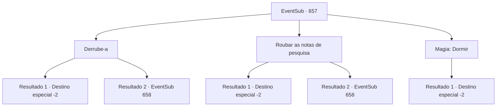

# Eventos secundários · 657

[Índice da tabela](index.md) · [Índice geral](../index.md)

ID: `pt:EventSub:657` · Fonte: `EventSub4` · Versão: 1.2.47.

Mapeamento estático dos arquivos; a disponibilidade e a execução dependem do estado da run.

## Texto do evento

*Sem texto no arquivo.*

## Dados de entrada

```json
{
  "id": 657,
  "grade": 1,
  "subEvent": "",
  "required": ""
}
```

## Mapa das escolhas



## Escolhas e resultados

### Escolha 1

Derrube-a

Requisitos e outros campos da escolha:

```json
{
  "required": ""
}
```

#### Resultado 1.1

Você caminha silenciosamente até Edenheart e começa a sufocá-la. Não demora muito para que ela desmaie. Você a coloca no chão, pega suas notas de pesquisa e sai do laboratório. 

 Você retorna a Osborne com as notas de pesquisa de Edenheart. Dando uma olhada nas notas, Osborne sorri, satisfeito, e lhe entrega uma bolsa de couro cheia de ouro. 200 ouro, como prometido. 

 "Aqui, pelo seu esforço. Agora é seu."

 Você pega o ouro e é escoltado para fora da mansão pelas empregadas de Osborne.

Continuação registrada: [Destino especial `-2`](../destinos-especiais.md).

```json
{
  "required": "",
  "chance": "1|0_5_1",
  "nextEvent": -2,
  "type": 0,
  "reward": "0_2_1|4_299_1|0_4_200|12_10_-1|14_10_2|14_10_9"
}
```

#### Resultado 1.2

Você caminha silenciosamente até Edenheart e começa a sufocá-la. Lutando por ar, ela consegue te empurrar para longe. 

 "Ack..! *tosse*...! O que...?"

 Seu rosto está pálido de terror. Edenheart, com o olhar tremendo, te encara. 

 "O que você está fazendo, {1}...? É por causa do ouro...? Ou... oh! É o Elixir?!"

 Você não responde, mas parece que ela entendeu como um sim. Ela se ajoelha, implorando. 

 "Por favor, por favor não faça isso, {1}... Você sabe tanto quanto eu! Fheren, meu amigo... a vida dele está em jogo! Então, por favor...!"


Continuação registrada: [Evento 658](0658.md) na mesma tabela.

```json
{
  "required": "",
  "chance": "14",
  "nextEvent": 658,
  "type": 1,
  "reward": ""
}
```

### Escolha 2

Roubar as notas de pesquisa

Requisitos e outros campos da escolha:

```json
{
  "required": ""
}
```

#### Resultado 2.1


 "{1}?! {1}! Por quê?! Por favor, devolva-os! POR FAVOR!"

 Você rapidamente escapa do laboratório com as notas de pesquisa. Edenheart vem correndo, mas logo tropeça e cai. 

 Você retorna a Osborne com as notas de pesquisa de Edenheart. Dando uma olhada nas notas, Osborne sorri, satisfeito, e lhe entrega uma bolsa de couro cheia de ouro. 200 ouro, como prometido. 

 "Aqui, pelos seus esforços. Agora é seu."

 Você pega o ouro e é escoltado para fora da mansão pelas empregadas de Osborne.

Continuação registrada: [Destino especial `-2`](../destinos-especiais.md).

```json
{
  "required": "",
  "chance": "1|0_6_1",
  "nextEvent": -2,
  "type": 0,
  "reward": "0_2_1|4_299_1|0_4_200|12_10_-1|14_10_2|14_10_9"
}
```

#### Resultado 2.2

Tentas fugir do laboratório com as notas de pesquisa, mas Edenheart está exatamente na entrada. O rosto dela está pálido de terror. Edenheart morde os lábios, ajoelha-se e implora. 

 "Por favor, por favor não faças isso, {1}... Sabes tanto quanto eu! Fheren, meu amigo... a vida dele está em jogo! Então, por favor...!"


Continuação registrada: [Evento 658](0658.md) na mesma tabela.

```json
{
  "required": "",
  "chance": "14",
  "nextEvent": 658,
  "type": 1,
  "reward": ""
}
```

### Escolha 3

Magia: Dormir

Requisitos e outros campos da escolha:

```json
{
  "required": "20_0_1"
}
```

#### Resultado 3.1

Você lança Sono em Edenheart. Em seguida, você pega suas notas de pesquisa e sai silenciosamente do laboratório. 

 Você retorna a Osborne com as notas de pesquisa de Edenheart. Dando uma olhada nas notas, Osborne sorri, satisfeito, e lhe entrega uma bolsa de couro cheia de ouro. 200 ouro, como prometido. 

 "Aqui, por seus esforços. Agora é seu."

 Você pega o ouro e é escoltado para fora da mansão pelas empregadas de Osborne.

Continuação registrada: [Destino especial `-2`](../destinos-especiais.md).

```json
{
  "required": "",
  "chance": "1",
  "nextEvent": -2,
  "type": 2,
  "reward": "0_2_1|4_299_1|0_4_200|12_10_-1|14_10_2|14_10_9"
}
```

## Referências que chegam a este evento

- [Evento 655 · escolha 3 · resultado 1](0655.md#escolha-3)
