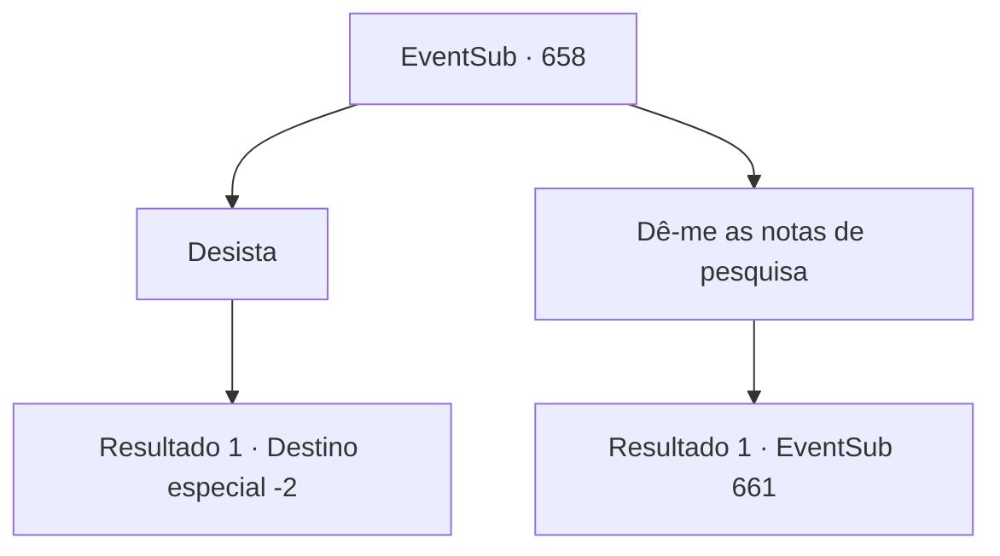

# Eventos secundários · 658

[Índice da tabela](index.md) · [Índice geral](../index.md)

ID: `pt:EventSub:658` · Fonte: `EventSub4` · Versão: 1.2.47.

Mapeamento estático dos arquivos; a disponibilidade e a execução dependem do estado da run.

## Texto do evento

*Sem texto no arquivo.*

## Dados de entrada

```json
{
  "id": 658,
  "grade": 1,
  "subEvent": "",
  "required": ""
}
```

## Mapa das escolhas



## Escolhas e resultados

### Escolha 1

Desista

Requisitos e outros campos da escolha:

```json
{
  "required": ""
}
```

#### Resultado 1.1

Você muda de ideia e decide não pegar as notas de pesquisa de Edenheart. Edenheart segura firmemente as notas, agradecendo a você. 

 "...Obrigado, {1}."

 Um silêncio constrangedor preenche o ar. Você sai do laboratório de Edenheart.

Continuação registrada: [Destino especial `-2`](../destinos-especiais.md).

```json
{
  "required": "",
  "chance": "1",
  "nextEvent": -2,
  "type": 2,
  "reward": "0_2_1|0_3_1|4_299_1|12_10_-1|14_10_8|14_10_13"
}
```

### Escolha 2

Dê-me as notas de pesquisa

Requisitos e outros campos da escolha:

```json
{
  "required": ""
}
```

#### Resultado 2.1

Você exige que ela desista de suas anotações de pesquisa. Edenheart, seu corpo tremendo de medo, puxa uma adaga. Em seus olhos você vê duas emoções conflitantes - medo e determinação. 

 "N-n-nunca...!"

 Então, uma das esculturas se vira para você e te ataca. É um gárgula. Para o gárgula, você é uma ameaça para seu mestre - então ele começa a balançar suas garras em você.

Continuação registrada: [Evento 661](0661.md) na mesma tabela.

```json
{
  "required": "",
  "chance": "1",
  "nextEvent": 661,
  "type": 2,
  "reward": "6_0_37",
  "place": 10
}
```

## Referências que chegam a este evento

- [Evento 657 · escolha 1 · resultado 2](0657.md#escolha-1)
- [Evento 657 · escolha 2 · resultado 2](0657.md#escolha-2)
