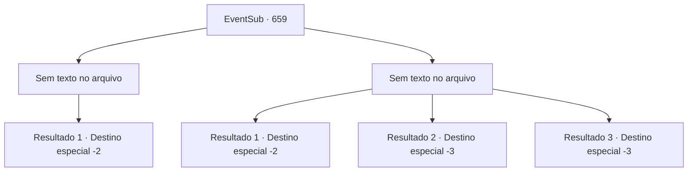

# Eventos secundários · 659

[Índice da tabela](index.md) · [Índice geral](../index.md)

ID: `pt:EventSub:659` · Fonte: `EventSub4` · Versão: 1.2.47.

Mapeamento estático dos arquivos; a disponibilidade e a execução dependem do estado da run.

## Texto do evento

*Sem texto no arquivo.*

## Dados de entrada

```json
{
  "id": 659,
  "grade": 1,
  "subEvent": "",
  "required": ""
}
```

## Mapa das escolhas



## Escolhas e resultados

### Escolha 1

*Sem texto no arquivo; o papel dessa opção depende da interface do jogo.*

Requisitos e outros campos da escolha:

```json
{
  "required": ""
}
```

#### Resultado 1.1


 "N-não...."

 Edenheart desmaia, inconsciente. Você pega suas anotações de pesquisa e sai do laboratório. 

 Você retorna a Osborne com as anotações de pesquisa de Edenheart. Dando uma olhada nas anotações, Osborne sorri, satisfeito, e lhe entrega uma bolsa de couro cheia de ouro. 200 ouro, como prometido. 

 "Aqui, pelos seus esforços. Agora é seu."

 Você pega o ouro e é escoltado para fora da mansão pelas empregadas de Osborne.

Continuação registrada: [Destino especial `-2`](../destinos-especiais.md).

```json
{
  "required": "",
  "chance": "1",
  "nextEvent": -2,
  "type": 2,
  "reward": "0_2_1|4_299_1|0_4_200|12_10_-1|14_10_2|14_10_9"
}
```

### Escolha 2

*Sem texto no arquivo; o papel dessa opção depende da interface do jogo.*

Requisitos e outros campos da escolha:

```json
{
  "required": ""
}
```

#### Resultado 2.1

Edenheart assume uma ofensiva imprudente e destemida. Você é dominado pela determinação dela e acaba falhando em derrotá-la. Então, você ouve uma comoção do lado de fora. Os guardas e outros cidadãos se reuniram ao redor do laboratório para investigar os barulhos. Infelizmente, você desiste das notas de pesquisa e foge.

Continuação registrada: [Destino especial `-2`](../destinos-especiais.md).

```json
{
  "required": "1_0_2|1_1_2",
  "chance": "1",
  "nextEvent": -2,
  "type": 2,
  "reward": "0_0_-1|0_1_-1|4_299_1|12_10_-1|14_10_8|14_10_13"
}
```

#### Resultado 2.2

Edenheart assume uma ofensiva imprudente e destemida. Você é dominado pela determinação dela e acaba batendo a cabeça em algo duro. Com um estalo horrível, você encontra a sua morte.

Continuação registrada: [Destino especial `-3`](../destinos-especiais.md).

```json
{
  "required": "2_0_2",
  "chance": "1",
  "nextEvent": -3,
  "type": 2,
  "reward": "0_0_-1|0_1_-1"
}
```

#### Resultado 2.3

Edenheart lança um ataque imprudente e destemido. Você é dominado pela determinação dela e acaba batendo a cabeça em algo duro. Com um estalo horrível, você encontra a sua morte.

Continuação registrada: [Destino especial `-3`](../destinos-especiais.md).

```json
{
  "required": "2_1_2",
  "chance": "1",
  "nextEvent": -3,
  "type": 2,
  "reward": "0_0_-1|0_1_-1"
}
```

## Referências que chegam a este evento

- [Evento 660 · escolha 1 · resultado 2](0660.md#escolha-1)
- [Evento 660 · escolha 2 · resultado 2](0660.md#escolha-2)
- [Evento 661 · escolha 1 · resultado 1](0661.md#escolha-1)
