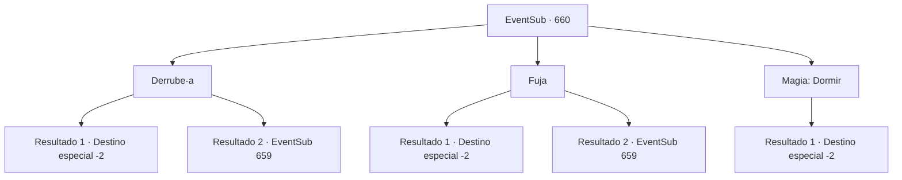

# Eventos secundários · 660

[Índice da tabela](index.md) · [Índice geral](../index.md)

ID: `pt:EventSub:660` · Fonte: `EventSub4` · Versão: 1.2.47.

Mapeamento estático dos arquivos; a disponibilidade e a execução dependem do estado da run.

## Texto do evento

*Sem texto no arquivo.*

## Dados de entrada

```json
{
  "id": 660,
  "grade": 1,
  "subEvent": "",
  "required": ""
}
```

## Mapa das escolhas



## Escolhas e resultados

### Escolha 1

Derrube-a

Requisitos e outros campos da escolha:

```json
{
  "required": ""
}
```

#### Resultado 1.1

Você dá um soco surpresa em Edenheart. Com um baque, ela cai no chão, inconsciente. Você sai do laboratório de Edenheart. 

 Você retorna a Osborne com as notas de pesquisa de Edenheart. Dando uma olhada nas notas, Osborne sorri, satisfeito, e lhe entrega uma bolsa de couro cheia de ouro. 200 ouro, como prometido. 

 "Aqui, pelo seu esforço. Agora é seu."

 Você pega o ouro e é escoltado para fora da mansão pelas empregadas de Osborne.

Continuação registrada: [Destino especial `-2`](../destinos-especiais.md).

```json
{
  "required": "",
  "chance": "1|0_5_1",
  "nextEvent": -2,
  "type": 0,
  "reward": "0_2_1|4_299_1|0_4_200|12_10_-1|14_10_2|14_10_9"
}
```

#### Resultado 1.2

Você dá um soco surpresa em Edenheart. Mas ela consegue desviar do seu golpe, cambaleando. Ela puxa uma adaga, seu corpo tremendo de medo. Em seus olhos você vê duas emoções conflitantes - medo e determinação. 

 "N-n-nunca...!"

 Ela balança a adaga em sua direção.

Continuação registrada: [Evento 659](0659.md) na mesma tabela.

```json
{
  "required": "",
  "chance": "1",
  "nextEvent": 659,
  "type": 1,
  "reward": "6_0_162",
  "place": 10
}
```

### Escolha 2

Fuja

Requisitos e outros campos da escolha:

```json
{
  "required": ""
}
```

#### Resultado 2.1


 "{1}?! {1}! Por quê?! Por favor, devolva-os! POR FAVOR!"

 Você rapidamente escapa do laboratório com as notas de pesquisa. Edenheart vem correndo, mas logo tropeça e cai. 

 Você retorna a Osborne com as notas de pesquisa de Edenheart. Dando uma olhada nas notas, Osborne sorri, satisfeito, e lhe entrega uma bolsa de couro cheia de ouro. 200 ouro, como prometido. 

 "Aqui, pelos seus esforços. Agora é seu."

 Você pega o ouro e é escoltado para fora da mansão pelas empregadas de Osborne.

Continuação registrada: [Destino especial `-2`](../destinos-especiais.md).

```json
{
  "required": "",
  "chance": "1|0_6_1",
  "nextEvent": -2,
  "type": 0,
  "reward": "0_2_1|4_299_1|0_4_200|12_10_-1|14_10_2|14_10_9"
}
```

#### Resultado 2.2

Você pega as notas de pesquisa e tenta fugir. Mas você é impedido por Edenheart. Em seus olhos, você vê duas emoções conflitantes - medo e determinação. 

 "N-n-nunca...!"

 Ela balança a adaga em sua direção.

Continuação registrada: [Evento 659](0659.md) na mesma tabela.

```json
{
  "required": "",
  "chance": "14",
  "nextEvent": 659,
  "type": 1,
  "reward": "6_0_162",
  "place": 10
}
```

### Escolha 3

Magia: Dormir

Requisitos e outros campos da escolha:

```json
{
  "required": "20_0_1"
}
```

#### Resultado 3.1

Você lança Sono em Edenheart. Em seguida, você pega suas notas de pesquisa e sai silenciosamente do laboratório. 

 Você retorna a Osborne com as notas de pesquisa de Edenheart. Dando uma olhada nas notas, Osborne sorri, satisfeito, e lhe entrega uma bolsa de couro cheia de ouro. 200 ouro, como prometido. 

 "Aqui, por seus esforços. Agora é seu."

 Você pega o ouro e é escoltado para fora da mansão pelas empregadas de Osborne.

Continuação registrada: [Destino especial `-2`](../destinos-especiais.md).

```json
{
  "required": "",
  "chance": "1",
  "nextEvent": -2,
  "type": 2,
  "reward": "0_2_1|4_299_1|0_4_200|12_10_-1|14_10_2|14_10_9"
}
```

## Referências que chegam a este evento

- [Evento 656 · escolha 1 · resultado 1](0656.md#escolha-1)
