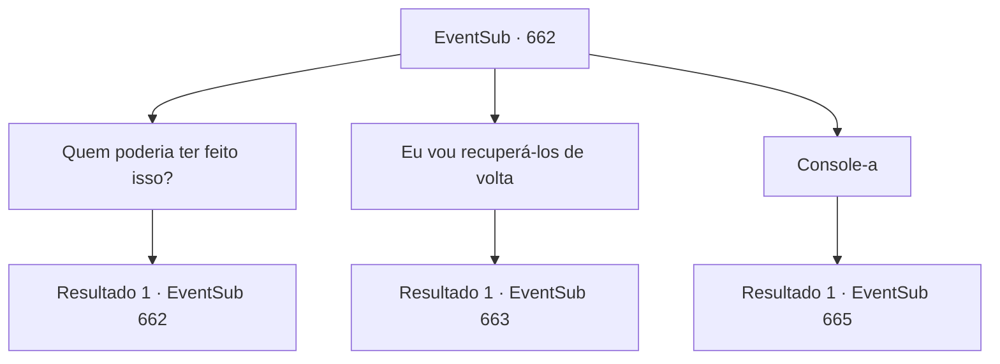

# Eventos secundários · 662

[Índice da tabela](index.md) · [Índice geral](../index.md)

ID: `pt:EventSub:662` · Fonte: `EventSub4` · Versão: 1.2.47.

Mapeamento estático dos arquivos; a disponibilidade e a execução dependem do estado da run.

## Texto do evento

*Sem texto no arquivo.*

## Dados de entrada

```json
{
  "id": 662,
  "grade": 1,
  "subEvent": "",
  "required": ""
}
```

## Mapa das escolhas



## Escolhas e resultados

### Escolha 1

Quem poderia ter feito isso?

Requisitos e outros campos da escolha:

```json
{
  "required": "5_604_1"
}
```

#### Resultado 1.1

Você pergunta a Edenheart se ela conhece alguém que possa ter feito isso. Ela enxuga as lágrimas com a manga e responde com a voz rouca. 

 "Não tenho certeza... mas alguns dias atrás, Osborne, o vice-presidente da guilda de comerciantes Veneprada, me visitou. Ele queria comprar minha pesquisa por 200 ouros."

 Ela explica mais, dizendo como Osborne é o suspeito mais provável. 

 "Mas mesmo que ele seja o verdadeiro culpado, duvido que ele admitiria. Quem acreditaria no que eu digo, quando afirmo que as anotações dele são na verdade minhas?"


Continuação registrada: [Evento 662](0662.md) na mesma tabela.

```json
{
  "required": "",
  "chance": "1",
  "nextEvent": 662,
  "type": 2,
  "reward": "5_604_2"
}
```

### Escolha 2

Eu vou recuperá-los de volta

Requisitos e outros campos da escolha:

```json
{
  "required": "5_604_2"
}
```

#### Resultado 2.1

Você decide ajudar a recuperar as notas de pesquisa de Edenheart. Você a ajuda a se levantar e juntos caminham em direção à Mansão de Osborne. O culpado é óbvio - não há necessidade de investigar a cena ou qualquer coisa do tipo. 

 Você vê uma carruagem pronta para partir em frente à mansão - você anda mais rápido. Osborne está bem ali, pulando na carruagem, como se estivesse prestes a ir a algum lugar. Quando os mercenários ao seu redor veem você e Edenheart se aproximando da carruagem, eles ordenam que vocês parem. Edenheart empurra os mercenários para longe, gritando com Osborne. 

 "Por favor, devolva minhas notas de pesquisa! Esses são materiais preciosos - a vida do meu amigo está em jogo! Eu te imploro...!"

 Mas, apesar do sincero apelo de Edenheart, tudo o que Osborne faz é zombar. Ele balança a cabeça, dando ordens aos seus mercenários. 

 "Hm. Não faço ideia do que você está falando. Por favor, se livre desse lunático agora mesmo."


Continuação registrada: [Evento 663](0663.md) na mesma tabela.

```json
{
  "required": "",
  "chance": "1",
  "nextEvent": 663,
  "type": 2,
  "reward": "0_3_1"
}
```

### Escolha 3

Console-a

Requisitos e outros campos da escolha:

```json
{
  "required": "5_604_2"
}
```

#### Resultado 3.1

Você coloca suas mãos nos ombros de Edenheart, confortando-a. Isso é tudo que você pode fazer agora, vendo-a em profunda tristeza. Mas então, Edenheart segura suas mãos e fala. 

 "Eu sei que isso parece ridículo, mas, {1}... você estaria disposto a me ajudar a recuperar minhas anotações de pesquisa? Por favor?"


Continuação registrada: [Evento 665](0665.md) na mesma tabela.

```json
{
  "required": "",
  "chance": "1",
  "nextEvent": 665,
  "type": 2,
  "reward": ""
}
```

## Referências que chegam a este evento

- [Evento 654 · escolha 3 · resultado 1](0654.md#escolha-3)
- [Evento 662 · escolha 1 · resultado 1](0662.md#escolha-1)
