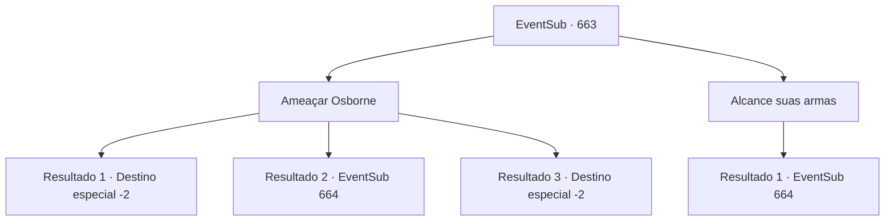

# Eventos secundários · 663

[Índice da tabela](index.md) · [Índice geral](../index.md)

ID: `pt:EventSub:663` · Fonte: `EventSub4` · Versão: 1.2.47.

Mapeamento estático dos arquivos; a disponibilidade e a execução dependem do estado da run.

## Texto do evento

*Sem texto no arquivo.*

## Dados de entrada

```json
{
  "id": 663,
  "grade": 1,
  "subEvent": "",
  "required": ""
}
```

## Mapa das escolhas



## Escolhas e resultados

### Escolha 1

Ameaçar Osborne

Requisitos e outros campos da escolha:

```json
{
  "required": ""
}
```

#### Resultado 1.1

Tudo o que é preciso é uma única frase. 'Retorna as notas de pesquisa, ou perde a tua cabeça.' Simples e clichê, mas faz o truque. Assustado, Osborne te joga um livro, pula na carruagem e vai embora. 

 "Obrigado! Muito obrigado, {1}."

 Após verificar o conteúdo do livro, Edenheart responde, abraçando o livro com força. Parece que as notas de pesquisa dela estão de volta. 

 "Eu preciso ir. Vou ter que mover meu laboratório também, apenas por precaução. Sem dúvida, isso vai atrasar a pesquisa, mas não tenho escolha, não é?"

 Ela te entrega uma poção pelo que você fez e retorna ao seu laboratório. Você toma a poção, se despede de Edenheart e retorna às suas aventuras.

Continuação registrada: [Destino especial `-2`](../destinos-especiais.md).

```json
{
  "required": "21_1_4",
  "chance": "1|0_12_1",
  "nextEvent": -2,
  "type": 0,
  "reward": "0_2_1|3_36_1|3_37_1|12_10_-1|14_10_8|14_10_13"
}
```

#### Resultado 1.2

Tudo o que é preciso é uma única frase. 'Devolva as notas de pesquisa, ou perca a sua cabeça.' Mas parece que sua intimidação não funcionou. Nem um pouco. Osborne zomba, gritando ordens para seus mercenários. 

 "Peço desculpas - DOIS lunáticos. Livrem-se deles agora mesmo!"

 Ouvindo as ordens de Osborne, os mercenários sacam suas armas, prontos para lutar.

Continuação registrada: [Evento 664](0664.md) na mesma tabela.

```json
{
  "required": "21_1_4",
  "chance": "16",
  "nextEvent": 664,
  "type": 1,
  "reward": "6_3_62",
  "place": 4
}
```

#### Resultado 1.3

Tudo o que é preciso é uma única frase. 'Retorna as notas de pesquisa, ou perde a tua cabeça.' Simples e clichê, mas faz o truque. Assustado, Osborne te joga um livro, pula na carruagem e vai embora. 

 "Obrigado! Muito obrigado, {1}."

 Após verificar o conteúdo do livro, Edenheart responde, abraçando o livro com força. Parece que as notas de pesquisa dela estão de volta. 

 "Eu preciso ir. Vou ter que mover meu laboratório também, apenas por precaução. Sem dúvida, isso vai atrasar a pesquisa, mas não tenho escolha, não é?"

 Ela te entrega uma poção pelo que você fez e retorna ao seu laboratório. Você toma a poção, se despede de Edenheart e retorna às suas aventuras.

Continuação registrada: [Destino especial `-2`](../destinos-especiais.md).

```json
{
  "required": "20_1_4",
  "chance": "1",
  "nextEvent": -2,
  "type": 2,
  "reward": "0_2_1|3_36_1|3_37_1|12_10_-1|14_10_8|14_10_13"
}
```

### Escolha 2

Alcance suas armas

Requisitos e outros campos da escolha:

```json
{
  "required": ""
}
```

#### Resultado 2.1

Parece que Osborne não pode ser persuadido. Você diz a Edenheart para recuar, se preparando para lutar. Observando você, Osborne zomba, gritando com seus mercenários. 

 "Peço desculpas - DOIS lunáticos. Livrem-se deles agora mesmo!"

 Ouvindo as ordens de Osborne, os mercenários sacam suas armas, prontos para lutar.

Continuação registrada: [Evento 664](0664.md) na mesma tabela.

```json
{
  "required": "",
  "chance": "1",
  "nextEvent": 664,
  "type": 2,
  "reward": "6_3_62",
  "place": 4
}
```

## Referências que chegam a este evento

- [Evento 662 · escolha 2 · resultado 1](0662.md#escolha-2)
- [Evento 665 · escolha 1 · resultado 1](0665.md#escolha-1)
