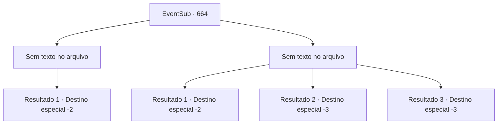

# Eventos secundários · 664

[Índice da tabela](index.md) · [Índice geral](../index.md)

ID: `pt:EventSub:664` · Fonte: `EventSub4` · Versão: 1.2.47.

Mapeamento estático dos arquivos; a disponibilidade e a execução dependem do estado da run.

## Texto do evento

*Sem texto no arquivo.*

## Dados de entrada

```json
{
  "id": 664,
  "grade": 1,
  "subEvent": "",
  "required": ""
}
```

## Mapa das escolhas



## Escolhas e resultados

### Escolha 1

*Sem texto no arquivo; o papel dessa opção depende da interface do jogo.*

Requisitos e outros campos da escolha:

```json
{
  "required": ""
}
```

#### Resultado 1.1

Suas espadas, lanças, flechas, até mesmo magia - os mercenários não podem te derrotar. Você lida com todos eles em um instante, se aproximando de Osborne. Assustado, Osborne te joga um livro, pula na carruagem e vai embora. 

 "Obrigado! Muito obrigado, {1}."

 Após verificar o conteúdo do livro, Edenheart responde, abraçando o livro com força. Parece que suas anotações de pesquisa estão de volta. 

 "Eu preciso ir. Vou ter que mover meu laboratório também, apenas por precaução. Isso, sem dúvida, atrasará a pesquisa, mas não tenho escolha, não é mesmo?"

 Ela te entrega uma poção pelo que você fez e retorna ao seu laboratório. Você pega a poção, se despede de Edenheart e retorna às suas aventuras.

Continuação registrada: [Destino especial `-2`](../destinos-especiais.md).

```json
{
  "required": "",
  "chance": "1",
  "nextEvent": -2,
  "type": 2,
  "reward": "3_36_1|3_37_1|12_10_-1|14_10_8|14_10_13"
}
```

### Escolha 2

*Sem texto no arquivo; o papel dessa opção depende da interface do jogo.*

Requisitos e outros campos da escolha:

```json
{
  "required": ""
}
```

#### Resultado 2.1

Esses mercenários são veteranos habilidosos, cada um deles. Talvez um contra um, você poderia lidar - mas dois? Três? Sua derrota parece inevitável. Infelizmente, você desiste de recuperar as notas de pesquisa e foge. Edenheart, também, foge soluçando.

Continuação registrada: [Destino especial `-2`](../destinos-especiais.md).

```json
{
  "required": "1_0_2|1_1_2",
  "chance": "1",
  "nextEvent": -2,
  "type": 2,
  "reward": "0_0_-1|0_1_-1|12_10_-1|14_10_2|14_10_9"
}
```

#### Resultado 2.2

Você vê vagamente o corpo de Edenheart, através de seus olhos vermelhos de sangue. Ela já é um saco de cadáver - ensanguentada e sem vida. Você tenta se levantar, mas simplesmente não consegue reunir forças. Logo, seu mundo escurece e você perde a consciência.

Continuação registrada: [Destino especial `-3`](../destinos-especiais.md).

```json
{
  "required": "2_0_2",
  "chance": "1",
  "nextEvent": -3,
  "type": 2,
  "reward": "0_0_-1|0_1_-1"
}
```

#### Resultado 2.3

Você vê vagamente o corpo de Edenheart, através de seus olhos vermelhos de sangue. Ela já é um saco de cadáver - ensanguentada e sem vida. Você tenta se levantar, mas simplesmente não consegue reunir forças. Logo, seu mundo escurece e você perde a consciência.

Continuação registrada: [Destino especial `-3`](../destinos-especiais.md).

```json
{
  "required": "2_1_2",
  "chance": "1",
  "nextEvent": -3,
  "type": 2,
  "reward": "0_0_-1|0_1_-1"
}
```

## Referências que chegam a este evento

- [Evento 663 · escolha 1 · resultado 2](0663.md#escolha-1)
- [Evento 663 · escolha 2 · resultado 1](0663.md#escolha-2)
